# Weather GPU Benchmark

Measure the cost of verifying weather forecasts with NumPy CPU, PyTorch CPU and CUDA: **Bias, MAE and RMSE**. Synthetic FP32 and precision benchmarks are complemented by real NetCDF and Zarr cases, including NOAA GFS and ECMWF IFS ENS control forecasts. This learning portfolio focuses on reproducible timing, numerical agreement and the difference between GPU compute speed and complete workflow speed.

**Current scope: performance engineering of weather-data processing and metric computation.** Evaluate CPU/GPU latency, throughput, memory, data movement, storage/chunk access, batching, reuse and numerical precision. Bias/MAE/RMSE provide representative calculations and correctness checks against a numerical reference. Forecast quality, model skill/ranking, ensemble-skill assessment and validation against independent observations are outside this task. Dataset changes must serve a stated performance or numerical-correctness experiment.

NetCDF real-data result: [GFS 2-m forecasts vs matching GFS f000 analysis near Taiwan](results/rtx3050_gfs_pair_run01/analysis.md), with checked initialization/lead/valid-time matching and no manufactured perturbations.

Zarr case: [ECMWF IFS ENS control from a pinned public Icechunk/Zarr snapshot](results/rtx3050_ecmwf_zarr_run01/analysis.md), evaluated directly from local Zarr stores against matching GFS analysis. ENS control is not HRES.

Latest scaling result: [6.68M genuine ECMWF ensemble values across four initializations](results/rtx3050_ecmwf_batch_comparison/analysis.md). Two RTX 3050 sessions show 5.46–6.20x resident compute speedup, 1.49–1.53x including input upload, and 1.07–1.09x for the warm local Zarr pipeline.

Latest workflow optimization: [stage profiling and shared-input regional verification](results/rtx3050_pipeline_comparison/analysis.md). Five distinct regional tasks improve from 166–171 ms to about 52 ms on GPU, including read/preparation/upload. CPU receives the same input reuse; shared GPU/CPU whole-workflow speedup is 1.85–1.89x.

Latency follow-up: [2,400 checked workflows under blocked/interleaved scheduling](results/rtx3050_stability_comparison/analysis.md) shows why a median alone is insufficient. GPU prepared-input reuse has P50 about 5.1–5.3 ms in same-method blocks versus 10.7–16.5 ms interleaved; the monitoring-off interleaved control still has a 51.5-ms P95. [JAX survey in Traditional Chinese](docs/jax_survey_zh.md) covers JIT, compatibility and a fair evaluation plan; JAX has not yet been installed or benchmarked.

Current PyTorch follow-up: [CPU/CUDA dispatch and result-return traces](results/rtx3050_dispatch_comparison/analysis.md) verify that five regional returns can become one without changing output bytes or numerical kernels. Prepared-input median latency falls about 12–20% in four measured comparisons; complete local workflow gains are inconsistent, including a regression. The alternative remains an explicit experiment. JAX implementation is deferred.

## Three key findings

1. **Fast GPU compute does not imply the same end-to-end speedup.** At 10M grid points in run02, CUDA compute takes 2.055 ms versus NumPy's 30.368 ms (14.78x). Including input transfer and scalar return takes 13.533 ms (2.24x). At 1M, this GPU E2E path is slower than NumPy in both baseline runs.
2. **Reusing inputs on GPU removes substantial transfer cost.** In the resident experiment at 10M, repeatedly uploading inputs takes 14.086 ms per iteration; keeping inputs on GPU and returning all three metrics takes 2.194 ms (6.42x faster). This excludes the initial upload and reuses the same arrays; it is not a whole weather-model speedup.
3. **Lower precision trades accuracy for speed and memory.** Two precision runs show native FP16 about 1.81x faster than FP32 at 10M, with peak allocated memory 80.002 vs 152.590 MiB. Its RMSE error against the FP64 source reference is 0.001254, versus roughly 7.1e-8 for FP32. Casting FP16 inputs back to FP32 improves arithmetic accuracy but cannot undo input quantization; this eager mixed implementation is slower and has no peak-memory advantage.

## Hardware and software

Observed on 2026-11-01 in the existing WSL environment. The [hardware inventory](results/hardware_inventory.json) was captured **after the FP32 baseline experiments**. It identifies the current machine, but does not establish driver version, clocks, thermals or background load during earlier runs. The later precision experiments also save their own pre/post GPU state snapshots.

| Item | Observed value |
|---|---|
| CPU | Intel Core i5-12400F; 12 logical CPUs visible to WSL |
| GPU | NVIDIA GeForce RTX 3050, 8192 MiB (8 GiB) VRAM |
| GPU compute capability | 8.6 |
| OS | Ubuntu 22.04.1 LTS on WSL2 |
| NVIDIA driver | 560.94 at inventory capture |
| Python / NumPy | 3.10.12 / 2.2.6 |
| PyTorch / CUDA runtime | 2.14.1+cu126 / 12.6, as reported by the environment |
| Protocol | FP32, seed 42, one PyTorch CPU thread, 5 warmups, 20 measured repeats |

Each run preserves its own `environment.json`. NumPy thread environment variables were unset; thread counts were not explicitly controlled for NumPy. Dependencies in `requirements.txt` are compatibility ranges, not an exact lock of the measured environment.

## Quick start

Use Python 3.10+ in a virtual environment. In the existing WSL setup, activate it with `source ~/venvs/weather-gpu/bin/activate`.

```bash
python -m pip install -r requirements.txt
# Install a compatible CUDA-enabled PyTorch using https://pytorch.org/get-started/locally/
python -m unittest discover -s tests -v

# Use a new output folder for each run; the runner does not protect against overwrites.
python benchmark.py --sizes 1000000 5000000 10000000 --repeats 20 --warmup 5 --output results/my_run01
python plot_results.py results/my_run01/summary.csv --output results/my_run01/overview.png
```

CPU-only smoke test without PyTorch:

```bash
python benchmark.py --numpy-only --sizes 1000 10000 --repeats 3 --warmup 1
```

GPU-resident experiment (requires CUDA):

```bash
python benchmark.py --resident --sizes 1000000 5000000 10000000 --repeats 20 --warmup 5 --output results/my_resident01
python plot_results.py results/my_resident01/summary.csv --output results/my_resident01/overview.png
```

Outputs: `summary.csv` contains medians, quartiles and speedups; `samples.csv` preserves every timed repetition; `environment.json` describes the recorded environment and boundaries. The resident option also saves the resident GPU metric values and one initial-upload observation per size. Record `nvidia-smi`, CPU information and load **before** future runs.

## Benchmark method

In the original synthetic benchmark, all backends receive identical, finite FP32 forecast and observation arrays. Error is forecast minus observation. Bias = mean(error), MAE = mean(abs(error)), RMSE = sqrt(mean(error squared)). The validated entry point rejects empty, mismatched or non-finite inputs. The later NetCDF pipeline defines joint masking and weighted reductions separately.

| Measurement | Timed boundary |
|---|---|
| NumPy / PyTorch CPU | Compute all three metrics with inputs already on CPU |
| CUDA compute | Compute metrics with inputs already on GPU; synchronized host wall time |
| H2D | Copy both pageable host tensors into existing GPU buffers |
| GPU E2E | Copy both inputs, compute metrics and return three Python scalars |
| GPU resident E2E (`--resident`) | Reuse GPU inputs, compute metrics and return three Python scalars |
| Initial upload (`--resident`) | Two copies into new GPU tensors, including allocation; one observation per size |

Five warmups precede 20 timed repetitions per method/size. CUDA synchronization brackets each wall-clock timing. Data generation, validation, disk I/O and GPU context initialization are excluded; intermediate computation allocations are included. These are not kernel-only CUDA-event timings. Initial upload has no repeat distribution and is excluded from resident steady-state speedups.

Report the median and p25/p75. IQR/median describes spread within a run, not a confidence interval. Methods run in fixed order. H2D and compute are separately sampled; adding their medians does not produce a measured E2E latency. PyTorch outputs are checked against NumPy at `rtol=atol=1e-5` before saving results.

The workload reuses the same arrays and applies unweighted global reductions. It does not yet include real weather data, time/coordinate alignment, regridding, area weights or missing-data handling. A CPU-origin input that changes each iteration still needs another transfer.

## Results: repeated baseline runs

The user supplied run01 and run02. Their recorded environments/protocols are identical; all **600 timing samples** reconcile with the saved medians, quartiles and speedups. These timing files do not save per-backend metric values, so they cannot independently establish numerical agreement.

| Grid points | CUDA compute ms, run01 / run02 | GPU E2E ms, run01 / run02 | Compute speedup, run01 / run02 | E2E speedup, run01 / run02 |
|---:|---:|---:|---:|---:|
| 1M | 0.296 / 0.315 | 1.697 / 1.468 | 4.26x / 4.37x | 0.74x / 0.94x |
| 5M | 1.074 / 1.075 | 7.583 / 7.024 | 12.09x / 11.53x | 1.71x / 1.76x |
| 10M | 2.038 / 2.055 | 13.823 / 13.533 | 12.83x / 14.78x | 1.89x / 2.24x |

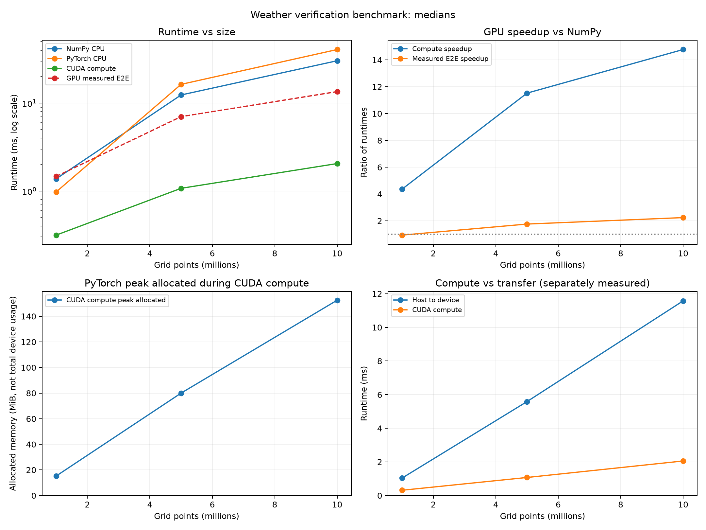

The memory panel uses `gpu_peak_allocated_mb`, calculated as bytes / 2^20, so the unit is **MiB** despite the CSV suffix. It is PyTorch peak allocated memory during CUDA compute, including resident inputs and intermediate tensors. It is not total process/device VRAM, allocator-reserved memory or a peak measurement of the entire E2E/resident workflow. Run02 reports 15.264, 80.004 and 152.592 MiB at 1M, 5M and 10M respectively.

See [run01 analysis](results/rtx3050_run01/analysis.md) and the [run01/run02 comparison](results/rtx3050_run02/comparison.md). At 1M/5M/10M, PyTorch CPU medians change by -56.40%/+45.10%/+10.35% across runs. Two sessions do not establish long-term stability; scheduling, clocks and load are possible factors, not diagnosed causes.

At 10M, the NumPy baseline slows down 16.12% between runs while CUDA compute slows down 0.81%. The compute speedup nevertheless rises from 12.83x to 14.78x. Compare absolute times alongside ratios.

## Results: GPU-resident inputs

Executed directly through the existing WSL / RTX 3050 setup. All **360 timing samples** reconcile. Saved resident GPU Bias/MAE/RMSE values agree with NumPy at the specified tolerance.

| Grid points | NumPy ms | Reupload E2E ms | Resident + scalar return ms | Speedup vs reupload | Speedup vs NumPy |
|---:|---:|---:|---:|---:|---:|
| 1M | 1.223 | 1.572 | 0.386 | 4.07x | 3.16x |
| 5M | 12.483 | 6.921 | 1.152 | 6.01x | 10.84x |
| 10M | 28.047 | 14.086 | 2.194 | 6.42x | 12.78x |

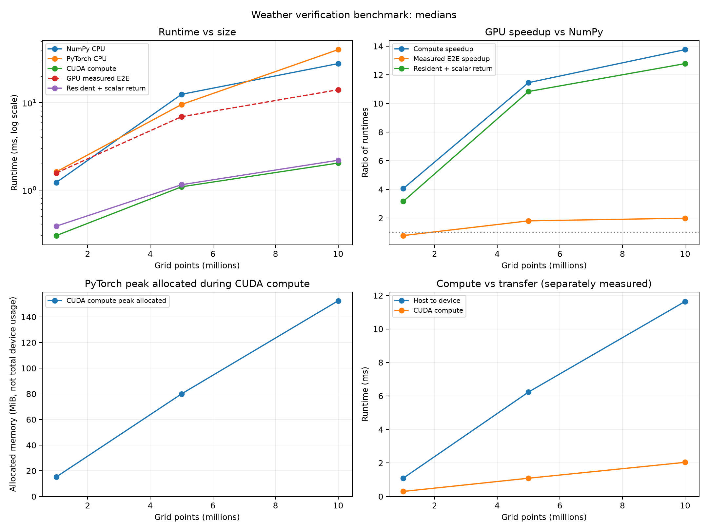

Initial uploads including input allocation take 3.778 / 7.659 / 15.521 ms at 1M / 5M / 10M. These are single observations, not medians. The table excludes them from steady-state speedups. Only one resident session has been measured; this does not establish a universal acceleration factor. See the [full resident report](results/rtx3050_resident_run01/analysis.md).

## v3: FP32 vs FP16 precision tradeoff

`precision_benchmark.py` compares three GPU-resident variants on exactly the same FP32 source arrays. Every timed call returns all three metrics as host scalars:

| Mode | Stored inputs | Arithmetic |
|---|---|---|
| `fp32` | FP32 | FP32 intermediates and outputs |
| `fp16_native` | FP16 | Native FP16 intermediate/output tensors; internal reduction accumulation is backend-defined |
| `fp16_fp32_math` | FP16 | Cast to FP32 before subtraction inside each call; FP32 intermediates and reductions |

Input conversion to FP16 and initial upload are excluded from timing. Only one mode's input tensors reside on GPU at a time. Each mode has 5 warmups and 20 measured repeats. Mode order is seeded per size and repeats across sessions; this is not an order-balanced experiment.

Two measured sessions preserve **360 timings with per-repeat Bias/MAE/RMSE values**. References are calculated in FP64 on (a) the original FP32 input values and (b) the quantized FP16 input values, separating input quantization from arithmetic error. Results at **10M** points:

| Mode | Median ms run01 / run02 | FP32 / mode runtime run01 / run02 | Input MiB | Peak allocated MiB |
|---|---:|---:|---:|---:|
| FP32 | 2.179 / 2.149 | 1.00x / 1.00x | 76.294 | 152.590 |
| FP16 native | 1.207 / 1.188 | 1.81x / 1.81x | 38.147 | 80.002 |
| FP16 inputs / FP32 math | 3.364 / 2.774 | 0.65x / 0.77x | 38.147 | 154.441 |

Maximum absolute metric errors across measured repeats against the original-source FP64 reference are identical in the two sessions at 10M:

| Mode | Bias error | MAE error | RMSE error |
|---|---:|---:|---:|
| FP32 | 2.29446e-8 | 6.55823e-8 | 7.10578e-8 |
| FP16 native | 8.99801e-5 | 4.34095e-4 | 1.25368e-3 |
| FP16 inputs / FP32 math | 1.05432e-5 | 2.15113e-5 | 2.48368e-3 |

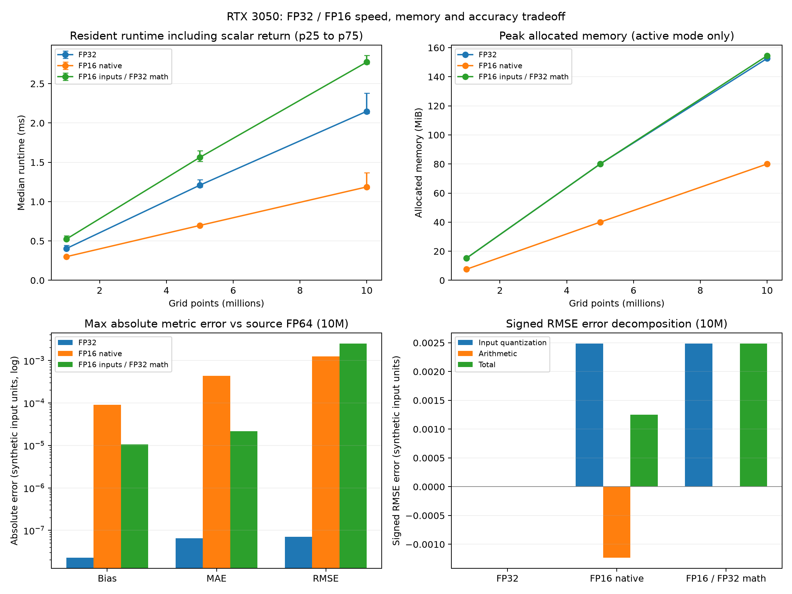

The mixed mode closely matches the FP64 reference **for quantized inputs**, but cannot recover the original input information. At 10M, quantization increases the reference RMSE by about 0.002484. Native FP16 arithmetic then changes RMSE by about -0.001230, partially cancelling that input error. Its smaller total RMSE error in this example does not make it a more reliable algorithm.

All benchmark outputs are finite, and all FP32/mixed results agree with their own input references at `rtol=atol=1e-5`. Native FP16 fails that diagnostic tolerance, and neither FP16 variant matches the original-source reference at that tolerance. This is a numerical diagnostic, **not an established weather-verification error budget**. Separate unit tests demonstrate native-half intermediate overflow and verify that casting before subtraction avoids those test failures. The mixed mode materializes FP32 tensors; it is not a fused low-precision implementation.

Keep FP32 as the baseline until real-data accuracy requirements justify a change. See the [first precision report](results/rtx3050_precision_run01/analysis.md) and [repeat precision report](results/rtx3050_precision_run02/analysis.md) for all sizes, quartiles, saved metric values and error decomposition. Two short sessions do not establish long-term stability or statistical significance.

```bash
python precision_benchmark.py --sizes 1000000 5000000 10000000 --repeats 20 --warmup 5 --output results/my_precision01
python scripts/analyze_precision.py results/my_precision01
```

The precision runner requires CUDA and refuses an existing output directory. Its CSV schema is separate from the original benchmark; use `analyze_precision.py` for validation and figures.

## v4: first real-NetCDF pipeline

The first case reads **real NCEP reanalysis air temperatures** from the [xarray tutorial dataset](https://docs.xarray.dev/en/stable/examples/area_weighted_temperature.html), selecting 2013-01-01 at 00/06/12/18 UTC over 30–50 N, 130–90 W. This is **sigma-level 0.995 air temperature**, not 2-m temperature or Taiwan station data. [Data and provenance](data/weather_demo/README.md) document the pinned source, checksum, selection and original metadata. Reanalysis data provided by NOAA PSL, Boulder, Colorado, USA; see the [source documentation](https://psl.noaa.gov/data/gridded/data.ncep.reanalysis.html).

The paired forecast is a deterministic **manufactured perturbation**. Ten deliberately missing time/grid values test joint masking. These are artificial errors and missing cells, not operational forecast skill or measured data availability.

The implemented flow is:

```text
NetCDF decode -> temperature units/coordinates -> exact valid-time/grid check
-> joint finite mask -> cosine-latitude weights -> CPU/CUDA metrics -> report/plots
```

`weather_verify.py` accepts canonical `time/lat/lon` dimensions or their supported aliases. It converts K/degC to FP32 kelvin, sorts coordinates, wraps longitude to [-180,180), rejects duplicate/mismatched coordinates, and normalizes weights over joint finite cells. Cosine-latitude weighting is restricted to regular latitude/longitude grids. All-missing or zero-weight inputs fail explicitly. Empty individual times produce blank metrics and zero coverage rather than a fabricated zero error.

**Caller responsibilities:** select the same physical variable and vertical level; supply UTC **valid time**, resolving initialization plus lead time beforehand. Matching coordinate arrays do not establish matching scientific meaning. No regridding, curvilinear grids or calendar conversion is implemented. The committed files use NetCDF3; reading NetCDF4/HDF5 needs an additional compatible xarray engine.

Two WSL / RTX 3050 sessions each preserve 15 per-backend/per-time metric rows and 80 timing samples. There are **602 joint finite values out of 612 (98.37%)**, with 98.41% of the total area-time weight retained. FP32 CPU/CUDA values agree with FP64 arithmetic on the same packed FP32 inputs and weights at `rtol=atol=1e-5`.

| Pooled metric | FP64 reference | NumPy FP32 | CUDA FP32 |
|---|---:|---:|---:|
| Bias K | 0.685742374 | 0.685742438 | 0.685742438 |
| MAE K | 0.770504044 | 0.770504117 | 0.770504057 |
| RMSE K | 0.934485432 | 0.934485435 | 0.934485435 |

These pool valid weighted cells over four sampled times. Pooled RMSE is calculated from pooled squared errors; it is not the mean of the four RMSEs and is not a continuous-day average.

| Measured boundary | NumPy median ms, run01 / run02 | CUDA median ms, run01 / run02 |
|---|---:|---:|
| Packed resident inputs -> metrics | 0.0071 / 0.0091 | 0.3022 / 0.2393 |
| Warm-cache NetCDF read -> checks/mask/weights -> packing -> upload if CUDA -> metrics | 8.8929 / 8.7880 | 9.9870 / 10.0710 |

**CUDA is slower for this small correctness case.** The workload has only 602 valid values; these measurements do not establish a GPU benefit. The actual warm-cache file pipeline also exposes the cost of reading/decoding and preprocessing. Context initialization, downloads and writing output files are excluded. Timings use 5 warmups and 20 repeats in fixed method blocks; this is not a cold-disk or order-balanced experiment.

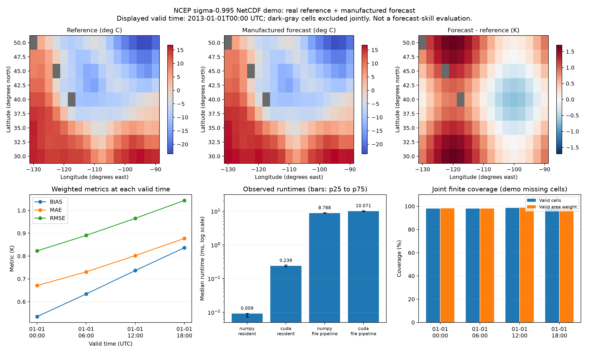

See the [first NetCDF report](results/rtx3050_weather_run01/analysis.md) and [repeat report](results/rtx3050_weather_run02/analysis.md). Eighteen tests pass in the WSL environment, including the earlier precision tests and checks for known weighted answers, coordinate/time mismatch, units, duplicate coordinates, radians, irregular grids, missing values and NetCDF fill-value decoding. GitHub CPU CI installs the weather dependencies and exercises the committed NetCDF case without downloading data; PyTorch tests still skip when PyTorch is not installed.

```bash
python -m pip install -r requirements-weather.txt
python weather_verify.py --forecast data/weather_demo/manufactured_forecast.nc --reference data/weather_demo/reference.nc --backend both --output results/my_weather01
python scripts/analyze_weather.py results/my_weather01
```

For a CPU-only run, use `--backend numpy`. Outputs are `metrics.csv`, `timing_summary.csv`, `timing_samples.csv` and `environment.json`; the analysis script validates input hashes, coverage, backend agreement and raw timing summaries before generating `analysis.md` and `weather.png`. With other input files, pass their paths again using `analyze_weather.py --forecast ... --reference ...`.

The following case replaces the manufactured forecast with a genuine matched forecast/analysis pair. A larger domain and an application error budget remain necessary before claiming operational GPU or FP16 benefits.

## v4: genuine GFS forecast / analysis pair

Real [NOAA GFS products](https://registry.opendata.aws/noaa-gfs-bdp-pds/) provide a matched historical case near Taiwan: **2-m temperature in K, native 0.25-degree grid, 18–28 N and 115–125 E**, including both land and ocean. No synthetic forecast errors, missing cells, interpolation or regridding are introduced. [Preparation and provenance](data/gfs_taiwan_pair/README.md) include every source message URL, index selection, byte range, checksum and decoder version.

| Forecast initialization UTC | Forecast lead h | Valid time UTC | Reference |
|---|---:|---|---|
| 2024-05-06 00:00 | 24 | 2024-05-07 00:00 | GFS 2024-05-07 00 UTC f000 |
| 2024-05-06 00:00 | 30 | 2024-05-07 06:00 | GFS 2024-05-07 06 UTC f000 |
| 2024-05-06 00:00 | 36 | 2024-05-07 12:00 | GFS 2024-05-07 12 UTC f000 |
| 2024-05-06 00:00 | 42 | 2024-05-07 18:00 | GFS 2024-05-07 18 UTC f000 |

The reference is the **same-system zero-hour analysis/initialization field**, labeled `anl` in the NOAA index. It is not independent station observations. All 6,724 selected values (four 41 x 41 grids) are finite. Cosine-latitude weighted pooled errors against analysis:

| Metric | FP64 arithmetic reference | NumPy FP32 | CUDA FP32 |
|---|---:|---:|---:|
| Bias K | -0.199035721 | -0.199035704 | -0.199035719 |
| MAE K | 0.498139354 | 0.498139322 | 0.498139381 |
| RMSE K | 0.880694300 | 0.880694270 | 0.880694270 |

In this case the forecast is about 0.20 K colder than the analysis on the pooled domain/time average. These are **forecast-minus-analysis errors for one initialization/day**, not a general GFS skill estimate or Taiwan-land-only verification. Valid time and lead change together, so the four points do not isolate a general lead-time trend. No land mask is applied.

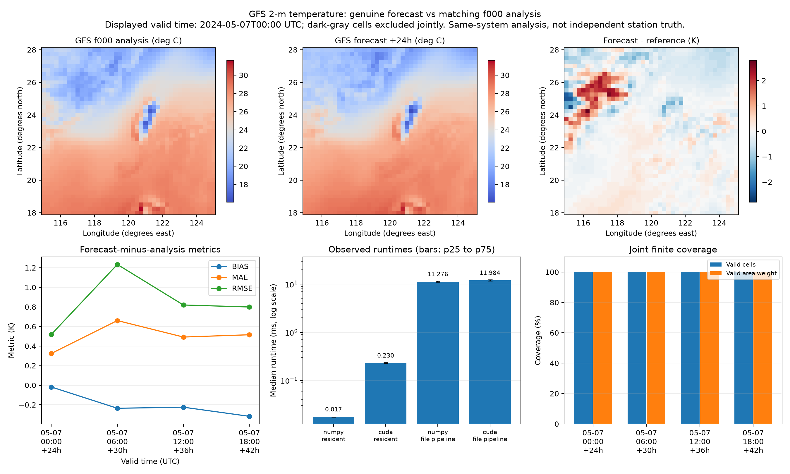

CPU/CUDA values agree with FP64 reference arithmetic at `rtol=atol=1e-5`. All 80 raw timing/metric samples and 15 metric rows reconcile, and 25 tests pass in WSL. NumPy/CUDA resident medians are 0.0175/0.2297 ms; warm-file pipeline medians are 11.2759/11.9840 ms. This regional correctness case is still small and shows no GPU acceleration. See the [full paired-data report](results/rtx3050_gfs_pair_run01/analysis.md) for valid-time scores and timing boundaries.

Evaluate the committed files offline with the weather dependencies; GRIB decoding is not needed:

```bash
python -m pip install -r requirements-weather.txt
python weather_verify.py --forecast data/gfs_taiwan_pair/forecast.nc --reference data/gfs_taiwan_pair/reference.nc --backend both --output results/my_gfs_pair01
python scripts/analyze_weather.py results/my_gfs_pair01 --forecast data/gfs_taiwan_pair/forecast.nc --reference data/gfs_taiwan_pair/reference.nc
```

Use `--backend numpy` without CUDA. To recreate the pair from the original NOAA archive, install `requirements-gfs.txt` and run `python scripts/prepare_gfs_pair.py --output data/gfs_pair_recreated`. Only eight indexed TMP/2-m messages are downloaded (about 4.06 MB plus indexes), with HTTP range/framing/hash checks. Acquisition/decoding are excluded from the NetCDF pipeline timings.

Further work uses controlled shapes, batch sizes, missing-value fractions and storage layouts to measure CPU/GPU crossover, memory and complete-workflow latency while preserving input identity and numerical checks. Forecast-quality assessment is outside scope.

## ECMWF Zarr acquisition and native Zarr evaluation

The [public ECMWF IFS ENS archive processed by dynamical.org](https://dynamical.org/catalog/ecmwf-ifs-ens-forecast-15-day-0-25-degree/) retains initialization, lead and member axes. We read **member 0 (ENS control)** from a pinned, read-only Icechunk snapshot, selecting the 2024-05-06 00 UTC run at leads 24/30/36/42 h over a chunk-aligned 32 x 32 region near Taiwan (18.25–26 N, 116–123.75 E). The archive supplies 2-m temperature in Celsius; it is normalized against Kelvin GFS f000 analysis at the exact same valid times and cells.

Both prepared inputs remain **Zarr v2 stores**, and `weather_verify.py` now directly reads local Zarr directories as well as NetCDF files. No NetCDF intermediate is needed for the ECMWF forecast evaluation. [Data, attribution, snapshot and reproduction instructions](data/ecmwf_zarr_pair/README.md) identify the third-party processing and reference source.

| Pooled metric | FP64 arithmetic reference | NumPy FP32 | CUDA FP32 |
|---|---:|---:|---:|
| Bias K | 0.218128577 | 0.218128562 | 0.218128577 |
| MAE K | 0.623759979 | 0.623759925 | 0.623759985 |
| RMSE K | 0.859978730 | 0.859978676 | 0.859978676 |

All 4,096 values are finite. All 80 timing/metric samples and 15 metric rows reconcile; 31 tests pass in WSL, including NetCDF/Zarr numerical parity, units/missing values, source-axis selection, directory hashes and explicit zero-coordinate chunk compatibility. NumPy/CUDA resident medians are 0.0125/0.2317 ms. Warm local Zarr pipeline medians are 13.8442/14.9328 ms. The input remains too small to show GPU acceleration.

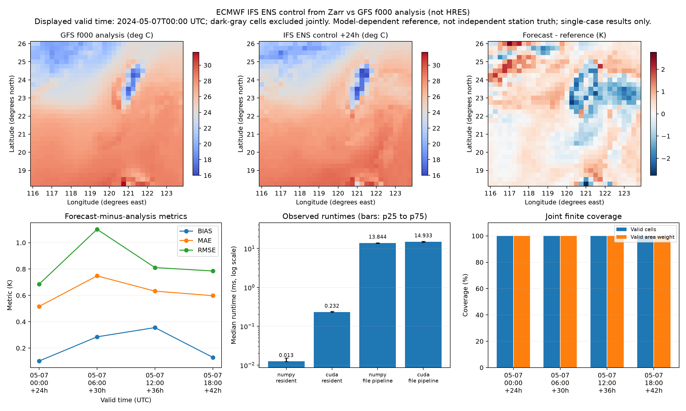

**Do not rank models from these numbers.** This is ENS control, not IFS HRES or AIFS; the reference is GFS analysis, not independent station observations. The source provider applies unit conversion and bit rounding. This chunk-aligned box differs from the earlier 41 x 41 GFS case, so comparing its 0.860 K RMSE directly with the earlier 0.881 K would also mix regions. The domain contains land and ocean, and only one historical run/day is represented.

Remote metadata opening took 4.207 s and selected-data materialization 3.472 s in the first observed read. These are separate from the repeated local pipeline measurements. The source chunk includes 85 leads and 51 members: one selected spatial chunk has 17,756,160 nominal uncompressed bytes, although the selected member/four leads contain only 16,384 logical temperature bytes. Neither number measures actual HTTP traffic. **Zarr permits selective access, but chunk layout determines the physical work.** These experiments do not establish a general Zarr-versus-NetCDF performance advantage.

```bash
# Existing WSL Python 3.10 CUDA environment: offline local Zarr evaluation
python -m pip install -r requirements-zarr.txt
python weather_verify.py --forecast data/ecmwf_zarr_pair/forecast.zarr --reference data/ecmwf_zarr_pair/reference.zarr --backend both --output results/my_ecmwf_zarr01
python scripts/analyze_weather.py results/my_ecmwf_zarr01 --forecast data/ecmwf_zarr_pair/forecast.zarr --reference data/ecmwf_zarr_pair/reference.zarr

# Python >=3.12: remote Icechunk v2 acquisition (Windows project Python 3.13 was tested)
python -m pip install -r requirements-icechunk.txt
python scripts/prepare_ecmwf_zarr.py --snapshot-id G76A041BF9PWGCNRBFVG --output data/ecmwf_zarr_recreated
```

Use `--backend numpy` without CUDA. Local stores use explicit zero chunks and Git byte preservation for portable directory hashes. See the [Zarr report](results/rtx3050_ecmwf_zarr_run01/analysis.md) for timing boundaries and source-chunk/read observations.

## Larger real-data batches: where GPU acceleration appears

The new [Zarr batch subset](data/ecmwf_batch_case/README.md) contains **4 initializations x 8 leads x 51 members x 64 x 64 cells = 6,684,672 genuine forecast values**. Exact GFS analysis matching uses 20 unique valid-time cycles. The 6.8 MB compressed subset is included for offline reproduction. Each initialization/lead/member retains its own spatial Bias/MAE/RMSE; this does not evaluate an ensemble-mean forecast.

| Largest-batch median | Session 1 | Session 2 |
|---|---:|---:|
| NumPy resident | 26.075 ms | 25.797 ms |
| CUDA resident | 4.777 ms | 4.158 ms |
| CUDA upload + compute | 17.074 ms | 17.278 ms |
| NumPy warm local Zarr pipeline | 93.340 ms | 90.202 ms |
| CUDA warm local Zarr pipeline | 85.987 ms | 84.606 ms |
| CUDA per-group launch/return loop | 341.199 ms | 362.621 ms |

Batching keeps reductions on device and returns the group metric matrix in one transfer. The per-group CUDA loop reuses the same device inputs but launches/reduces/returns one forecast group at a time; it measures dispatch/return overhead. **Compare CUDA with vectorized NumPy for CPU/GPU speedup**, and use the loop only to diagnose inefficient GPU scheduling. Pipeline gains remain modest because reading, decoding, normalization and packing occupy much of the workflow.

Seven measured case shapes range from 4,096 to 6,684,672 values; case shape and value count change together, so this does not establish a universal crossover threshold. Both sessions validate all 9,312 saved metric rows and 720 timing samples against the same packed-data FP64 reference. All 35 WSL tests pass, including CUDA tests. Method order is shuffled within repetitions; case order is fixed. The two sessions do not establish long-term performance stability.

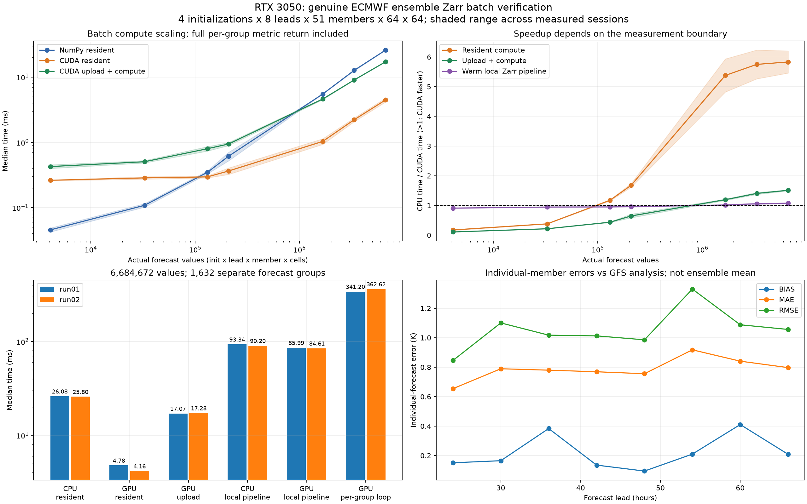

```bash
python -m pip install -r requirements-zarr.txt
python weather_batch.py --output results/my_batch01 --group-loop
python weather_batch.py --output results/my_batch02 --group-loop --seed 20261102
python scripts/analyze_weather_batch.py results/my_batch01 results/my_batch02 --output results/my_batch_comparison
```

Use `--backend numpy` without CUDA. Remote acquisition uses the separate Python >=3.12 environment: `python scripts/prepare_ecmwf_batch.py --output data/ecmwf_batch_recreated`. Both archives are provider-processed Zarr; GFS analysis remains a model-dependent reference. Members/overlapping dates are correlated, and these short cases cannot rank models. Remote acquisition is excluded from local timing.

## Full-workflow optimization: profile stages and share inputs

`weather_pipeline.py` evaluates the full domain and its four quadrants, preserving a separate score for every initialization/lead/member. It compares repeated region-specific Zarr reads, one full read with the existing dense representation, one read with shared reference/weights, and explicitly labeled already-prepared reuse. The old region-specific method selects the region before reading; the comparison does not deliberately read unrelated chunks.

| Five-task whole-workflow median | Session 1 | Session 2 |
|---|---:|---:|
| CPU, reopen/prepare each region | 171.855 ms | 174.037 ms |
| CPU, read once and share inputs | 96.249 ms | 98.633 ms |
| GPU, reopen/prepare each region | 166.244 ms | 170.941 ms |
| GPU, read once and share inputs | 52.139 ms | 52.091 ms |
| CPU, shared inputs already prepared | 55.420 ms | 57.036 ms |
| GPU, shared inputs already prepared | 8.641 ms | 7.385 ms |

The first four rows include all local reading, preparation and GPU upload as applicable; reuse-only excludes setup equally for CPU/GPU. GPU whole-workflow improvement is 3.19–3.28x versus its original repeated-read workflow, while CPU improves 1.76–1.79x. Comparing both optimized workflows gives **1.85–1.89x GPU/CPU speedup**, rather than comparing optimized GPU with unoptimized CPU.

One GFS analysis per initialization/lead and one latitude-weight vector replace member-expanded copies. All-finite input needs no stored per-member mask; missing values retain the tested joint-mask fallback. Logical prepared input payload drops **76.50 -> 26.00 MiB (66.0%)** on either backend. This is not total/peak VRAM. The original FP32 Kelvin normalization, individual-member identities and metrics remain numerically consistent with the unchanged dense FP64 arithmetic reference.

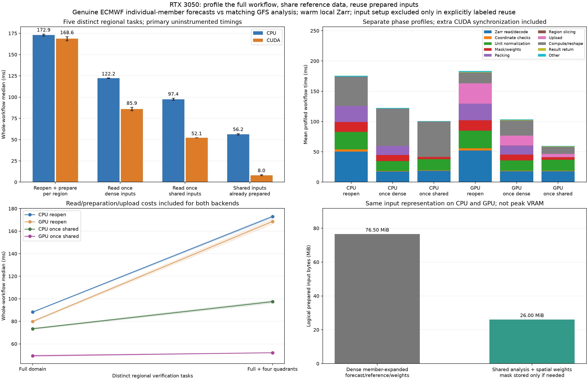

The phase profiles independently measure Zarr reading/decoding, checks, units, mask/weights, packing, region selection, upload, compute/reshape and result return. They use extra CUDA synchronization and are kept separate from primary end-to-end samples. Mean phase durations reconcile with their own profiled total; independently sampled medians are not added together. All 39 tests pass in WSL; each session validates 320 uninstrumented workflow samples, 80 stage-profile workflows and 9,792 FP64 reference region/group rows.

```bash
source ~/venvs/weather-gpu/bin/activate
python weather_pipeline.py --output results/my_pipeline01
python weather_pipeline.py --output results/my_pipeline02 --seed 20261104
python scripts/analyze_pipeline.py results/my_pipeline01 results/my_pipeline02 --output results/my_pipeline_comparison
```

The input cache is local to this evaluation and stores prepared data, not result values. Full-domain/quadrant outputs are recomputed for every task. "First use" here means fresh input preparation in an initialized process with warm local storage; CUDA initialization, remote acquisition, source hashing, correctness checks and CSV writing are excluded. This regional reuse workload differs from the earlier single full-domain benchmark. GFS analysis remains a model-dependent reference, and the two sessions do not establish general forecast skill or performance across machines.

## Latency stability and JAX evaluation plan

`weather_stability.py` preserves the shared-input numerical kernels and measures 100 repetitions of each CPU/GPU first-use/reuse method in both scheduling modes. Blocked execution warms and measures one method consecutively. Interleaved execution shuffles all methods per repetition. A second monitored session reverses schedule order; a third session disables monitoring. All 2,400 measured five-region outputs agree with unchanged dense-path FP64 reference metrics. All 41 tests pass in WSL, including CUDA tests.

| GPU prepared-input reuse | P50 ms | P95 ms |
|---|---:|---:|
| Monitored, blocked (two sessions) | 5.13–5.27 | 5.87–6.44 |
| Monitored, interleaved (two sessions) | 14.43–16.47 | 27.00–28.89 |
| Monitoring off, blocked | 5.12 | 5.64 |
| Monitoring off, interleaved | 10.71 | 51.48 |

These reuse rows exclude prepared-input setup equally for CPU/GPU. The complete local GPU workflow is measured separately: blocked P50 46.4–58.0 ms versus interleaved 60.4–64.6 ms across these sessions. Schedule and device activity affect observed latency, but this does not identify a single cause. Coarse 200-ms device-wide telemetry can miss short active bursts; matched low clock observations cannot establish the clock of each kernel. Monitoring-off results are a control, not an isolated estimate of observer cost.

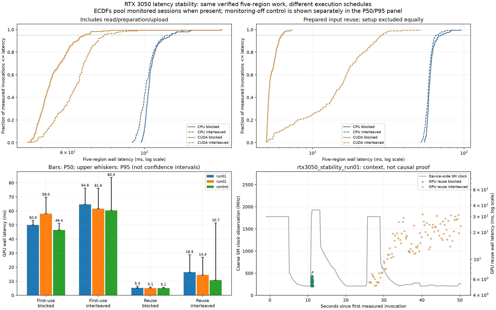

```bash
python weather_stability.py --output results/my_stability01 --telemetry
python weather_stability.py --output results/my_stability02 --telemetry --schedules interleaved blocked --seed 20261106
python weather_stability.py --output results/my_stability_control --seed 20261107
python scripts/analyze_stability.py results/my_stability01 results/my_stability02 results/my_stability_control --output results/my_stability_comparison
```

The [JAX survey](docs/jax_survey_zh.md) records compatibility and evaluation considerations. JAX implementation is deferred; current work continues in the existing Python 3.10/PyTorch/CUDA environment.

## Trace diagnosis: reduce result-return boundaries

`weather_dispatch.py` compares the unchanged per-region-return baseline with keeping all five regional metric tensors on device, stacking them and returning once. Both return **97,920 bytes of FP32 results** with identical region/initialization/lead/member identity. Two sessions contain 2,000 unprofiled primary calls and 160 independent profiled calls. All returned values agree with the unchanged dense-path FP64 reference; all 43 WSL CUDA tests pass.

| Prepared-input reuse median | Original: 5 returns | Alternative: 1 return |
|---|---:|---:|
| Session 1, blocked | 5.082 ms | 4.450 ms |
| Session 1, interleaved | 9.680 ms | 8.295 ms |
| Session 2, blocked | 6.959 ms | 6.130 ms |
| Session 2, interleaved | 7.534 ms | 6.040 ms |

Traces verify **5 -> 1 DtoH copy events**. Physical copy activity is around 0.01 ms, while CPU return ranges last several milliseconds because they include waiting for prior GPU work and host/driver return handling. This explains why result-return scheduling matters even for a small payload. CPU ranges overlap GPU execution; their durations must not be added as separate CPU/GPU components. Profiler measurements have instrumentation overhead and remain separate from primary latency samples.

Full local workflows include fresh read/preparation/upload, and their benefits are inconsistent: session 1 blocked median changes 47.006 -> 51.649 ms, while the other measured combinations improve. A lower reuse P50/P95 also does not guarantee a lower maximum: session 2 interleaved maximum changes 18.445 -> 23.136 ms. The original default paths are retained; the alternative is explicitly measured rather than universally substituted. These schedule conditions differ from the earlier stability runner, so comparisons should use methods within this experiment.

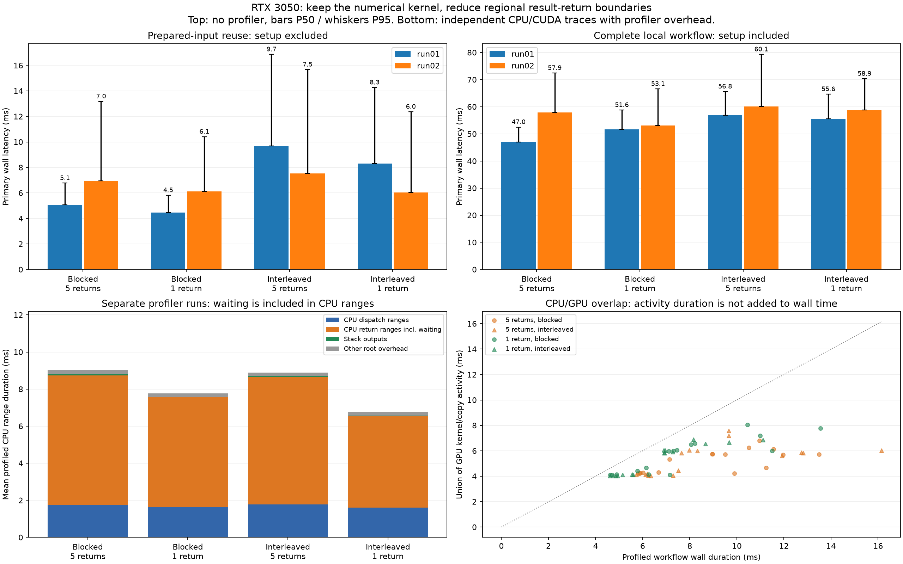

```bash
python weather_dispatch.py --output results/my_dispatch01
python weather_dispatch.py --output results/my_dispatch02 --schedules interleaved blocked --seed 20261109
python scripts/analyze_dispatch.py results/my_dispatch01 results/my_dispatch02 --output results/my_dispatch_comparison
```

Each run includes a compressed Chrome trace, per-call summaries and raw primary timings. The analyzer can independently reconcile saved GPU traces using CPU-only dependencies; CI performs that validation without claiming to execute GPU work. This diagnosis narrows one actionable source of overhead but does not identify a single cause of all latency tails. Subsequent work remains focused on processing efficiency, memory and numerical correctness under explicitly defined workloads.

## Phase 5A: PhysicsNeMo FNO forward performance

The official small 2D FNO runs in a separate WSL Python 3.12.16 environment, with PhysicsNeMo 2.2.2 and PyTorch 2.14.1+cu126. Its 132,353 parameters have fixed random, **untrained** weights; inputs are distinct real ECMWF Zarr frames with fixed `(Celsius - 20)/20` scaling. This is an architecture performance workload. It does not run a pretrained weather model or assess forecast quality.

Two sessions, each with 5 warmups and 30 samples per case/method, use identical weights and different method-order seeds:

| Input | CPU P50 ms | GPU resident + full return P50 ms | CPU/GPU ratio |
|---|---:|---:|---:|
| B1, 32x32 | 1.01–1.11 | 1.47–1.53 | 0.68–0.73x |
| B4, 64x64 | 5.03–5.22 | 1.67–1.73 | 3.01–3.02x |
| B64, 64x64 | 76.61–79.48 | 10.08–10.13 | 7.56–7.88x |

Uploading input each invocation and returning full output takes 10.31–10.58 ms for B64 (7.43–7.52x). The maximum observed warm-invocation PyTorch allocated peak is about 150.5 MiB, not total process VRAM. CPU uses 6 threads; TF32 is disabled. Reads/transforms, model setup, reference computation, checks and writes are excluded from these steady-state timings. First observed forwards and setup costs are recorded separately; these are not cold-process startup measurements.

All 1,200 timed outputs pass elementwise CPU FP64 checks using the same FP32 weights/input cast to double, at rtol=1e-4, atol=1e-5. Complete saved backend arrays and weights allow offline validation; both sessions' references were independently recomputed in the isolated environment. [Full methods, P95, memory boundaries and reproduction](results/rtx3050_physicsnemo_comparison/analysis.md); [Chinese guide and next step](docs/phase5_plan_zh.md).

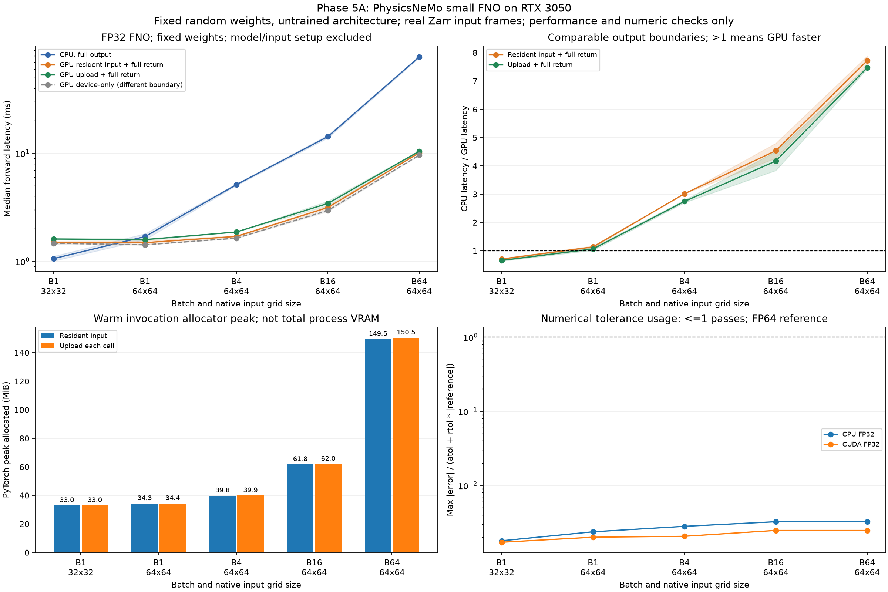

For a fresh WSL/Linux CUDA12 checkout, run `bash scripts/setup_physicsnemo.sh`; then activate `.venv/physicsnemo/bin/activate`. The installer uses the [complete lock](requirements-physicsnemo.lock.txt), including CUDA-compatible torchvision and Warp binaries. It preserves an existing isolated environment and leaves the original weather-gpu environment separate. Use `python physicsnemo_benchmark.py --output results/my_physicsnemo01` with a new output path. CI validates saved GPU artifacts using CPU dependencies; the live FNO smoke test runs when the optional framework is installed.

## Phase 5B: complete local Zarr-to-FNO-to-file workflow

The same fixed untrained model now runs through Zarr open/read/decode/check, FP32 input packing, CUDA upload, forward, full host return and **uncompressed NPZ write/close**. CPU/CUDA models remain resident; every call rereads local input and writes the same output schema/byte count. Every file is read back and checked against the full FP64 reference outside timing. Setup, validation, hashing and temporary-file cleanup are separate; file close does not guarantee durable-media persistence (`fsync` is not requested).

| Input | CPU full-workflow P50 ms | CUDA full-workflow P50 ms | CPU/CUDA ratio |
|---|---:|---:|---:|
| B1, 32x32 | 21.10–23.93 | 22.62–24.59 | 0.93–0.97x |
| B4, 64x64 | 26.60–30.21 | 24.65–28.12 | 1.07–1.08x |
| B16, 64x64 | 36.50–41.48 | 52.45–58.81 | 0.62–0.79x |
| B64, 64x64 | 104.54–106.39 | 40.55–42.12 | 2.53–2.58x |

These are two 30-repeat sessions, with separate 8-repeat synchronized profiles. B64 retains about 2.5x complete-workflow acceleration, while the earlier forward/upload/return result was about 7.4x. Small inputs have little end-to-end benefit. **B16 is slower on CUDA in both main sessions**; a separate B16-only process measured CPU 40.559 ms versus CUDA 27.259 ms (1.49x). All three datasets are retained. Shape/history, scheduling and power/system state are not isolated by that contrast, so it does not establish a cause.

Profiles are separate executions and can differ substantially from primary timings; their means/shares are not an exact decomposition of primary P50. Source/reference setup and validation can warm OS caches, with no cache clearing or cold-disk claim. The reader preserves the earlier bounding-selection behavior: B64 materializes 102 frames before taking 64. This makes read coverage and later reader optimization explicit. No remote download, training, forecast-quality evaluation or Earth2Studio execution is included.

[Full result tables and protocol](results/rtx3050_physics_pipeline_comparison/analysis.md), [B16-only control](results/rtx3050_physics_pipeline_b16_report/analysis.md), [Traditional Chinese explanation/reproduction](docs/physicsnemo_pipeline_zh.md).

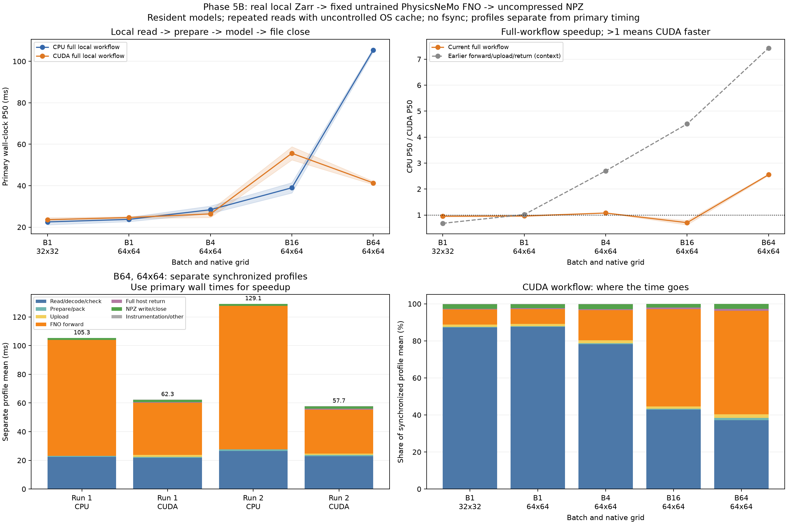

In the existing isolated environment, run `python physicsnemo_pipeline.py --output results/my_physics_pipeline01`, then `python scripts/analyze_physicsnemo_pipeline.py results/my_physics_pipeline01 --output results/my_physics_pipeline_report`. Use new output paths. CI revalidates retained files, source identities/hashes, numerical errors, trial hashes, quantiles, execution order and stage sums on CPU.

## Phase 5B: paired input reuse and GPU cadence controls

Two further sessions interleave B16/B64 and all seven CPU/CUDA workflows within each repetition. For B64, CUDA request P50 falls from **44.06–47.02 ms** with repeated reopening to **28.89–29.78 ms** with an already-open dataset, **23.14–25.01 ms** with prepared CPU input, and **23.04–23.09 ms** with resident GPU input. Each path still returns full output and writes/closes the same uncompressed NPZ. CPU also benefits from reader/input reuse; these are workflow improvements, not extra GPU arithmetic speed.

Open-once still selects, loads, checks and packs each request. Input caches apply to the **identical input reused across requests**, with setup costs recorded separately; changing source frames/transforms requires rebuilding them. One-off setup observations include differing initialization/cache states and are not fair cold-start comparisons. The amortization plot explicitly uses measured setup/N plus warm request means, not separately measured N-request applications.

Separate blocked cadence controls compare continuous GPU calls, a 25 ms idle gap, source reading/packing and CPU FNO work before each GPU call. B16 forward/full-return medians span roughly 3.4–4.8 ms and do not consistently reproduce the earlier 26–33 ms profile interval. No single driver/power/shape-history cause is established. CUDA event intervals include possible dispatch/scheduling gaps; they are not kernel-active time or occupancy. Both cases, all controls, all slower results and raw ordering remain archived.

[Paired results, setup and cadence tables](results/rtx3050_physics_reuse_comparison/analysis.md), [Chinese explanation and reproducible commands](docs/physicsnemo_reuse_zh.md). Both sessions total 840 real workflow files and 768 cadence outputs verified against the same CPU FP64 reference. CI checks archived evidence using CPU dependencies.

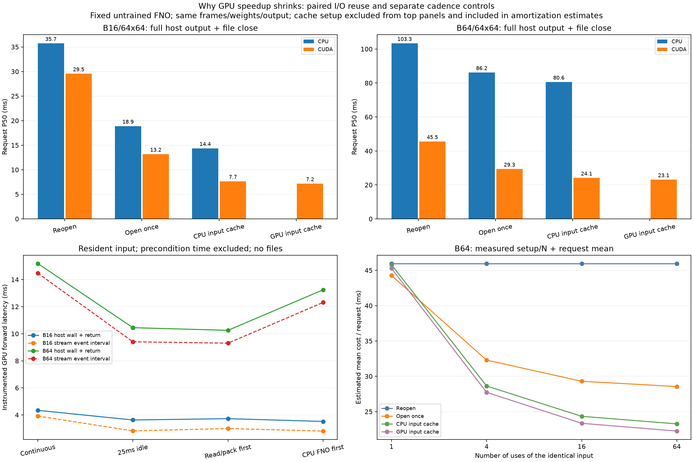

## Phase 5B: isolate batch-shape schedules with real CUDA traces

Two sessions compare grouping B16/B64 calls against alternating them, keeping the same 64x64 grids, resident inputs/weights, equal call counts and full host outputs. Primary timings have **no profiler, annotations or CUDA events**. Both first batch and first schedule are counterbalanced across paired rounds, with identical alternating warmup before every block. Output checks run after each block.

B16 P50 is 2.91–2.93 ms grouped versus 3.04–3.17 ms alternating; B64 is 9.75–9.99 versus 9.84–9.93 ms. Paired equal-work block ratios (alternating/grouped) are **1.015x and 0.993x**, with grouped faster in 8/12 and 5/12 pairs. There is no consistent total-work gain across these sessions, and this controlled contrast does not reproduce the earlier multi-fold pipeline outliers. Grouping is not adopted as a default optimization.

Separate CPU/CUDA traces capture 99 kernel events and one full DtoH copy per call (256 KiB B16, 1 MiB B64), with no HtoD observed in these resident-input calls. For B64, mean CPU return ranges are about 7.4–7.7 ms while GPU copy activity is about 0.6 ms; return ranges include preceding-work completion. CPU dispatch/return durations overlap device activity and cannot be added. Trace timings include instrumentation and are not primary performance results; active interval union is not GPU occupancy.

Both sessions retain 768 primary calls, 48 equal-work blocks and 96 trace calls, actual outputs/weights and compressed Chrome traces. [Full tables and trace accounting](results/rtx3050_physics_schedule_comparison/analysis.md), [Chinese interpretation/reproduction](docs/physicsnemo_schedule_zh.md). The CPU analyzer independently reconstructs trace intervals and validates copy bytes, order/transitions, hashes, FP64 errors, quantiles and block sums.

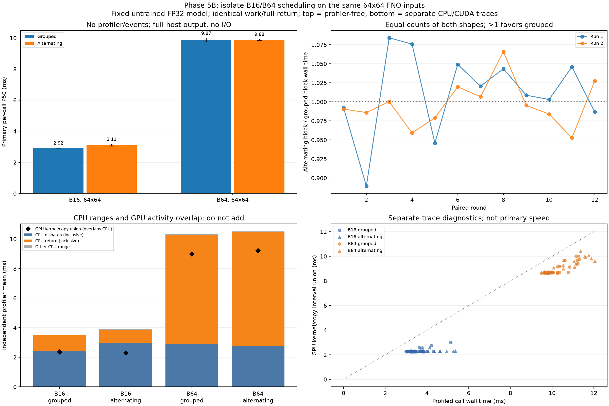

## Reproduce the reports and figures

```bash
python scripts/analyze_run.py results/rtx3050_run01
python scripts/compare_runs.py results/rtx3050_run01 results/rtx3050_run02
python plot_results.py results/rtx3050_run02/summary.csv --output results/rtx3050_run02/overview.png
python plot_results.py results/rtx3050_resident_run01/summary.csv --output results/rtx3050_resident_run01/overview.png
python scripts/analyze_precision.py results/rtx3050_precision_run01
python scripts/analyze_precision.py results/rtx3050_precision_run02
python scripts/analyze_weather.py results/rtx3050_weather_run01
python scripts/analyze_weather.py results/rtx3050_weather_run02
python scripts/analyze_weather.py results/rtx3050_gfs_pair_run01 --forecast data/gfs_taiwan_pair/forecast.nc --reference data/gfs_taiwan_pair/reference.nc
python scripts/analyze_weather.py results/rtx3050_ecmwf_zarr_run01 --forecast data/ecmwf_zarr_pair/forecast.zarr --reference data/ecmwf_zarr_pair/reference.zarr
```

`analyze_run.py` is the original run01 report generator with run01-specific narrative. `compare_runs.py` compares the original five-method runs. `plot_results.py` supports CPU-only, original GPU, resident and historical CSVs.

## Historical results

The five original rows from the shared conversation remain unchanged in [legacy_rtx3050.csv](results/legacy_rtx3050.csv), with their [historical chart](results/legacy_benchmark.png). They lack raw repeat timings and full metadata. The reported maximum compute speedup is 13.73x at 20M. At 50M, H2D + compute implies an **estimated** 1.68x speedup, not directly measured E2E latency. The legacy memory field's measurement boundary is unknown. Do not merge these rows with the current protocol or treat them as independently reproduced results.

## Roadmap

Mapping to the original five-step plan: (1) figures, (2) hardware/README, (3) FP32/FP16 and (4) real-data performance pipelines now have reproducible baselines. **Step 5A and initial 5B forward/full-workflow benchmarks are implemented:** an isolated PhysicsNeMo environment runs a small FNO on real ECMWF Zarr input frames. See the [forward results](results/rtx3050_physicsnemo_comparison/analysis.md), [complete local workflow](results/rtx3050_physics_pipeline_comparison/analysis.md) and [Traditional Chinese plan](docs/phase5_plan_zh.md). This uses fixed random, untrained weights for performance and numerical checks. Earth2Studio model pipelines (5C) remain future work; forecast quality remains outside scope.

1. **FP32 baseline: completed.** Repeated timings, raw samples, four-panel figures, hardware inventory and the resident-input experiment. Further repeat sessions and profiling remain useful for assessing stability.
2. **v3: first precision comparison completed.** Two sessions compare FP32, native FP16 and FP16 storage with FP32 arithmetic, including input/error decomposition, allocated memory and overflow tests. Further precision experiments must specify numerical-error tolerances for the benchmark outputs and measure the resulting time/memory tradeoff.
3. **v4: controlled, genuine GFS and ECMWF Zarr cases completed.** Preserve run/member/lead identity, exact-grid alignment and CPU/CUDA numerical agreement across NetCDF and local Zarr. Batch scaling, shared inputs, phase profiling and result-return traces are recorded. Remote acquisition and chunk costs are separate from compute. Additional data cases are for performance/correctness coverage, not forecast-skill evaluation.
4. **Current performance work.** Investigate remaining host preprocessing, allocation, synchronization and latency tails in the existing PyTorch workflow. Compare complete-workflow P50/P95, throughput and peak memory under equivalent input reuse and numerical tolerances. Framework migration and Weather AI integrations require a separately defined performance task; JAX implementation remains deferred.

Learning goal: explain how data movement, numerical precision and measurement boundaries affect a useful weather-verification pipeline.
