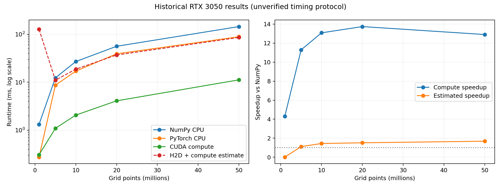

# Weather GPU Benchmark

Benchmark NumPy CPU, PyTorch CPU and CUDA for weather forecast verification: Bias, MAE and RMSE. A learning portfolio toward Weather AI / Scientific Computing, built around reproducible performance measurements.

## Quick start

Use Python 3.10+ in a virtual environment.

```bash
python -m pip install -r requirements.txt
# Install PyTorch using https://pytorch.org/get-started/locally/
python benchmark.py --sizes 1000000 5000000 10000000 --repeats 20 --warmup 5
python plot_results.py results/latest/summary.csv
python -m unittest discover -s tests -v
```

CPU-only smoke test without PyTorch:

```bash
python benchmark.py --numpy-only --sizes 1000 10000 --repeats 3 --warmup 1
```

The output folder contains `summary.csv` (median and quartiles), `samples.csv` (individual timings), and `environment.json` (hardware/software context). Default PyTorch CPU threads: 1; change with `--threads`. NumPy thread-related environment variables are recorded, not controlled. Inspect `nvidia-smi` separately to record the driver version and system load for published runs. Dependencies are broad compatibility ranges, not an exact environment lock.

## Historical result: RTX 3050

The original five rows from the shared conversation are preserved verbatim in `results/legacy_rtx3050.csv`. The conversation reports an RTX 3050 8 GB / WSL2 environment; the CSV itself lacks full environment metadata and raw repeat timings. These measurements have **not** been reproduced here.



- Highest reported compute-only speedup: **13.73x**, at 20 million points.
- At 50 million points: 144.47 ms NumPy vs 11.20 ms CUDA compute.
- Adding the separately recorded H2D time gives 85.77 ms and an **estimated 1.68x** speedup at 50 million points.
- The 1M transfer sample takes 126.25 ms. Cold-start overhead is a possible explanation, not a verified diagnosis.
- H2D + compute is an estimate, not a directly measured end-to-end latency. The new runner measures end-to-end independently.
- The legacy `gpu_peak_mem_mb` field is preserved without assuming it measures all temporary allocations.

Generate the historical chart:

```bash
python plot_results.py results/legacy_rtx3050.csv --output results/legacy_benchmark.png
```

## Measurement boundaries

All backends use the same finite synthetic FP32 input arrays and unweighted global reductions. Error is forecast minus observation. Bias = mean(error), MAE = mean(abs(error)), RMSE = sqrt(mean(error squared)). Input checks and data generation are outside timed regions. Missing or infinite values are rejected by the validated metrics entry point; the generated benchmark data is finite.

1. **CPU / CUDA compute**: data already resides on the target device. CUDA synchronization brackets each timed wall-clock sample. This includes launch overhead and allocation of intermediate tensors; it is not a kernel-only CUDA-event measurement.
2. **H2D**: copy two pageable host tensors into preallocated GPU buffers. Allocation and pinning are excluded.
3. **GPU E2E**: copy both inputs into existing GPU buffers, calculate all metrics and return three Python scalars to the host. This includes scalar synchronization/transfer; it excludes file I/O, preprocessing, input allocation and GPU context initialization.

All methods receive warm-up iterations. Report median and 25th/75th percentiles, retain samples, and check PyTorch results against NumPy with `rtol=atol=1e-5`. A GPU run fails if correctness checks fail. Small reductions may differ because FP32 addition order differs. This workload is a synthetic reduction benchmark, not a complete operational forecast-verification pipeline; no area weights, coordinate/time alignment, regridding or real-model skill claims are included.

## 驗證狀態與下一步

本次已驗證 NumPy 的已知答案、無效輸入處理、CPU smoke test、原始數據繪圖與 Python 語法。執行環境沒有 PyTorch/CUDA，因此 PyTorch CPU 與 CUDA 路徑尚未實測；請先在你的 RTX 3050 執行 quick start，保留三種輸出，再進行效能判讀。

依序精進：

1. RTX 3050 重跑：比較 warm-up 前後、不同 threads、完整流程和計算時間。
2. 加入 PyTorch CPU/CUDA 自動正確性測試、OOM 清楚提示與 driver metadata。
3. 用 profiler 找出 reduction、配置與傳輸瓶頸，再評估 pinned memory / GPU-resident pipeline。
4. 擴充 xarray/NetCDF 實際資料，處理時間、格點、單位與缺值，再加入面積加權。
5. 經正確性與數值穩定性驗證後，評估 torch.compile / fused kernels 與混合精度。

學習驗收：能解釋「13.7x compute speedup 為何不等於整體快 13.7x」，以及何時值得把資料留在 GPU。
