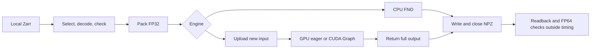
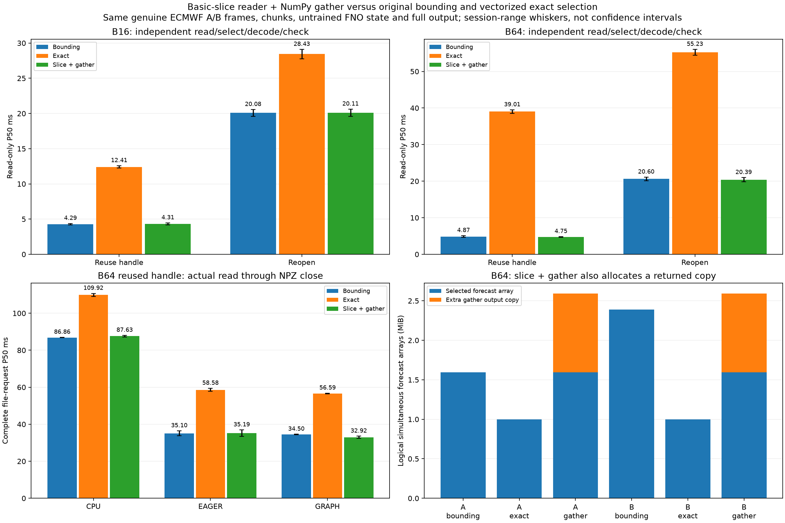
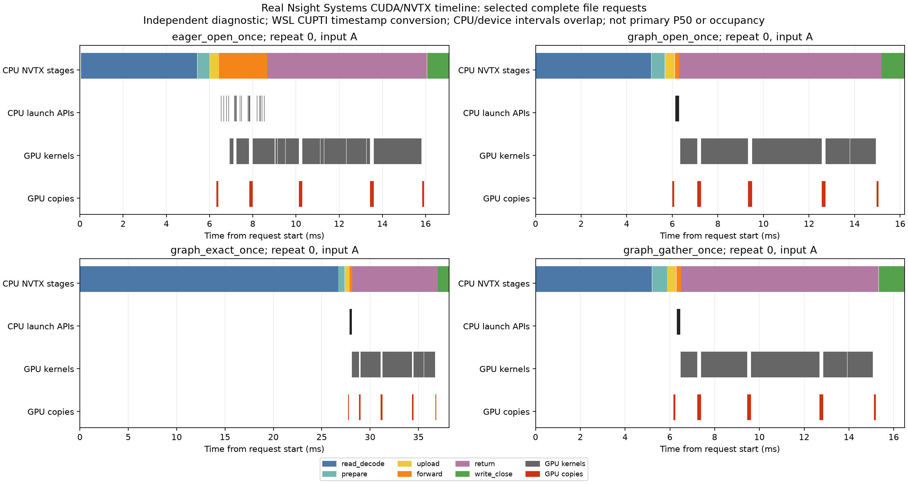

# Weather data performance: measure the complete workflow

This public case uses genuine ECMWF Zarr frames, a fixed **untrained** PhysicsNeMo FNO, and an RTX 3050. It studies data access, execution and numerical agreement, without assessing forecast skill or representing a deployed forecasting service.

**Question.** Can selecting fewer frames improve a real read-to-file request?

**Method.** Compare bounding, vectorized exact, and basic-slice/NumPy-gather readers. Match genuine A/B inputs, model state, output bytes and numerical tolerance. Shuffle methods within repetitions; preserve P50/P95, maxima and regressions. Two sessions contain 960 read-only observations and 2,160 complete-file requests. Store probes and profiling are separate.

**Results.** B64 reused-handle read-only P50 is 38.54–39.49 ms for exact, 4.63–5.11 ms for bounding and 4.65–4.84 ms for gather. All fetch the same four chunks. Gathering removes the large exact-path regression, but lacks a consistent general end-to-end advantage over bounding. Graph-path paired bounding/gather medians are 0.972× and 1.038×. Defaults remain unchanged.

**Memory.** A 1 MiB gathered output briefly coexists with a 1.594 MiB selected box. Smaller returned arrays do not establish lower process peak RAM or fewer decoded chunks.

**Diagnostic evidence.** Real Nsight traces correlate CPU dispatch with device execution. Graph uses one graph launch; both engines retain kernels and full transfers. CPU result-return intervals overlap preceding GPU work and are not standalone PCIe cost. Two partial captures remain explicitly partial; a documented WSL timestamp workaround recovers device evidence in the third. Diagnostic times do not replace primary results.

**Decision.** Retain bounding and close this bounded experiment. Select optimizations using complete-workflow evidence, numerical checks and explicit lifecycle boundaries.

[Reader details](../results/rtx3050_physics_gather_comparison/analysis.md) · [Nsight evidence and limits](../results/rtx3050_physics_nsight_comparison/analysis.md) · [Chinese explanation](physicsnemo_gather_nsight_zh.md)
