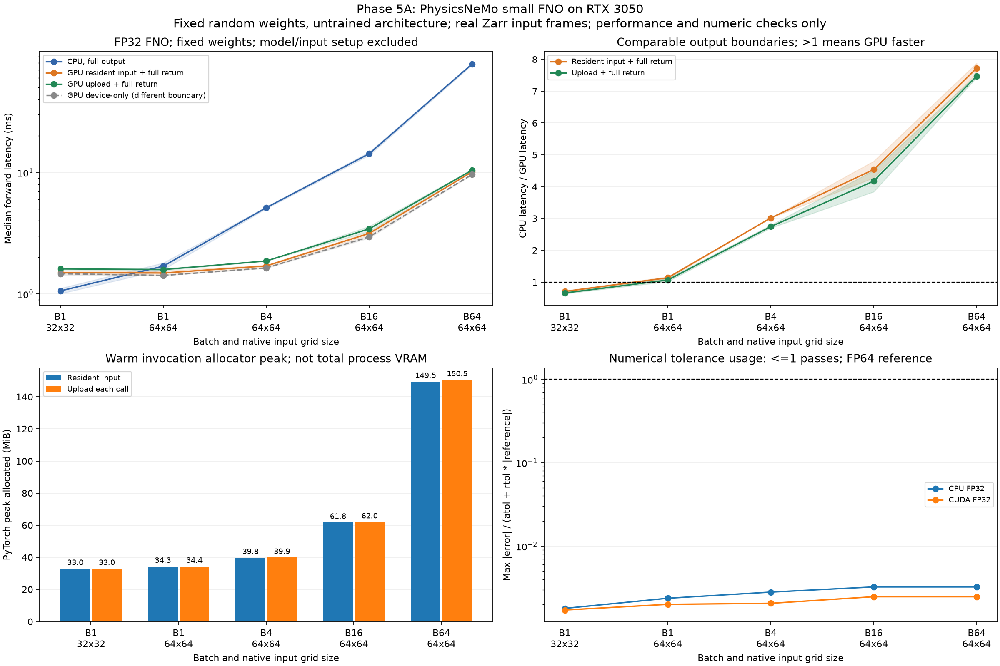

# 第五步：NVIDIA 生態系的推論與資料流程效能

狀態（2026-11-03，Asia/Taipei）：**5A 已實作完成，5B 已有 FP32 forward、完整流程、重用／排程診斷與 CUDA Graph 對照。** 只研究效能、資源使用與數值正確性；預報品質、模型排名、訓練成效及獨立觀測驗證不在範疇。JAX 試作持續暫緩。

## 原始五步走到哪裡

| 原始步驟 | 狀態 |
|---|---|
| 1. Benchmark 圖表 | 已有 runtime、speedup、memory、compute/transfer 圖與樣本 |
| 2. 硬體與 README | 已有環境紀錄、方法、限制、重現指令及 GitHub CI |
| 3. FP32 / FP16 | 已有時間、記憶體、數值誤差、溢位與混合精度試驗 |
| 4. 真實氣象資料 | 已有 GFS NetCDF、ECMWF Zarr、批次、共享輸入、延遲分布與 CPU/CUDA trace |
| 5. Earth-2 / PhysicsNeMo | PhysicsNeMo 小型 FNO 已在 CPU/RTX 3050 執行；Earth2Studio 尚未安裝或執行 |

## 這次實作了什麼

使用官方 `physicsnemo.models.fno.FNO`，固定種子、相同權重，在 CPU 和 GPU 執行 forward。架構為二維 FNO，2 個 Fourier layer、16 latent channels、8 Fourier modes，共 132,353 個參數。

**權重是固定隨機初始化，未訓練，沒有下載預訓練模型。** 這是可控制的模型運算工作負載。輸入是真實 ECMWF ensemble Zarr 的不同起報／時效／成員 frame，不複製或放大格點湊 batch。溫度先用固定公式 `(Celsius - 20)/20` 縮放，再轉 FP32；這不是某個氣象模型的訓練正規化。

環境位於 WSL 專案的 `.venv/physicsnemo`：Python 3.12.16、PhysicsNeMo 2.2.2、PyTorch 2.14.1+cu126、torchvision 0.29.1+cu126、Warp 1.18.0+cu12。RTX 3050 為 8 GiB，driver 560.94、compute capability 8.6。CPU 使用 6 threads、interop 1，關閉 TF32。[完整版本鎖定](../requirements-physicsnemo.lock.txt)與[實際環境紀錄](../results/rtx3050_physicsnemo_run01/environment.json)已保存。

原本 `~/venvs/weather-gpu` 的 Python 3.10 環境保持獨立。[readiness 紀錄](../results/phase5_readiness/environment.json)是 2026-11-01 安裝前的歷史狀態，當時兩個框架都未安裝，不能用它描述現在的新環境。安裝時發現預設 torchvision/Warp 二進位與 CUDA 12.6／現有驅動組合不合，已固定使用 cu126 torchvision 和官方 CUDA12 Warp wheel，沒有更動驅動或全域 Python。

## 兩輪正式結果

每個 case 每條方法暖機 5 次、量測 30 次；各次量測的方法順序隨機排列。兩輪使用相同模型權重，不同順序種子，共 1,200 筆正式樣本。

| 輸入 | CPU P50 | GPU 輸入常駐＋完整取回 P50 | CPU/GPU 比值 |
|---|---:|---:|---:|
| batch 1，32×32 | 1.01–1.11 ms | 1.47–1.53 ms | 0.68–0.73× |
| batch 1，64×64 | 1.58–1.80 ms | 1.43–1.54 ms | 1.11–1.17× |
| batch 4，64×64 | 5.03–5.22 ms | 1.67–1.73 ms | 3.01–3.02× |
| batch 16，64×64 | 13.83–14.70 ms | 3.06–3.24 ms | 4.27–4.80× |
| batch 64，64×64 | 76.61–79.48 ms | 10.08–10.13 ms | 7.56–7.88× |

最大 case 每次重新上傳輸入再完整取回，P50 為 10.31–10.58 ms，比同輪 CPU 快 7.43–7.52×。最大的暖機呼叫 PyTorch peak allocated 約 150.5 MiB；這不是整個程序的 GPU 記憶體用量，也不能據此保證大型模型都放得下。

小輸入可能由呼叫與同步成本主導，GPU 不一定較快；增加 batch 後，這個 FNO 工作負載呈現明顯 GPU 效益。這個結果不能直接套用到前幾階段的 Bias/MAE/RMSE reduction，兩者做的運算不同。

[完整 P50/P95、吞吐量、方法與限制](../results/rtx3050_physicsnemo_comparison/analysis.md)



四個 panel 分別表示：

1. **延遲**：CPU、GPU 輸入常駐／每次上傳且完整取回的成本；虛線 device-only 另有不同輸出邊界。陰影是兩輪中位數的範圍，不是信賴區間。
2. **加速比**：同輪 CPU P50 除以 GPU P50，大於 1 才是 GPU 較快。
3. **記憶體**：暖機後單次呼叫的 PyTorch 配置峰值，取兩輪最大值，不等於總 VRAM；allocator cache、driver、cuFFT 的解讀限制另列於報告。
4. **數值容許度**：`最大 |誤差| / (atol + rtol × |FP64參考|)`，小於等於 1 才通過。這是運算一致性檢查，與預報準確度無關。

## 驗證與量測邊界

CPU/GPU 使用相同 FP32 權重及輸入；參考是把那些權重與輸入升成 FP64，在 CPU 跑同一架構。預先固定 `rtol=1e-4, atol=1e-5`，逐元素檢查所有暖機、正式、首次觀察與記憶體測試輸出。每個 case 都保存完整 input／FP64 reference／CPU FP32／CUDA FP32 陣列，並保存權重、來源與陣列 hash。

兩輪保存結果已離線核對，另在隔離環境重新載入權重、獨立重算每個 FP64 reference，全部通過。新 PhysicsNeMo 環境 47 項測試全部通過；舊 weather-gpu 環境共 47 項測試，其中 1 項因未安裝 PhysicsNeMo 跳過，其餘通過。CPU CI 不安裝這套大型 GPU 依賴，會檢查保存的真實結果與來源、數值差異、量測順序、統計與記憶體紀錄。

主圖是暖機後 forward：排除 Zarr 讀取、縮放、模型建構、CUDA 初始化、權重上傳、FP64 計算、正確性檢查與寫檔。每次上傳輸入的方法包含 H2D，但仍重用 GPU 權重。完整結果取回的邊界與 CPU 相同；device-only 診斷結果則留在 GPU。`first_forward.csv` 是已初始化程序內各 shape 的首次觀察，不能當作冷程序啟動時間。

## 如何重跑

在全新 WSL/Linux x86_64 checkout 建立隔離環境：

```bash
bash scripts/setup_physicsnemo.sh
```

環境已建立的這台機器，直接使用：

```bash
cd ~/weather-gpu-benchmark-github
source .venv/physicsnemo/bin/activate
python physicsnemo_benchmark.py --output results/my_physicsnemo01
python physicsnemo_benchmark.py --order-seed 20261103 --output results/my_physicsnemo02
python scripts/analyze_physicsnemo.py results/my_physicsnemo01 results/my_physicsnemo02 --recompute-reference --output results/my_physicsnemo_comparison
```

輸出資料夾必須是新路徑，避免覆寫既有結果。只驗證保存的結果與重畫圖，不加 `--recompute-reference` 即不需安裝 Torch/PhysicsNeMo。安裝腳本會保留已存在的隔離環境，不會覆蓋它。

## 下一個實作單位

| 子階段 | 現況與後續 |
|---|---|
| 5A. 環境與最小 forward | 已完成 |
| 5B. 模型推論 benchmark | FP32 forward、完整流程、配對重用／節奏、shape 排程／trace、CUDA Graph 及精確 frame reader 對照已完成；exact 減少 forecast backing，但同樣讀取 chunks 且較慢，維持原版預設；下一步比較連續 slice＋gather／chunk 分組策略 |
| 5C. Earth2Studio 流程 | 尚未實作；先確認指定模型的多變數、層次、時間窗口、網格、單位、權重與容量需求，再準備合格輸入 |

完整流程 B64 的兩輪基線加速約 2.53–2.58×，小 case 幾乎無優勢，B16 則呈現依執行情境而異的延遲。後續[重用與節奏實驗](physicsnemo_reuse_zh.md)顯示 B64 重用已開資料集可把 GPU 請求由約 44–47 ms 降到約 29–30 ms；條件式輸入快取還可改善，但不是任意新資料的讀取到寫檔速度。[可選 CPU／eager／graph 完整流程](physicsnemo_graph_pipeline_zh.md)也已完成：真實 A/B 輸入逐次讀取、完整回傳並寫檔，當時 B64 open_once 的 graph P50 約 30.88–32.99 ms，配對 eager/graph 比值約 1.014–1.033×，收益有限，reopen 還有較慢結果。接著的[精確 frame 選取實驗](physicsnemo_reader_zh.md)確認陣列雖縮小，仍讀相同 chunks 且速度較慢，未採為預設。不同協定的歷史數字不能直接當精確分段比較。下一步比較連續 slice＋gather／chunk 分組，再評估 chunk layout、非同步重疊或精度取捨。之後才接 Earth2Studio；現有單一 2-m 溫度區域子集不能直接當成全球預訓練模型的完整輸入。

參考：[官方 FNO API](https://docs.nvidia.com/physicsnemo/latest/physicsnemo/api/models/fnos.html)、[PhysicsNeMo 套件](https://pypi.org/project/nvidia-physicsnemo/)、[NVIDIA Warp CUDA wheel 說明](https://github.com/NVIDIA/warp/blob/main/README.md)、[Earth2Studio](https://nvidia.github.io/earth2studio/main/)。版本數字以本次安裝與保存 lock 為準。
