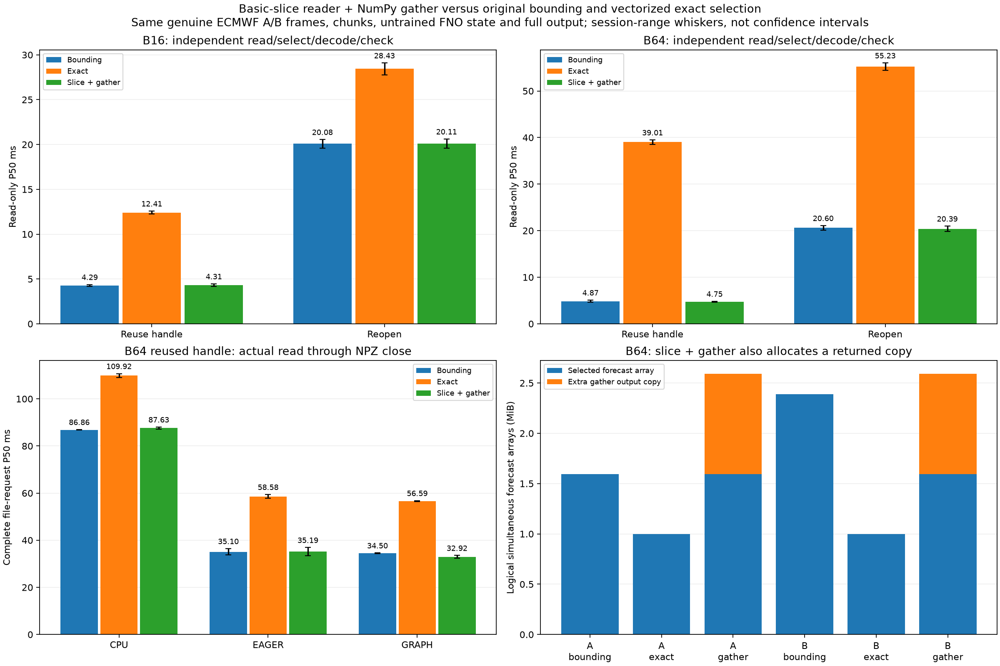
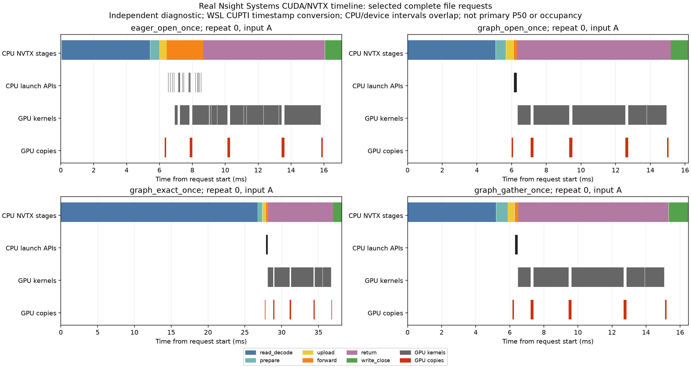

# Reader 對照收尾與 Nsight Systems 診斷

本輪完成連續 slice＋NumPy gather，以及真實 Nsight Systems CUDA／NVTX 擷取。**Gather 避開 vectorized exact 的大幅變慢，但未取得相對原版穩定的整體優勢；原版仍是預設，這輪 reader 優化到此收尾。**

## 新 reader 與正式結果

`gather_once`／`gather_reopen` 先算出目標 frames 的最小 init／lead／member 矩形，以一個 basic slice 載入，再由 NumPy 配對索引複製出 B 張。Backend 不接收逐點 vectorized indexers；A/B 身分、格點、縮放、模型、輸出格式與數值容許度都相同。

B64 A／B 原版載入 102／153 張；gather 改為 102／102 張，再複製 64 張。三條方法仍取回同樣 4 個 forecast chunks：833,260 bytes 壓縮資料，名義解壓 chunk 總量 3,342,336 bytes。這是 Store API 覆蓋，不是實體磁碟流量或 decoder 呼叫次數。

兩輪合計 **960 次純讀取、2,160 次完整輸出檔**，另有 432 次同步分段 profile、144 次 CPU/CUDA trace 與 48 次 allocator probes。各 repeat 使用相同 A/B，方法／case 順序混排。下表是 B64 重用已開 dataset handle 的兩輪 P50 範圍。

| 邊界 | 原版 bounding | Vectorized exact | Slice＋gather |
|---|---:|---:|---:|
| 純讀取 | 4.63–5.11 ms | 38.54–39.49 ms | 4.65–4.84 ms |
| CPU 完整流程 | 86.74–86.98 ms | 109.13–110.72 ms | 87.21–88.05 ms |
| GPU eager 完整流程 | 33.77–36.43 ms | 57.75–59.42 ms | 33.47–36.92 ms |
| GPU graph 完整流程 | 34.39–34.61 ms | 56.35–56.83 ms | 32.30–33.54 ms |

Graph 的兩輪 P50 看似都下降，但同 repeat／variant 的配對 `原版/gather` 中位數為 **0.972×／1.038×**，gather 較快為 **11/30／17/30**。P50 比值與配對比值不同；後者顯示改善沒有穩定跨輪重現。其他 case／引擎也有較慢結果，因此維持原版預設。

P95／最大值與所有離群樣本保留。例如第一輪 B64 graph gather 最大值 57.272 ms，高於原版 49.054 ms；第二輪 CPU B64 原版最大值達 620.671 ms。這些差異沒有隔離單一系統狀態原因，配對數也不是顯著性檢定。



上方是 B16／B64 純讀取；左下是 B64 完整流程。柱高為兩輪 P50 的中位數，誤差線為範圍，不是信賴區間。右下顯示：gather 回傳 backing 只有 1 MiB，但與 1.594 MiB 來源區塊短暫共存，合計 2.594 MiB；原版 A／B 約 1.594／2.391 MiB。這些是邏輯陣列，不含 decoder、packing 或其他暫存，不等於程序 peak RAM。

## Nsight：核對真實 GPU 證據

使用獨立解壓的 CLI，沒有更動驅動或 Python 環境。三次擷取各執行 36 個 B64 完整請求：CPU／eager／graph × 三個重用型 reader × 四次 repeat。

| 擷取 | 設定 | 結果 |
|---|---|---|
| run01 | Nsight 2024.5 | 有 NVTX／CUDA API，缺 GPU kernel／copy 表，標為不完整 |
| run02 | Nsight 2024.7＋環境指令嘗試 | 仍缺 GPU 表，標為不完整 |
| run03 | Nsight 2024.7＋官方設定檔時戳方法 | 2,376 個 GPU kernel events；36 個 request 全部核對 |

WSL 處理在 `nsys -z` 指向的設定檔暫加 `CuptiUseRawGpuTimestamps=false`，擷取後還原原 bytes，或移除新建檔。NVIDIA 說明這種時戳轉換精度較低，這裡用於理解流程重疊，不以微小偏移推論精確排程。[官方說明](https://forums.developer.nvidia.com/t/nsys-doesnt-show-cuda-kernel-and-memory-data/315536/9)



各 panel 取第一個 A 請求，橫軸範圍不同；由上至下為 CPU 階段、CPU launch APIs、GPU kernels 與 GPU copies。完整 36 筆另存 CSV。

1. Eager 逐一派送多個 kernels；graph 有一次 graph launch，兩者仍有實際 GPU 工作。
2. 紫色 CPU return 和 GPU kernels 大量重疊，取回呼叫也在等前面的運算，不能把整段當作 PCIe 複製成本。
3. Exact 藍色讀取區段較長；gather 與原版接近，GPU 無法消除新增的主機端成本。
4. 圖是獨立診斷，不是主測 P50 分解，不能將其中約 16–40 ms 替換正式結果。

完整擷取中 eager 每次 99 個 kernel-launch APIs，graph 一次 `cudaGraphLaunch`。兩者各有 99 個 kernel events，核心活動聯集約 8 ms，內部 device copies 也保留。這不代表算術工作減少或 GPU occupancy；CPU／GPU 範圍重疊，不能相加。

每個 GPU request 都有完整 1 MiB HtoD／DtoH，CPU 沒有 CUDA 工作。GPU events 透過 runtime correlation ID 對回 request，並核對全表 kernel 數。

## 驗證、保存與重現

69 項測試在 GPU 環境全過；原環境跳過 1 項選用套件測試，Windows CPU 跳過 10 項，其餘通過。每個正式／暖機／profile／記憶體／trace 檔案都核對完整數值、座標、起報／lead／member／valid time、metadata 與 CPU FP64；共用參考另從保存權重獨立重算。

原始 Nsight 報告／完整 SQLite 含程序環境資訊，留在本機並由 Git 忽略。公開 `events.sqlite` 只保留 NVTX／CUDA 事件、copy enum 及引用的 API／kernel 名稱；另有原始雜湊、筆數、來源程式、工具版本、日誌與輸出可核對。CI 重驗保存證據，不宣稱重跑 GPU／Nsight。

```bash
source .venv/physicsnemo/bin/activate
# 使用新路徑，各輪分開執行；第二輪更換 seed 和路徑
python physicsnemo_graph_pipeline.py --readers open_once exact_once gather_once reopen exact_reopen gather_reopen --seed 20261115 --output results/my_gather_pipeline01
python physicsnemo_reader_benchmark.py --readers open_once exact_once gather_once reopen exact_reopen gather_reopen --seed 20261115 --output results/my_gather01
# CLI 僅首次安裝需要，既有工具目錄會被保留
python scripts/setup_nsight_cli.py --release 2024.7.1
python scripts/run_physicsnemo_nsight.py --wsl-timestamps --output results/my_nsight
python scripts/analyze_physicsnemo_nsight.py results/my_nsight --output results/my_nsight_report
```

主測到 NPZ close，沒有 fsync；初始化、參考、驗證與 cleanup 在外。Cache 未清除；Nsight 只有一個 B64 graph，節奏與資源狀態不同於主測。沒有加入氣象署內部資料、訓練或預報品質評估。

[Gather 詳表與重現](../results/rtx3050_physics_gather_comparison/analysis.md) · [Nsight 詳表與限制](../results/rtx3050_physics_nsight_comparison/analysis.md) · [精簡英文案例](performance_case_study.md)
