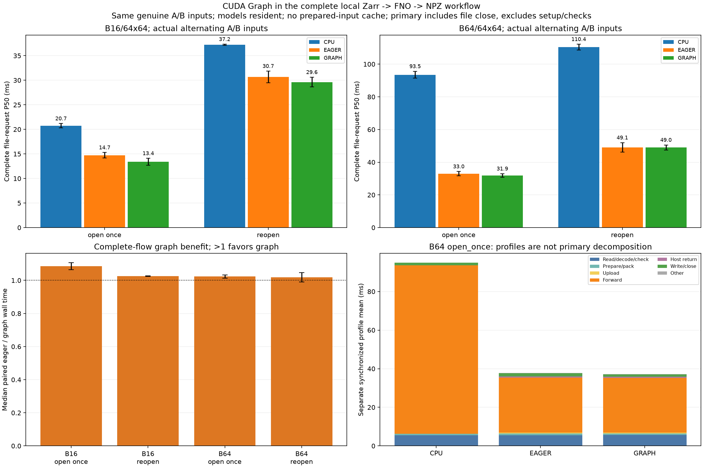

# CUDA Graph 接入完整 Zarr 到輸出檔流程

這次把先前的 `CudaGraphRunner` 接成可選執行引擎，直接比較 **CPU、一般 GPU eager、GPU CUDA Graph** 的完整請求時間。兩輪結果顯示：重用已開資料集時，Graph 對 B16 有約 1 ms 的配對中位數節省，B64 的收益較小；重開資料集的 B64 第一輪還略慢。因此保留三個引擎，依實際工作選用，不把 Graph 設為所有情境的預設。

## 實作與比較邊界

[`FnoFilePipeline`](../physicsnemo_graph_pipeline.py) 每次呼叫都執行：

```text
本機 Zarr 選取／讀取／解碼／座標檢查
  → 固定縮放與 FP32 contiguous packing
  → 新輸入複製到固定 GPU buffer（GPU 引擎）
  → 同一組權重的 FNO forward
  → 完整輸出取回 CPU
  → 寫入並關閉未壓縮 NPZ
```

CPU 與 GPU 模型都常駐，使用相同的未訓練 FNO、FP32 權重和來源資料。GPU eager／graph 使用同一固定輸入 buffer，兩者的主計時都包含新輸入上傳，沒有用準備好的 tensor 快取代替讀取，也沒有快取模型結果。只有選擇 `graph` 才會建立 graph；單獨選 `cpu` 不需要 CUDA。要求 graph 卻缺少可用條件時會報錯，不會悄悄改跑 eager。

每個 case 使用兩組互不重疊的真實 ECMWF frames：A 為前 B 張，B 為接著 B 張；依 repeat 交替，並在同一 repeat 對所有方法使用相同 variant。B16／B64 都是原生 64×64 格點，沒有複製或放大輸入。保留原本矩形讀取行為：B64 的 A 先 materialize 102 張再取前 64 張；B 先 materialize 153 張再取第 64–127 張，因此讀取成本也包含選取覆蓋的差異。

兩種 reader 都保留：

| Reader | 每次請求做的事 |
|---|---|
| `open_once` | 重用一個已開 dataset handle，但重新選取、讀取、解碼、檢查與 packing |
| `reopen` | 每次重新開 dataset，再做相同步驟 |

開啟 handle、模型準備、每個 shape 的 graph 建立成本另存。主測每 case／method 30 次，每輪混排全部 12 種 case／method 組合；兩輪共 **720 次完整請求**。主測沒有 profiler、CUDA events 或逐階段同步。另量 144 次同步分段 profile、48 次完整流程 CPU/CUDA trace、16 次 GPU allocator probes。

## 兩輪完整流程結果

以下是兩輪各自 P50 的範圍；範圍不表示信賴區間。

| 輸入 | Reader | CPU P50 ms | GPU eager P50 ms | GPU graph P50 ms |
|---|---|---:|---:|---:|
| B16 | open_once | 20.30–21.19 | 14.19–15.29 | 12.69–14.10 |
| B16 | reopen | 37.13–37.34 | 29.50–31.86 | 28.64–30.62 |
| B64 | open_once | 91.37–95.59 | 31.66–34.31 | 30.88–32.99 |
| B64 | reopen | 108.68–112.19 | 46.23–51.97 | 47.51–50.55 |

同輪 `CPU P50 / graph P50`：B64 open_once 約 **2.90–2.96×**，B16 約 **1.50–1.60×**。這說明此模型仍有 GPU 效益；Graph 是在既有 GPU 路徑上再減少部分成本。

逐 repeat、同 variant 配對後，結果如下。這是配對比值的中位數，與「兩個 P50 相除」是不同統計量。

| 輸入 | Reader | 配對 eager/graph 中位數，兩輪 | 配對節省中位數，兩輪 | Graph 較快的配對數 |
|---|---|---:|---:|---:|
| B16 | open_once | 1.108× / 1.064× | 1.218 / 0.988 ms | 24/30、23/30 |
| B16 | reopen | 1.024× / 1.027× | 0.647 / 0.857 ms | 19/30、19/30 |
| B64 | open_once | 1.014× / 1.033× | 0.271 / 0.979 ms | 19/30、20/30 |
| B64 | reopen | 0.991× / 1.048× | −0.403 / 2.394 ms | 13/30、19/30 |

所有較慢結果都保留。第一輪 B64 reopen 的 graph P50 為 47.514 ms，高於 eager 的 46.228 ms；第二輪同一路徑 graph 最大值 67.993 ms，也高於 eager 的 64.476 ms。第二輪 B64 CPU open_once 最大值達 361.538 ms，完整原始樣本、P95 和最大值均保留，沒有刪除離群值。配對數與比值只是描述這兩次量測，不是顯著性檢定或延遲保證。

## 圖怎麼讀



1. **左上 B16**：比較同一 reader 下三個引擎的完整請求 P50。Graph 比 eager 小幅改善；重用 reader 省下的時間更明顯。
2. **右上 B64**：較大的 FNO 工作負載使 GPU 明顯快於 CPU，但 eager 與 graph 的差距遠小於 CPU 與 GPU 的差距。上方兩張圖的柱高是兩輪 P50 的中位數，誤差線為兩輪範圍。
3. **左下 Graph 增益**：每輪先算配對 eager/graph 中位數，再畫兩輪的中位數與範圍。超過 1 代表 graph 較快。B64 reopen 範圍跨過 1，正好顯示改善並不穩定。
4. **右下分段 profile**：B64 open_once 的獨立同步分段平均值，協助觀察讀取、packing、上傳、forward、回傳與寫檔。它們加總成各自 profile 的平均時間，**不能當成上方主測 P50 的精確拆解**。兩輪 GPU forward profile 本身也有約 23–33 ms 的變動；這個實驗沒有把系統狀態的單一原因隔離出來。

Graph 改變模型派送方式，沒有省掉 Zarr 讀取、解碼、前處理、PCIe 上傳／回傳或 NPZ 寫檔。這些固定成本會稀釋單純 forward 的改善；CPU/I/O 與系統變動也可能蓋過小幅差距。不同階段的測試有不同輸入／buffer／排程協定，不應把舊 forward-only 的毫秒數直接扣到本次完整請求上。

## 建立成本與記憶體

| Shape | Graph setup，兩輪 | Setup 後 PyTorch allocated 淨增加 |
|---|---:|---:|
| B16 | 22.86–23.27 ms | 32.5 MiB |
| B64 | 51.97–52.39 ms | 34.0 MiB |

Setup 包含 buffer clone、side-stream warmup、capture／instantiate、第一次 replay；是在 eager 暖機之後量測，且兩個 shape 的 graph 與來源 buffers 都會共存。記憶體是 allocator 的前後淨觀察，不能解讀成整個程序 VRAM、單獨引擎用量或精確的 graph executable／pool 大小。

以 setup 除以同輪正的完整請求平均節省，B16 open_once 估計約 19–24 次回收成本，B64 open_once 約 42–58 次；B64 reopen 第一輪因平均節省僅約 0.085 ms，估計達 616 次，配對中位數還是負值。這正是小幅差距不能過度解讀的例子。這些數字受離群值影響，只是估算，沒有另量 N 次請求的完整應用，也不是冷啟動時間。

## 正確性與量測限制

每次首次觀察、暖機、主測、profile、記憶體及 trace 的輸出檔，都在計時之外讀回，核對完整陣列、dtype、經緯度、起報時間、lead、member、valid time 與 metadata。GPU trace 必須包含完整輸入 HtoD、完整輸出 DtoH 和實際 kernels；graph 方法必須有 `cudaGraphLaunch`，eager 不得有，CPU 路徑不得出現 CUDA 工作。

各輪從保存的 FP32 權重／輸入重新升成 CPU FP64 計算參考，逐元素容許度固定為 `rtol=1e-4, atol=1e-5`；另獨立重算共用參考並核對。兩輪各保留 24 個正式輸出檔，涵蓋全部 case／method 的 A/B；所有 trial 的檔案／payload hash 都與對應正式檔一致。這是數值運算一致性，與預報表現無關。

CPU 分析器重新核對來源、權重、參考、輸出座標／身分／誤差、執行順序、分位數、分段加總、記憶體加總，以及 gzip trace 的真實活動。新增 reader 切換／A-B-A 更新、方法配對和 CPU 寫檔測試後，隔離 GPU 環境共 61 項測試全通過；原本環境 61 項中 1 項依賴選用套件而跳過，Windows CPU 環境跳過 10 項，其餘均通過。

主測排除啟動、來源 hash、FP64 計算、輸出讀回／hash／驗證、刪除 trial 和 benchmark 報表寫檔。計時到檔案 close，沒有要求 `fsync`，不保證資料已持久寫入實體儲存媒體。來源準備與驗證會暖化 OS／library cache，沒有宣稱冷磁碟讀取。遠端下載、訓練、預報表現和 Earth2Studio 都不在本次量測內。

## 怎麼使用

```bash
cd ~/weather-gpu-benchmark-github
source .venv/physicsnemo/bin/activate

# 比較三個引擎、兩種 reader
python physicsnemo_graph_pipeline.py --output results/my_graph_pipeline01
python physicsnemo_graph_pipeline.py --seed 20261112 --output results/my_graph_pipeline02
python scripts/analyze_physicsnemo_graph_pipeline.py results/my_graph_pipeline01 results/my_graph_pipeline02 --recompute-reference --output results/my_graph_pipeline_report

# 只跑 graph，重用已開資料集
python physicsnemo_graph_pipeline.py --engines graph --readers open_once --output results/my_graph_only

# 只跑 CPU，每次重開資料集
python physicsnemo_graph_pipeline.py --engines cpu --readers reopen --output results/my_cpu_only
```

輸出必須使用新路徑。執行模型用現有隔離 PhysicsNeMo 環境；省略分析器的 `--recompute-reference` 後，可用 CPU 資料／繪圖依賴重新驗證保存的 GPU 證據與重畫圖。原有 eager 腳本仍可使用。這是固定兩個 shape 的效能工具，尚未提供任意動態 shape 的服務介面。

## 下一個合理實作

後續已完成[精確 frame reader 與原版的同輪對照](physicsnemo_reader_zh.md)：forecast backing 較小，但實際 Store 仍取回相同的 4 個 chunks，vectorized exact 路徑反而更慢，因此保留原版預設。下一步先比較連續 slice＋NumPy gather／chunk 分組，必要時再測獨立副本的 chunk layout。A/B、座標／時間身分、完整輸出及數值容許度持續相同。Graph 保持可選，暫不擴充 JAX 或預報品質評估。

[完整原始表、profile 與重現說明](../results/rtx3050_physics_graph_pipeline_comparison/analysis.md)
