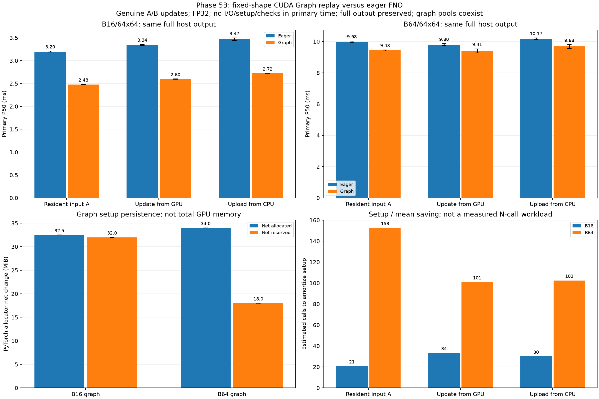

# 5B：CUDA Graph 重播、真實輸入更新與成本

本輪保留原本 eager 路徑，新增 `CudaGraphRunner`，在相同未訓練小型 FNO、相同 FP32 權重上，實作每個固定尺寸各一個 CUDA Graph。只研究效能與數值一致性；預報品質、訓練、AMP、JAX、Earth2Studio、driver／電源調整均未加入。

## CUDA Graph 做了什麼

普通 eager 會在每次 forward 經過 Python／ATen／CUDA 派送流程；CUDA Graph 先把可捕捉的裝置流程記錄下來，再重播。輸入／輸出記憶體位址必須保持存活；新資料以 `copy_` 寫入原本的固定緩衝區，不能用換一個 tensor 物件代替更新。[官方使用方式與限制](https://docs.pytorch.org/docs/2.14/notes/cuda.html#cuda-graphs)

實作先在側串流 eager 暖機，再捕捉／建立 executable，量第一個同步 replay。模型與 runner 要持續存活，權重保持不變。`replay()` 傳回的是會在下次重播被覆寫的 GPU 輸出；本輪每次都完整複製回 CPU，再進行下一次呼叫。錯誤形狀、dtype、非連續布局或不同 CUDA 裝置會被拒絕，沒有偷偷改跑 eager 或 CPU。

## 比較的三種邊界

每輪有 30 次重複，B16／B64 與全部六條 eager／graph 方法在每次重複中打散；兩輪使用不同順序種子。主計時不開 profiler、CUDA events 或語意標記。

| 邊界 | eager 與 graph 都包含 | 計時前條件 |
|---|---|---|
| resident | forward＋完整回傳 | A 已在固定 GPU buffer；兩邊都在計時外以相同 D2D 複製重設 A 並同步 |
| device_update | 新輸入 D2D 複製＋forward＋完整回傳 | 新資料 A／B 已在另外的 GPU buffer |
| host_update | CPU→GPU 複製＋forward＋完整回傳 | A／B 為已打包的 pageable CPU tensor |

沒有納入 Zarr 讀取、前處理、寫檔、graph 建立或驗證時間，所以不能把這組速度當成新的完整應用速度。兩條路徑使用同一個固定 GPU 輸入 buffer；eager 也付出相同的新輸入複製成本。

## 兩輪結果

下表是兩輪各自 P50 的範圍，不是信賴區間。

| 輸入／邊界 | Eager | CUDA Graph |
|---|---:|---:|
| B16，輸入常駐 | 3.19–3.21 ms | 2.47–2.48 ms |
| B16，GPU 新輸入更新 | 3.33–3.36 ms | 2.59–2.60 ms |
| B16，CPU 新輸入上傳 | 3.44–3.50 ms | 2.723–2.724 ms |
| B64，輸入常駐 | 9.93–10.03 ms | 9.39–9.46 ms |
| B64，GPU 新輸入更新 | 9.74–9.86 ms | 9.28–9.53 ms |
| B64，CPU 新輸入上傳 | 10.11–10.23 ms | 9.56–9.80 ms |

輸入常駐時，B16 的 P50 延遲約減少 **23%**；B64 約減少 **5–6%**。包含更新／上傳新輸入後仍有中位數改善。改善是這個模型、硬體與邊界的觀察，不是所有模型的固定倍數。

也有反例：第一輪 B64 resident 的最大值，eager 為 11.55 ms、graph 為 19.51 ms；B16 的兩種更新路徑也出現 graph 最大值較高。全部樣本、P95、最大值及較慢配對都保留；中位數改善不保證每一次或尾延遲都改善。



圖的解讀：

1. 上排：三種相同回傳邊界的主測 P50。柱為兩輪中位數的中位數，誤差線為兩輪中位數範圍。
2. 左下：建立 graph 前後，PyTorch allocator 的 net allocated／reserved 變化；不是整個程序總 VRAM，也不是 graph private pool 的精確大小。既有 reserved 空間可能被重用，因此兩種增量不必依大小排序。
3. 右下：以「建立總成本 ÷ 平均單次節省」估算需要多少次呼叫攤提；不是另外量測的 N 次完整應用，會受少數較慢樣本影響。圖先平均各輪未進位估值，再向上取整；完整表保留每輪估值。

## 建立時間與記憶體代價

| Graph | 建立總時間 | Net allocated 增量 | Net reserved 增量 |
|---|---:|---:|---:|
| B16 | 20.10–21.14 ms | 32.5 MiB | 32 MiB |
| B64 | 49.17–52.05 ms | 34 MiB | 18 MiB |

建立總時間包含固定 buffer 複製、側串流暖機、capture／instantiate 與第一次同步 replay；套件、模型、來源與 FP64 參考準備另計。這是在已初始化程序中的單次觀察，不能當成冷啟動保證。

兩個 graph 各有自己的預設 private pool，不共用 pool。上表是建立前後的淨變化，還可能包含側串流／庫需要的持續配置；較早建立的 graph、模型、A/B 來源輸入會同時存在。driver、graph executable、cuFFT 的部分記憶體不一定完整呈現在 allocator 數字中。

另有暖機後 runtime memory probes。eager 探測時 graph pools 仍存在，所以不是 standalone eager 用量；graph runtime 額外峰值很小，也不代表 graph 不吃記憶體，它已預先保留持續資源。

## 新輸入真的有更新嗎

A 為來源前 B 張場，B 為接下來 B 張，都是不同起報／時效／成員身分的真實資料，不使用人工擾動或重複貼圖。每輪都做 A→B→A：

- 讀回真正的 graph 固定輸入，逐值核對來源 A／B。
- 檢查輸入／輸出 pointer 維持不變，且 A／B 的實際輸出 hash 不同。
- 與 eager 做較嚴格的 `rtol=1e-6, atol=1e-7` 核對，並以預先固定 `rtol=1e-4, atol=1e-5` 比較 CPU FP64。
- 保存完整兩組輸入、FP64 參考、eager／graph 實際輸出、更新紀錄、權重與來源 hash。

所有更新路徑按 repeat 交替使用 A／B，同一 repeat 的 eager／graph 使用相同 variant。每個正式、暖機、記憶體探測與 profiled 結果都有數值檢查，不重用模型計算結果。

## Trace 支持什麼解釋

每輪另有 24 次 CPU/CUDA profiler 呼叫。實際 trace 觀察到 eager 每次有 91 個名稱包含 `LaunchKernel` 的 runtime API；graph 則是一次 `cudaGraphLaunch`，且仍有完整輸出 DtoH。CPU 上傳模式有完整 HtoD，GPU 更新模式也有相應 D2D。

這支持派送方式確實改變，但**不能把派送範圍減少的毫秒數直接當成總延遲節省**：原本 CPU 派送與 GPU 運算會重疊。Graph 讓 CPU 更早到取回步驟，也可能使該範圍的等待更長；獨立 profile 的分段時間不能當主測的精確分解。

這次 graph 是 102 個 kernel events，eager 為 99 個。Trace 顯示 graph 多了 `memcpy128` 裝置內核，而 eager 以內部 DtoD copy events 呈現相應複製。不能因 graph 的 DtoD event bytes 較少，就說裝置複製消失或算術工作變少。Capture 可能改變內部實作，不能把所有收益只歸因於 CPU 派送。

## 重現、驗收與下一步

兩輪共有 **720 次主測、12 次 A/B/A 更新檢查、24 次 runtime memory probes、48 次正式 trace 呼叫**。輸出均通過數值核對；另外已重新載入權重，獨立重算兩輪所有 A/B 的 CPU FP64 參考。

```bash
cd ~/weather-gpu-benchmark-github
source .venv/physicsnemo/bin/activate
python physicsnemo_graph.py --output results/my_physics_graph01
python physicsnemo_graph.py --seed 20261110 --output results/my_physics_graph02
python scripts/analyze_physicsnemo_graph.py results/my_physics_graph01 results/my_physics_graph02 --recompute-reference --output results/my_physics_graph_comparison
```

使用新路徑。省略 `--recompute-reference` 後，CPU 分析依賴即可重新核對保存的輸入／輸出、更新、pointer、配對、統計、記憶體加總及真實 graph-launch／copy trace；CI 不宣稱重新跑過 GPU。[完整原始表、估計攤提與方法](../results/rtx3050_physics_graph_comparison/analysis.md)

目前 eager 仍保留，沒有把所有工作預設改成 graph。下一步應把可選 graph engine 接回「重用已開資料集 → 新輸入更新 → 模型 → 完整回傳 → 寫檔」，直接量整體改善、啟動攤提與額外記憶體；單步少 0.5–0.8 ms 不等於完整流程也有相同比例收益。模型／輸入多變數相容性的 5C Earth2Studio 與預報品質評估沒有混入本階段。
