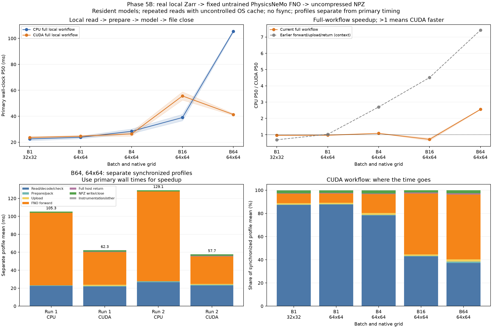

# 5B：從本機 Zarr 到模型輸出檔的完整流程

本次將已驗證的小型、固定隨機權重 FNO 接成完整資料流程。模型未訓練；只研究效能與數值一致性，預報品質不在範疇。Earth2Studio 與 JAX 都沒有新增安裝。

## 完成的流程與計時邊界

`本機 Zarr 開啟／讀取／解碼／來源座標檢查 → 溫度縮放與 FP32 打包 → 上傳（GPU）→ FNO → 完整結果取回 → 無壓縮 NPZ 寫入與關閉`

CPU/GPU 使用相同權重、輸入、前處理與輸出 schema。模型常駐，每次重新開啟與讀取 Zarr，不重用前一次打包輸入。計時包含建立輸出檔及關閉，但不要求 fsync／實體儲存裝置持久化。輸出為 dimensionless `model_output`，保存完整緯經度、起報時間、時效、成員、valid time 與來源／權重識別。

寫完後，每次都讀回檔案，逐一核對數值、dtype、座標、frame 身分與 metadata，並比較 CPU FP64 參考。讀回、數值驗證、hash、刪除暫存檔與 benchmark CSV/JSON 寫入另計。模型載入／CUDA 初始化也另列 setup，這是模型已常駐的重複處理情境。

CPU 使用 6 threads／interop 1；GPU 為 RTX 3050 8 GiB。沿用 Python 3.12.16／PhysicsNeMo 2.2.2／Torch 2.14.1+cu126 的隔離環境，TF32 關閉。框架／權重／縮放與 5A 相同。

## 兩輪正式結果

每條路徑暖機 3 次、正式量測 30 次，另外量測 8 次分段 profile。兩輪使用不同方法順序種子，保留全部樣本。

| 輸入 | CPU 完整流程 P50 | GPU 完整流程 P50 | 同輪 CPU/GPU 比值 |
|---|---:|---:|---:|
| B1，32×32 | 21.10–23.93 ms | 22.62–24.59 ms | 0.93–0.97× |
| B1，64×64 | 22.67–24.79 ms | 24.20–25.08 ms | 0.94–0.99× |
| B4，64×64 | 26.60–30.21 ms | 24.65–28.12 ms | 1.07–1.08× |
| B16，64×64 | 36.50–41.48 ms | 52.45–58.81 ms | 0.62–0.79× |
| B64，64×64 | 104.54–106.39 ms | 40.55–42.12 ms | 2.53–2.58× |

**B64 的完整流程約快 2.5 倍，低於先前只量模型／傳輸的約 7.4 倍。** 兩者的計時範圍不同，舊曲線只當背景參考。小 batch 的模型運算成本相對低，整體時間容易被其他工作主導；不能推論任何 batch 都能受益。

[完整 P50/P95、原始資料與分段表](../results/rtx3050_physics_pipeline_comparison/analysis.md)



四個 panel 的解讀：

1. 左上：直接量測的完整流程 P50；陰影是兩輪中位數範圍，不是信賴區間。
2. 右上：同輪 CPU/GPU 完整流程比值，大於 1 才較快；灰色舊曲線是先前 forward／上傳／回傳的另一場實驗。
3. 左下：B64 的獨立分段 profile 平均值堆疊；總和含量測框架的剩餘時間，屬於 profile 實驗。
4. 右下：同步 profile 中各段的時間比例。它不能當作主計時每一筆延遲的精確分解。

## B16 為什麼不能只看單一結論

主測兩輪的 B16 GPU 完整流程都較慢。其同步 profile 中，GPU forward 平均約 26–33 ms，明顯高於 5A 的暖機 forward 基線；讀取／解碼／來源檢查約 23–26 ms，因此差異不能完全解釋成「只是多算了讀檔」。

另外以新程序、只選 B16、另一個順序種子做對照：CPU P50 **40.559 ms**、GPU **27.259 ms**，比值 **1.49×**。這組同樣寫檔、讀回、核對 FP64，並保留全部樣本；不是替換前兩輪或排除較慢資料。[B16 單獨執行對照](../results/rtx3050_physics_pipeline_b16_report/analysis.md)

這顯示 batch 尺寸不足以單獨預測完整流程的延遲。執行歷史、driver 排程、電源狀態與系統活動等因素尚未逐一控制；單獨執行對照同時改變了程序／案例組合、時間與順序種子，不能據此歸因為某一項因素。

分段 profile 有額外 GPU 同步，且在主計時後另外執行。B64 GPU profile 平均約 58–62 ms，而主計時 P50 約 41–42 ms；不能拿分段平均加總來宣稱主流程耗時，也不能把差距全部歸因於同步。後續診斷要配對控制量測條件。

## 讀取量、快取與寫檔的限制

- 先量已下載的本機 Zarr，遠端下載未納入。來源 hash、參考輸入準備與驗證讀回可能已暖快取；沒有清空 OS 快取，不能稱為冷磁碟量測。`first_observed.csv` 也是已初始化程序中的首次觀察。
- 沿用 5A 的矩形選取：B64 先載入 2 個時效 × 51 成員＝102 張，再取前 64 張。選取陣列約 1.59 MiB，模型打包輸入 1 MiB；觸及的本機 forecast chunk 名目未壓縮量約 3.19 MiB。這些不是實測實體磁碟流量。
- 小 case 也可能碰到涵蓋更多時效與成員的 chunk，因此模型輸入縮小，不保證讀取成本同比縮小。
- NPZ 刻意不壓縮，CPU/GPU 寫入位元組數相同；壓縮輸出、Zarr 輸出、同步落盤和網路輸出都是另外的工作負載。
- 模型常駐、循序執行；未做 prefetch、非同步傳輸或計算／I/O 重疊。
- 記憶體另做一次暖機後完整呼叫的 PyTorch allocator 觀察，不等於總 VRAM，也不是 CPU RAM/RSS 測試。

## 正確性與重現

兩輪主測共 **600 筆完整流程、160 筆分段 profile**；B16 對照另有 60／16 筆。所有正式、首次、暖機、profile 與記憶體探測的輸出都寫入及讀回核對。每輪另以相同權重重算 FP64 參考；事先固定 `rtol=1e-4, atol=1e-5`。

每個 case/backend 保存最後一筆正式輸出；其他試次讀回驗證後才在計時外刪除。樣本紀錄保存檔案／完整 payload hash、檔案大小及數值差異。CPU 分析器會重建來源身分，檢查保存輸出、參考與所有 trial hash，並重算中位數、P95、順序及分段加總。GPU 實際計算在本機驗收，CI 以 CPU 重新檢查保存證據。

```bash
cd ~/weather-gpu-benchmark-github
source .venv/physicsnemo/bin/activate
python physicsnemo_pipeline.py --output results/my_physics_pipeline01
python physicsnemo_pipeline.py --order-seed 20261103 --output results/my_physics_pipeline02
python scripts/analyze_physicsnemo_pipeline.py results/my_physics_pipeline01 results/my_physics_pipeline02 --output results/my_physics_pipeline_comparison
```

請使用新的輸出路徑。重畫既有結果只需 CPU 分析依賴，不需要再次安裝 GPU 框架。

## 接下來的優化方向

先用固定 B16／B64 與配對順序，區分「連續模型呼叫」和「每次插入讀取／寫檔」對 GPU 延遲的影響，再檢查相應 CUDA trace；在原因尚未控制前，不選擇性只報最快 case。

讀取端可比較開檔重用、精確 frame 選取與減少重複解碼，完整記錄哪些成本被快取；之後再按瓶頸評估批次或傳輸重疊。上述工作仍屬於 5B。5C Earth2Studio 的模型／輸入相容性接通尚未實作，預報表現持續排除。
