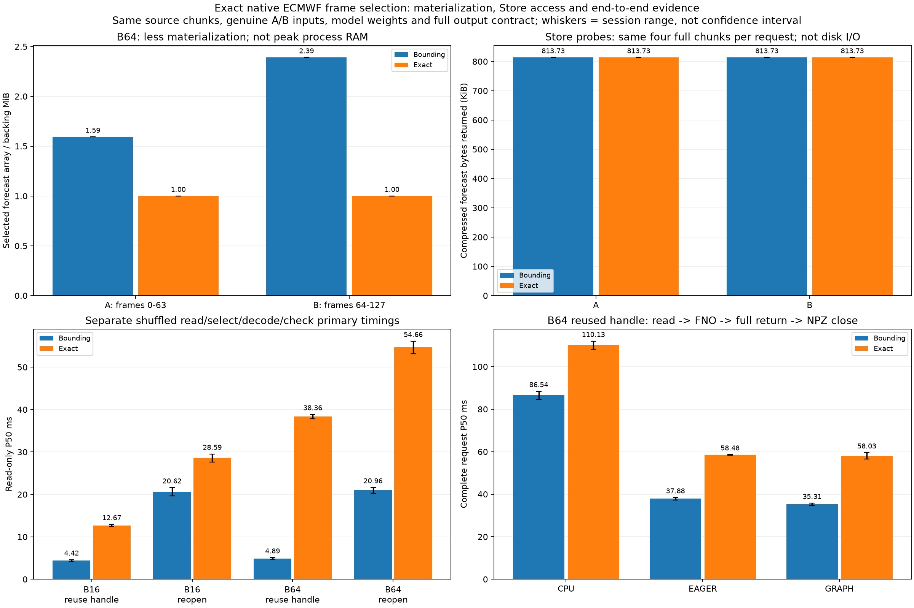

# 精確 frame 選取：陣列變小，這次卻更慢

這次實作 `exact_once`／`exact_reopen` 兩個 reader，直接選取需要的真實 ECMWF frames，並保留原本 bounding reader 作同輪對照。**結果沒有加速，因此原本預設維持不變。** 精確索引減少了取出的 forecast 陣列大小，但這份 Zarr 的 chunk 配置使兩者仍讀取相同的壓縮 chunks；精確選取路徑的整體成本反而更高。

## 改了什麼

[`physicsnemo_reader.py`](../physicsnemo_reader.py) 把 flattened frame 編號轉回 `(init_time, lead_time, ensemble_member)` 的位置，以共用 `frame` 維度的 xarray vectorized `isel` 選取。這是逐 frame 配對索引，不是三個索引陣列的笛卡兒積。來源格點、單位、起報／時效／成員／valid time、FP32 scaling 與模型權重都沿用既有協定。

| Reader | 生命週期 | 選取方式 |
|---|---|---|
| `open_once` | 重用已開 handle | 原本矩形 bounding selection，再取需要的 frames |
| `reopen` | 每次重新開啟 | 原本矩形 bounding selection，再取需要的 frames |
| `exact_once` | 重用已開 handle | 直接配對索引需要的 frames |
| `exact_reopen` | 每次重新開啟 | 直接配對索引需要的 frames |

預設仍是 `open_once`／`reopen`，必須明確指定才使用 exact。所有請求仍真正重新讀取／解碼／檢查／packing，沒有 prepared-input 或模型輸出快取。A 是前 B 張，B 是接著 B 張，同一 repeat 的方法使用同一 variant；每輪方法／case 順序混排。

## 為什麼讀比較少的 frames，chunks 卻沒變

| Case | Variant | 原本 materialized frames | Exact frames | 原本 forecast backing | Exact backing |
|---|---|---:|---:|---:|---:|
| B16 | A | 16 | 16 | 0.250 MiB | 0.250 MiB |
| B16 | B | 32 | 16 | 0.500 MiB | 0.250 MiB |
| B64 | A | 102 | 64 | 1.594 MiB | 1.000 MiB |
| B64 | B | 153 | 64 | 2.391 MiB | 1.000 MiB |

這些是選取後 forecast 陣列及其 NumPy backing 的大小，**不是整個程序 peak RAM**，也沒有涵蓋 decoder／索引的暫存陣列。原本回傳的 64-frame view 仍持有 102／153 張場的底層陣列；exact 回傳的底層陣列則只有 64 張。

本機 forecast 的 chunk shape 是 `[1, 4, 51, 32, 32]`：一個 chunk 同時涵蓋 4 個時效和全部 51 個成員。這次 A/B 都落在同一組時效 chunks，64×64 空間又必須覆蓋 4 個 32×32 chunks。因此，所有 B16/B64、A/B 與 bounding/exact 都需要同樣的 **4 個 forecast chunks**。

另做 Store 讀取探測，實際記錄每個 key 與回傳 bytes，確認每次 forecast 共取回 **833,260 bytes 壓縮資料**，名義解壓後 chunks 共 **3,342,336 bytes**。探測使用獨立的新 handle，連座標／metadata 的 key 紀錄也保留，但不納入主要計時。這是 Store API 回傳量，不能解讀成實體磁碟流量、網路流量或 decoder 呼叫次數；OS cache 未清除。

## 兩輪速度結果

獨立 read-only 實驗每 case／reader 各 40 次，兩輪共 640 筆。計時包含選取、讀取、解碼、來源檢查；reopen 另包含開啟／關閉 dataset。Packing、輸入 hash／身分／座標核對與 Store 探測在計時外。以下是兩輪 P50 範圍。

| 輸入 | Handle | 原版讀取 P50 | Exact 讀取 P50 |
|---|---|---:|---:|
| B16 | 重用 | 4.22–4.62 ms | 12.40–12.95 ms |
| B16 | 重開 | 19.63–21.61 ms | 27.64–29.54 ms |
| B64 | 重用 | 4.66–5.11 ms | 37.87–38.86 ms |
| B64 | 重開 | 20.27–21.64 ms | 53.17–56.15 ms |

完整流程另做兩輪，每 case／engine／reader 各 30 次，共 **1,440 次正式輸出檔**，每次皆為「新資料讀取 → packing → CPU／GPU FNO → 完整回傳 → NPZ 寫入與 close」。下面只列重用 handle 的同輪比較，其餘方法、P95、最大值與配對表都在完整報告。

| 輸入 | 引擎 | 原版完整流程 P50 | Exact 完整流程 P50 |
|---|---|---:|---:|
| B16 | CPU | 19.03–19.56 ms | 24.85–25.08 ms |
| B16 | GPU eager | 14.54–14.96 ms | 20.39–21.56 ms |
| B16 | GPU graph | 14.03–14.63 ms | 20.50–20.58 ms |
| B64 | CPU | 84.63–88.44 ms | 108.22–112.04 ms |
| B64 | GPU eager | 37.30–38.45 ms | 58.33–58.63 ms |
| B64 | GPU graph | 34.78–35.84 ms | 56.51–59.56 ms |

Exact 在兩輪的各條方法 P50 都較慢。較小的 forecast 結果陣列沒有換成較少的 chunks，加上不同選取路徑的成本，這個實作不適合當目前的速度優化。單靠這些結果不能把額外時間精確歸因到某一個 xarray／Zarr／NumPy 子步驟，也不能推論所有精確選取策略都會較慢。

所有尾端結果保留；例如第二輪 CPU B64 exact_reopen 最大值 588.467 ms，原版為 403.056 ms。配對比值／勝出次數只是這兩次執行的描述，不是顯著性檢定或延遲保證。獨立 read-only 與完整模型流程的節奏／系統狀態不同，不能把其中位數直接相加或相減當精確分解。

## 圖的四個 panel



1. **左上：forecast 陣列大小。** B64 A／B 的 backing 由約 1.59／2.39 MiB 降到 1 MiB，確實減少了這個陣列，不代表總 RAM 同比例下降。
2. **右上：Store 取回的 forecast 壓縮資料。** 兩個 reader 都約 813.73 KiB、4 個 chunks，解釋了為何 frame 數減少未必能省下實際 chunk 工作。
3. **左下：獨立讀取耗時。** Exact 在 B16／B64、重用／重開 handle 都更慢，且 B64 差距明顯。這是沒有模型運算的主要計時。
4. **右下：B64 重用 handle 的完整流程。** CPU／eager／graph 都因 exact 路徑變慢；GPU 無法消除讀取端增加的成本。

速度柱高是兩輪 P50 的中位數，誤差線為兩輪範圍，不是信賴區間。上方陣列／Store 數字由來源與獨立探測核對，並非速度樣本的分解。

## 驗證與使用

新增跨成員、時效與起報時間邊界的 A/B/A 選取測試，也檢查來源座標、拒絕越界、materialized bytes 及真實 Store gets。GPU 隔離環境 65 項測試全過；原本 Python 3.10／Zarr 2 環境跳過 1 項選用套件測試，其餘通過；Windows CPU 環境跳過 10 項，其餘通過。Store 診斷同時支援 Zarr 3 LocalStore 與舊環境的 Zarr 2 DirectoryStore，沒有升級原本環境。

每個正式／暖機／profile／記憶體／trace 輸出檔皆讀回，核對完整數值、dtype、經緯度、起報／lead／member／valid time 和 metadata。兩輪各保留 48 個正式檔，涵蓋全部 case／method 的 A/B。輸出逐元素通過 CPU FP64 容許度 `rtol=1e-4, atol=1e-5`，共用參考另從保存的精確權重獨立重算。

另外保存 288 次獨立同步分段 profile、96 次完整 CPU/CUDA trace 及 32 次 GPU allocator probes。Trace 確認 GPU 方法都有完整 HtoD／DtoH、graph 有真正 replay，CPU 沒有 CUDA 工作。這些證據用 CPU 分析器核對；CI 不宣稱重新執行 GPU。舊的兩-reader 保存結果也仍能通過分析器。

```bash
cd ~/weather-gpu-benchmark-github
source .venv/physicsnemo/bin/activate

# 完整流程兩輪；請分開執行，使用新路徑
python physicsnemo_graph_pipeline.py --readers open_once exact_once reopen exact_reopen --seed 20261113 --output results/my_reader_pipeline01
python physicsnemo_graph_pipeline.py --readers open_once exact_once reopen exact_reopen --seed 20261114 --output results/my_reader_pipeline02

# 獨立 read-only 兩輪
python physicsnemo_reader_benchmark.py --seed 20261113 --output results/my_reader01
python physicsnemo_reader_benchmark.py --seed 20261114 --output results/my_reader02

python scripts/analyze_physicsnemo_reader.py results/my_reader_pipeline01 results/my_reader_pipeline02 --reader-runs results/my_reader01 results/my_reader02 --recompute-reference --output results/my_reader_report

# 只使用 exact reader 與 graph
python physicsnemo_graph_pipeline.py --engines graph --readers exact_once --output results/my_exact_graph
```

省略 `--recompute-reference`，即可用 CPU 資料／繪圖依賴重新驗證保存證據與產圖。模型執行及重算參考才需要隔離 PhysicsNeMo 環境。計時到檔案 close，不要求 fsync；來源準備、驗證與 Store 探測會暖化 cache。本次沒有換 chunk layout、遠端下載、訓練或預報品質評估。

## 下一個實作方向

後續已完成[連續 slice＋NumPy gather 與 Nsight 診斷](physicsnemo_gather_nsight_zh.md)：gather 避開 exact 的大幅變慢，但與原版沒有穩定整體優勢，且需額外複製，維持原版預設，本輪 reader 實驗收尾。[英文案例](performance_case_study.md) 已整理實驗方法與取捨。Chunk 分組及獨立副本重分塊未實作，之後依具體需求再評估。

[完整數據、配對表與驗證邊界](../results/rtx3050_physics_reader_comparison/analysis.md)
