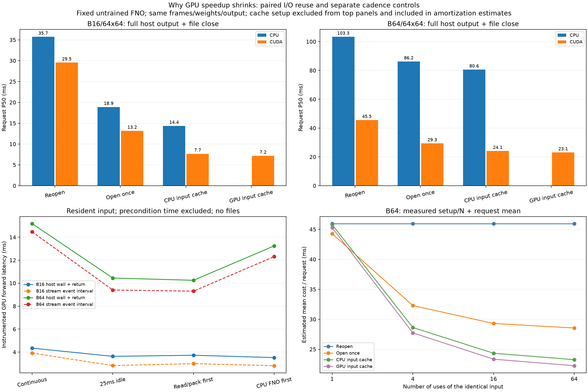

# 為什麼 GPU 加速被稀釋，以及這次改善了什麼

這一輪沿用相同的未訓練小型 FNO、FP32 權重與真實 ECMWF 輸入，專門測試資料重用與呼叫節奏。沒有進行預報品質評估、訓練、JAX 或 Earth2Studio 安裝，也沒有調整 driver／電源設定。

## GPU 加入後，為什麼整體沒有快 7–8 倍

最早約 7–8 倍是特定條件下的模型 forward 比較。完整工作還包含 CPU 處理的開檔、metadata／座標檢查、解碼、資料打包與寫檔；這些不會因為把模型移到 GPU 就一起變快。

用簡化式表示：`CPU 總時間 = 共同成本 + CPU 模型時間`，`GPU 總時間 = 共同成本 + GPU 模型時間 + 傳輸／同步成本`。共同成本越大，模型單獨加速的倍數越容易被稀釋。即使模型時間趨近零，其他成本仍然存在。

此外，本模型只有 132,353 個參數、單一變數與 64×64 格點；不同執行節奏下，排程／同步等成本可能佔很大比例。目前沒有證據顯示已用滿 RTX 3050 的算力，也不能用 VRAM 沒滿來判定加速是否有效。CPU 也使用 6 threads，並非單執行緒比較。模型精度、大小與算子組合不同，效益不能直接類推。

## 新增的兩組實驗

**工作流程重用**：每個 repeat 都把 B16、B64 與所有 CPU／GPU 模式打散排列，30 次量測、3 次暖機，兩輪用不同種子。所有模式都有模型 forward、完整回傳與相同無壓縮 NPZ 寫入／關閉；每次檔案都讀回核對。

| 模式 | 每次仍會做 | 另計的準備成本 |
|---|---|---|
| reopen | 開檔、讀取／檢查、打包、模型、回傳、寫檔 | 共用模型啟動 |
| open_once | 重用已開啟資料集；仍選取、載入、檢查、打包與處理 | 開啟資料集 |
| host_cache | 重用 CPU FP32 輸入與 metadata；GPU 仍每次上傳 | 讀檔、打包與建立 CPU 輸入 |
| device_cache | 再重用 GPU 輸入，仍完整回傳與寫檔 | CPU 輸入準備＋一次 GPU 上傳 |

**GPU 呼叫節奏**：固定 GPU 輸入，不寫檔，比較連續呼叫、等待 25 ms、先讀檔／打包／檢查、先跑 CPU FNO 等四種前置工作。每輪 6 個 block，每個條件／case 每 block 連續量 8 次；block 的案例與條件順序隨機排列。另記錄 CUDA event interval 與主機端完整回傳時間，驗證延後到每個 block 結束。

## 兩輪實測改善

下表為兩輪各自 P50 的範圍；不是信賴區間。建立快取的時間未包含在這些請求延遲內。

| 輸入／模式 | CPU 請求時間 | GPU 請求時間 |
|---|---:|---:|
| B16，每次重開 | 34.90–36.55 ms | 29.04–30.06 ms |
| B16，重用已開資料集 | 18.89 ms | 13.07–13.27 ms |
| B16，CPU 輸入快取 | 14.21–14.50 ms | 7.44–7.89 ms |
| B16，GPU 輸入快取 | — | 7.14–7.20 ms |
| B64，每次重開 | 103.13–103.53 ms | 44.06–47.02 ms |
| B64，重用已開資料集 | 85.73–86.59 ms | 28.89–29.78 ms |
| B64，CPU 輸入快取 | 80.33–80.78 ms | 23.14–25.01 ms |
| B64，GPU 輸入快取 | — | 23.04–23.09 ms |

重用已開啟資料集，B64 GPU 從約 44–47 ms 降到約 29–30 ms。按同一 repeat 配對，節省時間的中位數為 **15.8–17.8 ms**；CPU 也節省約 **17.1–17.8 ms**。這是減少資料處理成本，兩種裝置都會受益。

CPU 輸入快取進一步減少讀取與打包時間；再換成 GPU 輸入快取的差距較小。因此，這個 1 MiB 的 B64 輸入案例，優先改善開檔／資料準備，比只想省掉上傳更有幫助。這不代表大型多變數資料的 H2D 也不重要。

**輸入快取只適用同一批資料被重複使用。** 如果換了起報、時效、成員、格點、縮放或來源內容，必須重新建立。不能把 23 ms 稱為任意新資料從讀檔到輸出的速度。open_once 則可以重新選取其他資料；測試涵蓋同一 handle 交替讀取不同 case，確認不會誤用舊輸入。

## 呼叫節奏能解釋先前 B16 異常嗎

兩輪 B16 在四個條件下，GPU forward＋完整回傳的每輪樣本中位數約 **3.4–4.8 ms**。沒有穩定重現「插入讀檔就讓 forward 升到約 26–33 ms」的現象。B64 同類時間約 **10.1–16.1 ms**，仍有跨輪變動；各條件間的方向也不完全一致。

因此，本輪資料不支持「CPU 讀檔／短暫等待一定造成 GPU 變慢」這個單一解釋。先前完整流程的反例仍保留；這次請求混合了不同形狀／模式，cadence 則在 block 內固定形狀，系統狀態和量測時間也不同。尚未逐一隔離形狀切換、driver 排程與時脈／電源狀態，不能直接歸因。

CUDA event interval 也可能包含 host dispatch 間隙及裝置排程等待，不能當作所有 kernel 的純執行時間，更不能據此推算 occupancy。圖中的 cadence 曲線使用 block 中位數的中位數；同一 block 的 8 次觀察不是獨立實驗樣本。完整報告另外列出每輪樣本中位數。



## 準備成本與限制

所有 cache／資料集 handle 的建立時間都已記錄。第一次開啟來源還可能包含 xarray/backend 初始化；本輪 B16 的首次 open_once 建立約 285–338 ms，不能當成後續每次開檔的成本，也不能與已暖機後建立的其他 cache 當作完全同條件的冷啟動比較。模型與來源查核／參考準備也會影響快取。

右下圖只對 B64，使用 `一次準備成本/N + 實測請求平均時間` 估計同一輸入使用 N 次的平均成本。它不是另外量測的 N 次完整應用，也不代表冷程序第一次請求的速度。作業系統／套件快取沒有清空；所有案例與模式的 cache 同時存在於量測程序，額外佔用記憶體。輸入 GPU cache 合計約 1.25 MiB，不代表整個模型的總 VRAM。

兩輪共 **840 筆配對流程輸出**與 **768 筆 cadence 輸出**，皆通過相同 CPU FP64 參考、固定 `rtol=1e-4, atol=1e-5` 的數值核對。CPU/GPU 輸出檔保留實際陣列、座標、frame 身分與來源／權重識別。CPU 分析器能檢查保存檔、所有 trial hash、配對／block 順序、統計值與數值誤差；GPU event 時間是當時記錄的量測，CI 不會宣稱重新跑過 GPU。

## 重跑與下一步

```bash
cd ~/weather-gpu-benchmark-github
source .venv/physicsnemo/bin/activate
python physicsnemo_reuse.py --output results/my_physics_reuse01
python physicsnemo_reuse.py --seed 20261106 --output results/my_physics_reuse02
python scripts/analyze_physicsnemo_reuse.py results/my_physics_reuse01 results/my_physics_reuse02 --output results/my_physics_reuse_comparison
```

使用新輸出路徑。只重驗證保存結果與畫圖不需要 Torch／PhysicsNeMo。[完整原始表、配對差異與方法](../results/rtx3050_physics_reuse_comparison/analysis.md)。

目前最有證據支持的改善是重用資料集 handle，並在同一批輸入會被多次使用時重用打包結果。下一步可固定 GPU 輸入、只改變「相同 shape 連續處理／不同 shape 交錯處理」，配合 CUDA trace，釐清剩餘模型延遲；在此之前不把變動說成已查明的硬體問題。Earth2Studio 仍是後續 5C，預報表現持續排除。
