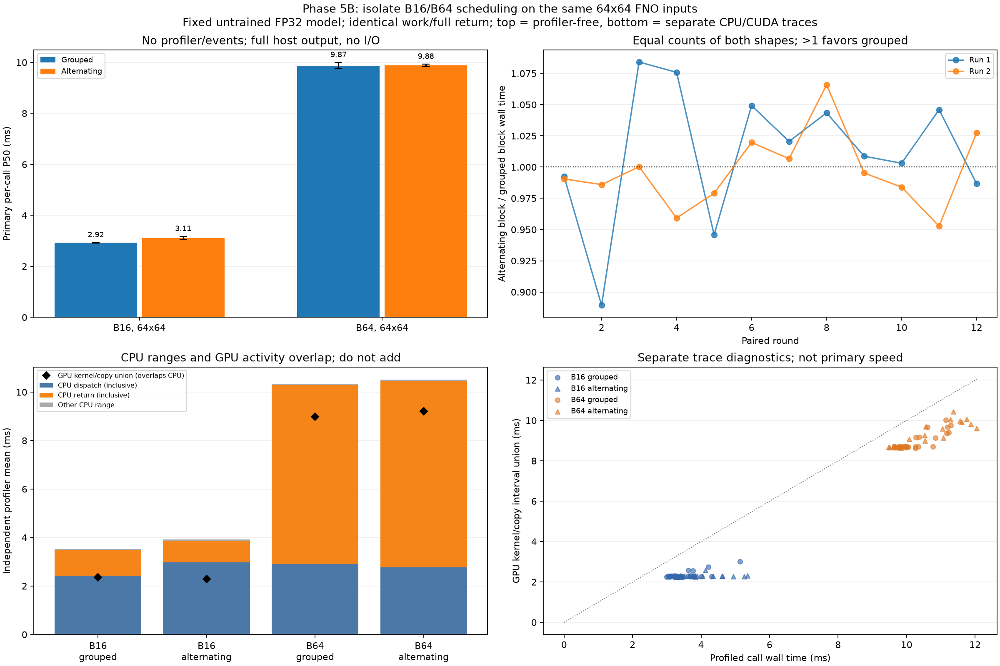

# 5B：固定輸入，只比較分組與交錯 batch

本輪已完成先前提出的 shape 排程對照與真實 CUDA trace。沿用相同未訓練小型 FNO、權重、ECMWF 輸入與 FP32 精度；只研究效能及運算一致性，沒有新增預報品質評估、訓練、JAX 或 Earth2Studio。

## 實驗如何控制

兩種輸入都是 64×64，只改變 batch 維度 B16／B64。模型與輸入已常駐 GPU，每次實際執行 forward 並完整回傳主記憶體；讀檔、前處理、上傳與寫檔都排除。

每一組配對使用相同起始 batch、相同數量的兩種輸入：

```text
分組：16,16,16,16,16,16,16,16,64,64,64,64,64,64,64,64
交錯：16,64,16,64,16,64,16,64,16,64,16,64,16,64,16,64
```

也會從 B64 開始。每輪 12 組配對，起始 batch × 先跑哪種排程的四種組合各出現 3 次；每個 block 前都執行相同交錯暖機並以 B64 結束。實際轉換標籤包含暖機末尾到第一個請求的轉換。

主計時不開 profiler、record_function 或 CUDA event；整個 block 結束才驗證輸出與計算 hash。另有較短、後續獨立執行的 CPU/CUDA profiler 診斷，不能拿它的耗時代替主測。

## 兩輪結果：沒有穩定的整批加速

| 輸入 | 分組 P50 | 交錯 P50 |
|---|---:|---:|
| B16，64×64 | 2.91–2.93 ms | 3.04–3.17 ms |
| B64，64×64 | 9.75–9.99 ms | 9.84–9.93 ms |

單看 B16 中位數，分組略快；但 B64 沒有一致方向。把相同工作量整批直接計時，配對的「交錯時間／分組時間」中位數為：

| 測試 | 配對比值 | 分組較快的配對數 |
|---|---:|---:|
| 第一輪 | 1.015×，分組約快 1.5% | 8／12 |
| 第二輪 | 0.993×，分組約慢 0.7% | 5／12 |

因此，這組資料沒有顯示可穩定重現的整批分組收益，不能用它解釋先前 B16 完整流程中數倍的延遲變化。這不是顯著性檢定，也不能排除其他負載或環境下有不同結果。所有較慢樣本、最大值與反向配對均保留。



圖的解讀：

1. 左上：未插樁的單次 P50；柱是兩輪中位數的中位數，誤差線是兩輪中位數範圍，不是信賴區間。
2. 右上：每個相同工作量配對的整批比值；大於 1 分組快，小於 1 交錯快，可看出方向會反轉。
3. 左下：獨立 profiler 的 CPU 派送／取回範圍；黑點是同時段 GPU kernel/copy 的聯集時間。兩者重疊，不能加總。
4. 右下：各 profiled call 的 wall time 與 GPU 活動聯集；離對角線的差距不等於某一個硬體故障或 occupancy。

## Trace 具體確認了什麼

96 個正式 trace call 都捕捉到實際 CUDA kernels，每次 forward 為 **99 個 kernel events**，且只有一次完整 DtoH：B16 262,144 bytes、B64 1,048,576 bytes。這些呼叫沒有觀察到 HtoD，符合輸入已常駐裝置的邊界。

兩輪合併後，B64 的 profiler 平均值約為：

| 觀察範圍 | 時間 |
|---|---:|
| 整次 CPU 觀察到的 wall time | 10.34–10.51 ms |
| CPU 派送範圍 | 2.77–2.92 ms |
| CPU 取回範圍 | 7.37–7.69 ms |
| GPU kernel 區間聯集 | 8.36–8.60 ms |
| GPU copy 區間聯集 | 0.61–0.63 ms |

**取回範圍約 7 ms，不代表資料搬移花了 7 ms。** 取回還會等候先前送出的 GPU 工作完成；實際 copy 活動約 0.6 ms。CPU 派送期間 GPU 也可能正在計算，因此上表各欄不能相加來分解總時間。

`runtime_wait_ms` 只統計名稱含 `Synchronize` 的 CUDA runtime API；其他 API（例如 pageable host copy）也可能等待，不能把這欄當成全部等待時間。99 個 kernel events 證明有許多裝置工作，但單靠事件數無法判定算力利用率或確認派送就是主要瓶頸。

這次沒有觀察到 batch 交錯必然造成大幅變慢。先前完整流程還有開檔、CPU 工作、輸入建立、記憶體分配與寫檔等條件；系統／driver／電源狀態也未完全控制。這個較窄的實驗不能把所有舊反例都歸因或排除。

## 已保存的證據與重跑

兩輪共 **768 次未插樁主測、48 個等工作量 block、96 次正式 CPU/CUDA trace 呼叫**，輸出全部通過相同 CPU FP64 參考。每輪另以同一組 FP32 權重／輸入升成 FP64 重新計算參考；容許誤差固定 `rtol=1e-4, atol=1e-5`。

保存實際完整 FP32 輸出、權重、輸入／來源識別、主測原始樣本、block 加總、trace-call 表及壓縮 Chrome trace。CPU 分析器會重新解壓並計算 trace 區間、copy 數量與 bytes，核對隨機計畫、轉換標籤、配對、數值差異及所有雜湊。CI 核對的是保存證據，不宣稱重新執行 GPU。

```bash
cd ~/weather-gpu-benchmark-github
source .venv/physicsnemo/bin/activate
python physicsnemo_schedule.py --output results/my_physics_schedule01
python physicsnemo_schedule.py --seed 20261108 --output results/my_physics_schedule02
python scripts/analyze_physicsnemo_schedule.py results/my_physics_schedule01 results/my_physics_schedule02 --output results/my_physics_schedule_comparison
```

使用新路徑。[完整原始表與方法](../results/rtx3050_physics_schedule_comparison/analysis.md)。各 run 的 `trace.json.gz` 可解壓後交給相容 Chrome trace viewer 檢視；分析器不需 Torch／PhysicsNeMo。

## 接下來的選擇

目前不把「分組處理」改成預設效能優化；前一輪已量到的資料集 handle／條件式輸入重用仍更值得採用。

下一個可控制的實作是固定 shape 的 CUDA Graph 重播，測試能否減少重複派送成本；必須先確認 FFT／模型算子能捕捉，保留普通 eager 路徑，檢查新輸入更新及 FP64 一致性，再比較時間、建立成本與額外記憶體。如果未通過或沒有實測收益，就如實記錄，不能拿啟動時間或漏掉完整回傳換取漂亮數字。這仍屬效能工程，不擴大到預報表現。
