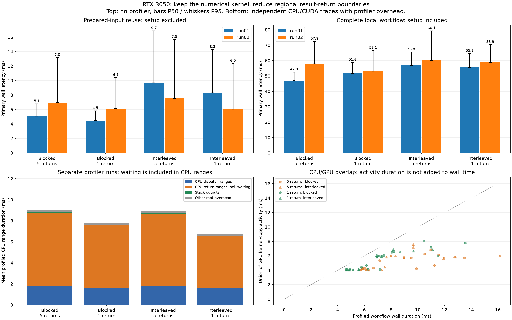

# Dispatch, GPU activity and regional result-return diagnosis

The same genuine ECMWF 51-member batch and matched GFS analysis are verified over the full domain plus four quadrants. The numerical FP32 weighted kernel is unchanged. The alternative retains five regional metric tensors on GPU, stacks them, then returns the complete matrix once. Baseline returns each region as it finishes. Both return identical region/group outputs and logical result bytes.

## Primary latency samples (profiler disabled)

| Session | Schedule | Workload | 5 returns P50 ms | 1 return P50 ms | 5 returns P95 ms | 1 return P95 ms | Median ratio baseline/alternative |
|---|---|---|---:|---:|---:|---:|---:|
| rtx3050_dispatch_run01 | blocked | first | 47.006 | 51.649 | 52.483 | 58.788 | 0.910x |
| rtx3050_dispatch_run01 | blocked | reuse | 5.082 | 4.450 | 6.770 | 5.814 | 1.142x |
| rtx3050_dispatch_run01 | interleaved | first | 56.840 | 55.563 | 65.586 | 64.619 | 1.023x |
| rtx3050_dispatch_run01 | interleaved | reuse | 9.680 | 8.295 | 16.862 | 14.268 | 1.167x |
| rtx3050_dispatch_run02 | interleaved | first | 60.062 | 58.856 | 79.298 | 70.307 | 1.020x |
| rtx3050_dispatch_run02 | interleaved | reuse | 7.534 | 6.040 | 15.670 | 12.362 | 1.247x |
| rtx3050_dispatch_run02 | blocked | first | 57.936 | 53.092 | 72.434 | 66.573 | 1.091x |
| rtx3050_dispatch_run02 | blocked | reuse | 6.959 | 6.130 | 13.173 | 10.403 | 1.135x |

Observed maximum-latency regressions remain visible: rtx3050_dispatch_run02/interleaved: reuse maximum 18.445 -> 23.136 ms. Better median/P95 does not guarantee every invocation is faster. All maxima/P99 values are retained in each timing_summary.csv.

First-use includes warm local Zarr read, checks, unit normalization, shared input preparation and CUDA upload. Reuse excludes that input setup. Every timed invocation returns all five regions. A CPU first-use workload is included in the shuffled schedule to preserve host/device interleaving. It is a scheduling control, not the optimized CPU reuse baseline, so this experiment does not make a new GPU/CPU speedup claim.

## What the trace verifies

Each invocation returns 97,920 logical FP32 result bytes. Traces verify five DtoH copy events and five return ranges for baseline versus one of each for the alternative. The transfer payload is preserved; the count of return/wait boundaries is reduced. A stack operation is added on GPU. There is no precision reduction, missing-member removal or reuse of metric result values.

| Schedule / reuse method | Mean profiled wall ms | CPU dispatch ranges ms | CPU return ranges ms | GPU kernel union ms | GPU copy union ms | DtoH events/call |
|---|---:|---:|---:|---:|---:|---:|
| blocked / cuda_reuse_per_region | 9.0261 | 1.7654 | 6.9801 | 5.1928 | 0.0117 | 5.0000 |
| blocked / cuda_reuse_once | 7.7612 | 1.6266 | 5.9283 | 5.5996 | 0.0087 | 1.0000 |
| interleaved / cuda_reuse_per_region | 8.8955 | 1.7832 | 6.8574 | 5.2985 | 0.0112 | 5.0000 |
| interleaved / cuda_reuse_once | 6.7537 | 1.5978 | 4.9269 | 5.3065 | 0.0088 | 1.0000 |

CPU dispatch ranges include Python/ATen/driver work and any waiting during submission. CPU return ranges include waiting for preceding GPU work, transfer initiation and completion, and host return; they are not physical copy duration alone. Kernel/copy busy time comes from CUDA trace intervals. Union accounting avoids double-counting concurrent device events. CPU ranges and GPU activity overlap in time and cannot be summed as independent workflow components.

In these traces, physical result-copy activity is around hundredths of a millisecond, while inclusive CPU return ranges last several milliseconds. That evidence points to completion/wait/return boundaries as a useful optimization target rather than result payload bandwidth alone. It does not assign every slow sample to the same mechanism or exclude CPU/driver scheduling and device execution time.

Primary results determine speed. Profiler numbers are separate diagnostic observations with instrumentation/annotation overhead, altered scheduling and potentially different clocks. Trace paths are prewarmed before profiling; the short trace schedule does not repeat the primary per-block warmup protocol. A large wall-minus-device-active interval can include host work, dispatch gaps, waiting and instrumentation; it does not isolate Windows/WSL/driver or clock behavior as the single cause.

## Interpretation and practical limits

Reducing return boundaries is a small, testable change to existing PyTorch code. The tables retain regressions as well as improvements. Prepared-input and full-read workloads may respond differently because read/preparation/upload still dominate the latter. Gains in one schedule or median do not prove a general P95 guarantee; all samples, including slow ones, are retained. The alternative is evaluated explicitly rather than silently replacing historical default paths.

JAX work is deferred. No framework, compiler, driver, power policy or GPU-clock setting was changed. These measurements concern the verified local data workflow; GFS analysis remains model-dependent reference, and no forecast-model ranking follows.

## Validation and reproducibility

All warmups, primary calls and profiled outputs agree with unchanged dense-packing FP64 arithmetic at rtol=atol=1e-5. The analyzer reloads hashed data, verifies region coverage and output shape/bytes, reconciles all primary quantiles and seeded order, checks compressed trace hashes, reconstructs every trace-call summary, and verifies actual copy/annotation counts. Unit tests cover interval-union accounting and regional numeric parity, including member-specific missing values on supported devices. The full WSL CUDA suite has 43 passing tests.

```bash
source ~/venvs/weather-gpu/bin/activate
python weather_dispatch.py --output results/my_dispatch01
python weather_dispatch.py --output results/my_dispatch02 --schedules interleaved blocked --seed 20261109
python scripts/analyze_dispatch.py results/my_dispatch01 results/my_dispatch02 --output results/my_dispatch_comparison
```

The runner needs the existing CUDA-enabled PyTorch and CPU/CUDA profiler activities. The analyzer requires only existing CPU data/plot dependencies and can reconcile saved GPU traces offline. Compressed Chrome traces are included alongside each run; decompress and open in a compatible trace viewer to inspect individual CPU/runtime/kernel/copy events. [PyTorch 2.14 profiler documentation](https://docs.pytorch.org/docs/2.14/profiler.html).


