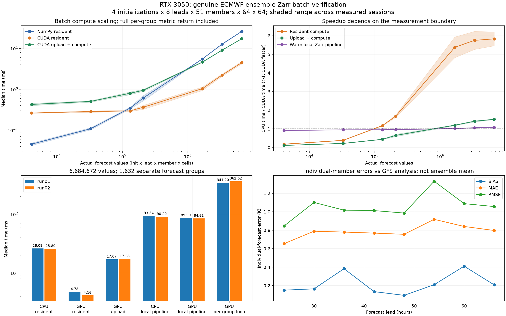

# Real ECMWF Zarr batch scaling on RTX 3050

Four genuine initializations (2024-05-06..09 00 UTC), leads 24/30/36/42/48/54/60/66 h, members 0..50, native 0.25-degree 64 x 64 grid (18.25..34 N, 116..131.75 E). Total 6,684,672 actual forecast values; no repeated/tiling-generated inputs. GFS f000 reference uses 20 unique matching valid-time cycles. Each init/lead/member is scored separately over space; this is not an ensemble-mean forecast experiment.

The data include land and ocean. GFS analysis is model-dependent, not independent observations. Members and overlapping valid times are correlated; the metric counts are not independent sample sizes. Provider unit conversion/bit rounding applies. Different domains, outputs and source processing prevent a direct timing/skill comparison with the earlier single-case report.

## Observed medians

| Session | Forecast values | Spatial groups | CPU resident ms | GPU resident ms | Resident speedup | GPU upload + compute ms | CPU local pipeline ms | GPU local pipeline ms |
|---|---:|---:|---:|---:|---:|---:|---:|---:|
| rtx3050_ecmwf_batch_run01 | 4,096 | 4 | 0.0487 | 0.2585 | 0.19x | 0.4535 | 6.4350 | 6.9710 |
| rtx3050_ecmwf_batch_run01 | 32,768 | 8 | 0.1152 | 0.2973 | 0.39x | 0.5259 | 8.5477 | 8.9713 |
| rtx3050_ecmwf_batch_run01 | 131,072 | 32 | 0.3654 | 0.3059 | 1.19x | 0.8616 | 15.4287 | 16.1829 |
| rtx3050_ecmwf_batch_run01 | 208,896 | 204 | 0.7040 | 0.4051 | 1.74x | 0.9948 | 9.7065 | 10.0116 |
| rtx3050_ecmwf_batch_run01 | 1,671,168 | 408 | 5.4847 | 1.1379 | 4.82x | 4.5103 | 27.2673 | 27.3207 |
| rtx3050_ecmwf_batch_run01 | 3,342,336 | 816 | 12.4582 | 2.3670 | 5.26x | 9.0852 | 48.4288 | 46.9407 |
| rtx3050_ecmwf_batch_run01 | 6,684,672 | 1632 | 26.0754 | 4.7774 | 5.46x | 17.0744 | 93.3404 | 85.9872 |
| rtx3050_ecmwf_batch_run02 | 4,096 | 4 | 0.0423 | 0.2660 | 0.16x | 0.3976 | 6.4028 | 7.1434 |
| rtx3050_ecmwf_batch_run02 | 32,768 | 8 | 0.1017 | 0.2732 | 0.37x | 0.4839 | 8.3151 | 8.8626 |
| rtx3050_ecmwf_batch_run02 | 131,072 | 32 | 0.3284 | 0.2850 | 1.15x | 0.7352 | 16.3525 | 17.2998 |
| rtx3050_ecmwf_batch_run02 | 208,896 | 204 | 0.5203 | 0.3222 | 1.61x | 0.8915 | 8.2531 | 8.7295 |
| rtx3050_ecmwf_batch_run02 | 1,671,168 | 408 | 5.5233 | 0.9306 | 5.93x | 4.7184 | 27.5281 | 26.6762 |
| rtx3050_ecmwf_batch_run02 | 3,342,336 | 816 | 12.9158 | 2.0716 | 6.23x | 8.9871 | 48.6597 | 44.9937 |
| rtx3050_ecmwf_batch_run02 | 6,684,672 | 1632 | 25.7971 | 4.1578 | 6.20x | 17.2776 | 90.2023 | 84.6056 |

## What changed GPU efficiency

- All forecast groups are represented in one batch tensor. Spatial reductions run across the last axis, retaining initialization/lead/member identity. The full group metric matrix returns to CPU in one transfer.
- Resident compute reuses packed inputs on device. Upload + compute copies existing packed host arrays each invocation; local pipeline additionally opens Zarr, reads/decodes, checks coordinates/units, normalizes Celsius to FP32 Kelvin, masks, builds weights and packs inputs.
- GPU acceleration depends on case shape as well as value count. This seven-case sample is not a universal crossover threshold; cases change dates, member count and spatial size together.
- Resident acceleration is substantial on the larger batches, while the warm local workflow gains are modest. Local pipeline timings exclude remote downloading. No claim of general Zarr versus NetCDF performance follows from these measurements.

- rtx3050_ecmwf_batch_run01, largest batch: resident 5.46x; upload + compute 1.53x; local pipeline 1.09x. Per-group CUDA launch/reduce/return loop 341.199 ms versus batched 4.777 ms (71.4x). Both reuse identical device inputs and return identical per-group metrics; the loop is a dispatch/return overhead diagnostic, not the CPU baseline.
- rtx3050_ecmwf_batch_run02, largest batch: resident 6.20x; upload + compute 1.49x; local pipeline 1.07x. Per-group CUDA launch/reduce/return loop 362.621 ms versus batched 4.158 ms (87.2x). Both reuse identical device inputs and return identical per-group metrics; the loop is a dispatch/return overhead diagnostic, not the CPU baseline.

## Numerical and timing validation

Every returned metric of every warmup/measured invocation is checked against FP64 arithmetic on the same FP32 packed temperatures/weights (rtol=atol=1e-5). The report independently reloads the hashed data, recomputes all group metrics and validates group labels, shared-valid weights/counts, summary quantiles, repeat IDs, case sizes and recorded seeded within-repeat method order. Metric checking and result-file writing occur outside timed intervals.

Each method uses five warmups and 20 measured repetitions in these sessions. Methods are shuffled within each repetition with recorded seeds; case order remains fixed. CPU/GPU compute includes returning all group metrics. CUDA context initialization, initial packing/upload for resident methods, hashing and remote acquisition are excluded. Warm local reads include OS/library caches; no cold-cache throughput claim. Shading shows the range of session medians, not a confidence interval. Memory entries in environment.json measure live PyTorch allocations and extra resident-method peak, not total process VRAM.

## Forecast-minus-analysis errors

| Lead h | Bias K | MAE K | RMSE K |
|---|---:|---:|---:|
| 24 | 0.151001 | 0.654161 | 0.845480 |
| 30 | 0.165131 | 0.789356 | 1.100612 |
| 36 | 0.383491 | 0.779835 | 1.017409 |
| 42 | 0.135228 | 0.768919 | 1.012707 |
| 48 | 0.094812 | 0.755696 | 0.985871 |
| 54 | 0.209959 | 0.917917 | 1.330436 |
| 60 | 0.410599 | 0.840878 | 1.087932 |
| 66 | 0.208351 | 0.797083 | 1.056248 |

These values pool weighted error moments over individual member forecasts and initializations. RMSE is computed from weighted mean square error, not the average of member RMSE values. No model ranking or general forecast-skill estimate is justified by this short case.

## Acquisition and reproduction

Source manifests pin immutable read-only Icechunk snapshots. Both temperature archives are distributed in Celsius and processed by dynamical.org: [ECMWF IFS ENS](https://dynamical.org/catalog/ecmwf-ifs-ens-forecast-15-day-0-25-degree/) and [NOAA GFS](https://dynamical.org/catalog/noaa-gfs-forecast/). CC BY 4.0 applies; ECMWF Terms of Use also apply to the ECMWF-derived forecast. [Data manifest](../../data/ecmwf_batch_case/manifest.json) records attribution, hashes, exact query and observed remote timings. Nominal uncompressed source-chunk sizes are estimates, not measured HTTP bytes.

```bash
python -m pip install -r requirements-zarr.txt
python weather_batch.py --output results/my_batch01 --group-loop
python weather_batch.py --output results/my_batch02 --group-loop --seed 20261102
python scripts/analyze_weather_batch.py results/my_batch01 results/my_batch02 --output results/my_batch_comparison
```

The checked-in local Zarr subset can be benchmarked offline on the existing WSL CUDA environment. Remote recreation uses Python >=3.12 and requirements-icechunk.txt: `python scripts/prepare_ecmwf_batch.py --output data/ecmwf_batch_recreated`. Use `--data data/ecmwf_batch_recreated/batch.zarr` to evaluate that store. Metadata/catalog updates may change the manifest even at a fixed data snapshot; the data store directory hash validates the selected bytes.


