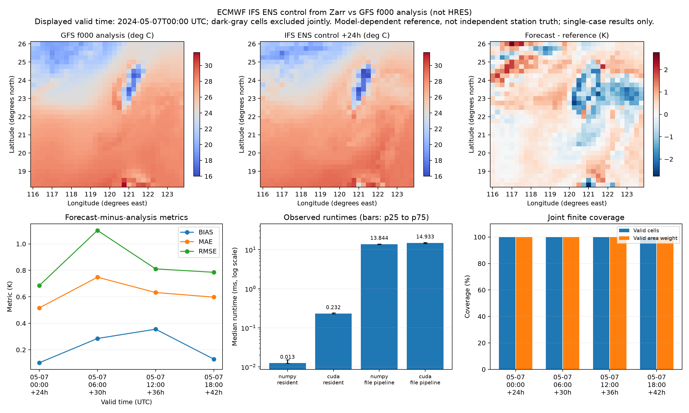

# Zarr weather pipeline: rtx3050_ecmwf_zarr_run01

Forecast role: **real ECMWF IFS ENS control member 0 via dynamical.org Zarr; not HRES, no manufactured perturbations**.

Reference role: real GFS f000 analysis/initialization field copied to Zarr; common reference, not independent station observations.

Real ECMWF IFS ENS control member 0 initialized 2024-05-06T00:00:00+00:00, leads [24, 30, 36, 42] hours, read from the public dynamical.org Icechunk/Zarr archive. This is ENS control, not IFS HRES, AIFS or an ensemble mean. The forecast remains in Celsius in the local Zarr; the matched GFS f000 analysis remains in Kelvin and both are normalized before verification. The provider rounds floating-point bits during reformatting. GFS analysis is model-dependent, not independent station truth; this single case does not rank ECMWF against GFS.

Coverage: 4096/4096 joint finite values (100.00%); 4 valid times, 32 x 32 grid. 2024-05-07T00:00:00.000000000 to 2024-05-07T18:00:00.000000000 UTC. Latitude 18.25..26, longitude 116..123.75 degrees.

Normalization: supported temperature units -> K -> FP32; coordinates sorted and longitude wrapped to [-180,180). Valid time and spatial coordinates must match exactly. No regridding, inner join or init-time/lead-time inference. Weighting: coslat. The denominator includes only joint finite cells. All-times metrics pool valid weighted cells over the sampled times; RMSE is not an average of the per-time RMSE values. It is not a continuous-day average.

Reference arithmetic uses FP64 on the same packed FP32 data and weights. All saved backend values and all timed metric values agree at rtol=atol=1e-5; 80 positive finite timing samples and all summaries reconcile. Input file/directory hashes match. No timing samples were removed.

## Pooled verification metrics

| Backend | Bias K | MAE K | RMSE K | Valid fraction | Area-weighted valid fraction |
|---|---:|---:|---:|---:|---:|
| reference_fp64 | 0.218128577 | 0.623759979 | 0.859978730 | 100.00% | 100.00% |
| numpy_fp32 | 0.218128562 | 0.623759925 | 0.859978676 | 100.00% | 100.00% |
| cuda_fp32 | 0.218128577 | 0.623759985 | 0.859978676 | 100.00% | 100.00% |

## Valid-time errors against matching GFS analysis

| Valid time UTC | Forecast lead h | Bias K | MAE K | RMSE K |
|---|---:|---:|---:|---:|
| 2024-05-07T00:00 | 24 | 0.102056 | 0.516516 | 0.685427 |
| 2024-05-07T06:00 | 30 | 0.285402 | 0.748240 | 1.101681 |
| 2024-05-07T12:00 | 36 | 0.355544 | 0.632512 | 0.811129 |
| 2024-05-07T18:00 | 42 | 0.129512 | 0.597771 | 0.785374 |

## Timing boundaries

5 warmups and 20 measured repetitions per method. Resident compute reuses packed joint-valid inputs and weights; CUDA includes scalar return. The local dataset pipeline reopens both NetCDF files or Zarr stores, decodes units/coordinates, checks alignment, builds the mask and weights, packs valid cells, allocates/uploads inputs for CUDA and returns metrics. OS/file caches are warm, not a cold-storage experiment. Context initialization, downloading and result-file output are excluded. The file-pipeline method is actually timed, not estimated by adding separately sampled components.

| Method | Median ms | p25 ms | p75 ms |
|---|---:|---:|---:|
| numpy_resident | 0.0125 | 0.0124 | 0.0152 |
| numpy_warm_file_pipeline | 13.8442 | 13.7038 | 14.1008 |
| cuda_resident | 0.2317 | 0.2275 | 0.2419 |
| cuda_warm_file_pipeline | 14.9328 | 14.4745 | 15.3440 |

## Interpretation and limits

- This deliberately small input is a correctness case, not a GPU scaling benchmark. Inspect the observed runtimes; do not extrapolate them to large domains or claim GPU acceleration if CUDA is slower.
- This case covers one forecast initialization and one valid date. Lead time and valid time change together; these four points cannot isolate a general lead-time dependence. The regional average includes both land and ocean. GFS analysis is not independent station truth and can favor its own model system.
- Cosine-latitude weights approximate relative cell areas on regular latitude/longitude grids. Curvilinear/projected grids and dateline-crossing subsets require additional grid/area handling.
- Methods execute in blocks in a fixed order. Only these short sessions and this small region are represented; pre/post GPU snapshots do not describe load throughout the measurement.

## Remote Zarr acquisition (separate from benchmark)

Read-only snapshot: `G76A041BF9PWGCNRBFVG`. Remote metadata open: 4.207 s; selected-value materialization: 3.472 s. Each is one observed read, not a throughput benchmark.

Logical selected temperature payload: 16,384 bytes. Source chunk shape: [1, 85, 51, 32, 32]; 1 spatial chunk(s), 17,756,160 nominal uncompressed bytes. The chunk includes other leads and ensemble members even when selecting only member 0 and four leads. These are storage-layout estimates, not measured HTTP bytes. A Zarr subset is not necessarily a tiny physical read.

Remote acquisition uses Icechunk/Zarr; offline verification reads consolidated local Zarr v2 stores. Zero-valued integer/time chunks are explicitly written for legacy Zarr 2 compatibility. Directory hashes include metadata and data chunks, and Git attributes preserve their bytes.

Source snapshot, processing, local directory hashes, units and reference provenance: [manifest](../../data/ecmwf_zarr_pair/manifest.json). [ECMWF IFS ENS archive and attribution](https://dynamical.org/catalog/ecmwf-ifs-ens-forecast-15-day-0-25-degree/). ECMWF-derived data via dynamical.org; CC BY 4.0 and ECMWF Terms of Use apply. Reference: NOAA GFS analysis from the previously documented source.

