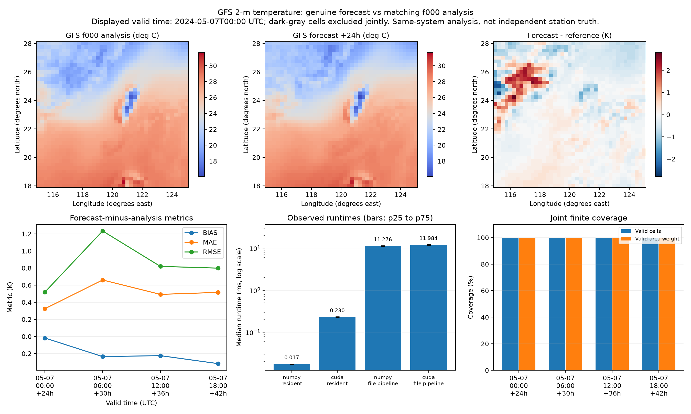

# NetCDF weather pipeline: rtx3050_gfs_pair_run01

Forecast role: **real operational GFS 2-m temperature forecast; original values, no manufactured perturbation**.

Reference role: real GFS f000 analysis/initialization-time 2-m temperature; same model system, not independent station observations.

Real GFS 2-m temperature forecasts initialized 2024-05-06T00:00:00+00:00, at leads [24, 30, 36, 42] hours, paired with GFS f000 analysis/initialization fields from the matching valid-time cycles. No perturbations, injected masks, interpolation or regridding. The reference is from the same model system, not independent station observations. These are forecast-minus-analysis errors for one case, not a general estimate of forecast skill.

Coverage: 6724/6724 joint finite values (100.00%); 4 valid times, 41 x 41 grid. 2024-05-07T00:00:00.000000000 to 2024-05-07T18:00:00.000000000 UTC. Latitude 18..28, longitude 115..125 degrees.

Normalization: supported temperature units -> K -> FP32; coordinates sorted and longitude wrapped to [-180,180). Valid time and spatial coordinates must match exactly. No regridding, inner join or init-time/lead-time inference. Weighting: coslat. The denominator includes only joint finite cells. All-times metrics pool valid weighted cells over the sampled times; RMSE is not an average of the per-time RMSE values. It is not a continuous-day average.

Reference arithmetic uses FP64 on the same packed FP32 data and weights. All saved backend values and all timed metric values agree at rtol=atol=1e-5; 80 positive finite timing samples and all summaries reconcile. NetCDF input hashes match. No timing samples were removed.

## Pooled verification metrics

| Backend | Bias K | MAE K | RMSE K | Valid fraction | Area-weighted valid fraction |
|---|---:|---:|---:|---:|---:|
| reference_fp64 | -0.199035721 | 0.498139354 | 0.880694300 | 100.00% | 100.00% |
| numpy_fp32 | -0.199035704 | 0.498139322 | 0.880694270 | 100.00% | 100.00% |
| cuda_fp32 | -0.199035719 | 0.498139381 | 0.880694270 | 100.00% | 100.00% |

## Valid-time errors against matching GFS analysis

| Valid time UTC | Forecast lead h | Bias K | MAE K | RMSE K |
|---|---:|---:|---:|---:|
| 2024-05-07T00:00 | 24 | -0.017925 | 0.324169 | 0.518945 |
| 2024-05-07T06:00 | 30 | -0.235585 | 0.660643 | 1.233943 |
| 2024-05-07T12:00 | 36 | -0.224625 | 0.492174 | 0.819727 |
| 2024-05-07T18:00 | 42 | -0.318008 | 0.515572 | 0.799136 |

## Timing boundaries

5 warmups and 20 measured repetitions per method. Resident compute reuses packed joint-valid inputs and weights; CUDA includes scalar return. The file pipeline reopens both NetCDF files, decodes units/coordinates, checks alignment, builds the mask and weights, packs valid cells, allocates/uploads inputs for CUDA and returns metrics. OS/file caches are warm, not a cold-storage experiment. Context initialization, downloading and result-file output are excluded. The file-pipeline method is actually timed, not estimated by adding separately sampled components.

| Method | Median ms | p25 ms | p75 ms |
|---|---:|---:|---:|
| numpy_resident | 0.0175 | 0.0173 | 0.0175 |
| numpy_warm_file_pipeline | 11.2758 | 11.0010 | 11.5257 |
| cuda_resident | 0.2297 | 0.2270 | 0.2370 |
| cuda_warm_file_pipeline | 11.9840 | 11.6601 | 12.3258 |

## Interpretation and limits

- This deliberately small input is a correctness case, not a GPU scaling benchmark. Inspect the observed runtimes; do not extrapolate them to large domains or claim GPU acceleration if CUDA is slower.
- This case covers one forecast initialization and one valid date. Lead time and valid time change together; these four points cannot isolate a general lead-time dependence. The regional average includes both land and ocean. Same-system analysis is not independent station truth.
- Cosine-latitude weights approximate relative cell areas on regular latitude/longitude grids. Curvilinear/projected grids and dateline-crossing subsets require additional grid/area handling.
- Methods execute in blocks in a fixed order. Only these short sessions and this small region are represented; pre/post GPU snapshots do not describe load throughout the measurement.

Source message URLs, byte ranges, SHA-256 hashes, initialization/lead/valid-time matching and decoder versions: [manifest](../../data/gfs_taiwan_pair/manifest.json). [NOAA GFS open data](https://registry.opendata.aws/noaa-gfs-bdp-pds/), [NCEP product documentation](https://www.nco.ncep.noaa.gov/pmb/products/gfs/).

