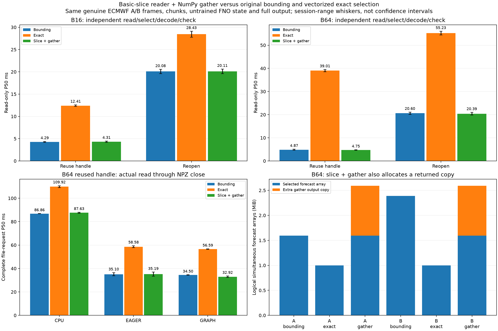

# Basic slice plus NumPy gather: bounded reader experiment

gather_once/gather_reopen derive the minimal rectangular init/lead/member bounding box of the requested genuine flattened A/B frames. Exactly one basic-slice forecast load is followed by paired NumPy indexing, which copies B frames in canonical order. The xarray/Zarr backend never receives paired vectorized indexers on this path. No rechunking, prepared-input/output cache, interpolation or synthetic frames are used. Original CLI defaults remain bounding.

## Forecast array and chunk accounting

| Batch | Variant | Selection | Selected frames | Selected array bytes | Returned backing bytes | Source + gather arrays bytes | Store chunks | Store compressed bytes |
|---|---|---|---:|---:|---:|---:|---:|---:|
| 16 | A | bounding | 16 | 262144 | 262144 | 262144 | 4 | 833260 |
| 16 | A | exact | 16 | 262144 | 262144 | 262144 | 4 | 833260 |
| 16 | A | gather | 16 | 262144 | 262144 | 524288 | 4 | 833260 |
| 16 | B | bounding | 32 | 524288 | 524288 | 524288 | 4 | 833260 |
| 16 | B | exact | 16 | 262144 | 262144 | 262144 | 4 | 833260 |
| 16 | B | gather | 16 | 262144 | 262144 | 524288 | 4 | 833260 |
| 64 | A | bounding | 102 | 1671168 | 1671168 | 1671168 | 4 | 833260 |
| 64 | A | exact | 64 | 1048576 | 1048576 | 1048576 | 4 | 833260 |
| 64 | A | gather | 102 | 1671168 | 1048576 | 2719744 | 4 | 833260 |
| 64 | B | bounding | 153 | 2506752 | 2506752 | 2506752 | 4 | 833260 |
| 64 | B | exact | 64 | 1048576 | 1048576 | 1048576 | 4 | 833260 |
| 64 | B | gather | 102 | 1671168 | 1048576 | 2719744 | 4 | 833260 |

The gather output is a new B-frame copy, not a view retaining the source box. B64 A/B loads 102/102 frames rather than 102/153, then copies 64; therefore a smaller returned backing does not establish lower peak RAM. The selected box and gathered output coexist during indexing. These logical arrays exclude decoder/indexer temporaries, packing and other process memory. Separate instrumented Store probes verify keys/get counts/compressed bytes and ultimate returned backing; they are not primary timing or physical disk/network traffic. All B16/B64 A/B paths still fetch four full forecast chunks, totaling 833,260 compressed bytes and 3,342,336 nominal uncompressed chunk bytes.

## Read-only primary P50/P95/max

| Session | Batch | Reader | P50 ms | P95 ms | Max ms |
|---|---:|---|---:|---:|---:|
| rtx3050_physics_gather_run01 | 16 | open_once | 4.384 | 5.260 | 5.913 |
| rtx3050_physics_gather_run01 | 16 | exact_once | 12.580 | 13.933 | 15.395 |
| rtx3050_physics_gather_run01 | 16 | gather_once | 4.462 | 5.104 | 5.764 |
| rtx3050_physics_gather_run01 | 16 | reopen | 20.556 | 22.072 | 25.613 |
| rtx3050_physics_gather_run01 | 16 | exact_reopen | 29.099 | 31.924 | 32.110 |
| rtx3050_physics_gather_run01 | 16 | gather_reopen | 20.613 | 22.250 | 24.718 |
| rtx3050_physics_gather_run01 | 64 | open_once | 5.108 | 5.837 | 5.930 |
| rtx3050_physics_gather_run01 | 64 | exact_once | 39.487 | 41.076 | 50.307 |
| rtx3050_physics_gather_run01 | 64 | gather_once | 4.842 | 5.524 | 5.644 |
| rtx3050_physics_gather_run01 | 64 | reopen | 21.093 | 22.403 | 23.724 |
| rtx3050_physics_gather_run01 | 64 | exact_reopen | 56.023 | 60.695 | 74.550 |
| rtx3050_physics_gather_run01 | 64 | gather_reopen | 20.977 | 22.536 | 23.187 |
| rtx3050_physics_gather_run02 | 16 | open_once | 4.192 | 5.015 | 5.751 |
| rtx3050_physics_gather_run02 | 16 | exact_once | 12.245 | 13.406 | 13.625 |
| rtx3050_physics_gather_run02 | 16 | gather_once | 4.163 | 4.732 | 4.990 |
| rtx3050_physics_gather_run02 | 16 | reopen | 19.612 | 21.464 | 37.036 |
| rtx3050_physics_gather_run02 | 16 | exact_reopen | 27.768 | 29.783 | 31.144 |
| rtx3050_physics_gather_run02 | 16 | gather_reopen | 19.611 | 21.169 | 21.981 |
| rtx3050_physics_gather_run02 | 64 | open_once | 4.626 | 5.360 | 5.528 |
| rtx3050_physics_gather_run02 | 64 | exact_once | 38.537 | 39.976 | 40.184 |
| rtx3050_physics_gather_run02 | 64 | gather_once | 4.650 | 5.821 | 7.078 |
| rtx3050_physics_gather_run02 | 64 | reopen | 20.113 | 21.748 | 23.395 |
| rtx3050_physics_gather_run02 | 64 | exact_reopen | 54.431 | 59.358 | 60.151 |
| rtx3050_physics_gather_run02 | 64 | gather_reopen | 19.802 | 22.124 | 24.377 |

Read-only primary is direct wall time around actual read/select/decode/source validation, including open/close for reopen paths and NumPy gather for gather paths. Packing, hashes, output/reference checks, separate Store probes and report writing are outside. Each repetition shuffles all case/reader jobs and uses the same A/B variant. Setup/probes/validation warm OS/library caches; no cold-disk claim.

## Complete-request primary P50/P95/max

| Session | Batch | Method | P50 ms | P95 ms | Max ms |
|---|---:|---|---:|---:|---:|
| rtx3050_physics_gather_pipeline_run01 | 16 | cpu_open_once | 18.875 | 21.239 | 23.357 |
| rtx3050_physics_gather_pipeline_run01 | 16 | eager_open_once | 14.466 | 19.875 | 22.432 |
| rtx3050_physics_gather_pipeline_run01 | 16 | graph_open_once | 14.304 | 17.957 | 19.684 |
| rtx3050_physics_gather_pipeline_run01 | 16 | cpu_exact_once | 24.561 | 28.245 | 29.987 |
| rtx3050_physics_gather_pipeline_run01 | 16 | eager_exact_once | 20.481 | 25.139 | 25.553 |
| rtx3050_physics_gather_pipeline_run01 | 16 | graph_exact_once | 19.412 | 24.254 | 25.264 |
| rtx3050_physics_gather_pipeline_run01 | 16 | cpu_gather_once | 19.180 | 23.458 | 24.665 |
| rtx3050_physics_gather_pipeline_run01 | 16 | eager_gather_once | 14.835 | 17.490 | 18.184 |
| rtx3050_physics_gather_pipeline_run01 | 16 | graph_gather_once | 14.209 | 17.557 | 26.349 |
| rtx3050_physics_gather_pipeline_run01 | 16 | cpu_reopen | 36.300 | 39.585 | 41.247 |
| rtx3050_physics_gather_pipeline_run01 | 16 | eager_reopen | 31.330 | 35.379 | 37.573 |
| rtx3050_physics_gather_pipeline_run01 | 16 | graph_reopen | 30.303 | 35.267 | 36.827 |
| rtx3050_physics_gather_pipeline_run01 | 16 | cpu_exact_reopen | 41.588 | 44.012 | 49.021 |
| rtx3050_physics_gather_pipeline_run01 | 16 | eager_exact_reopen | 36.619 | 41.883 | 42.705 |
| rtx3050_physics_gather_pipeline_run01 | 16 | graph_exact_reopen | 36.230 | 39.590 | 40.958 |
| rtx3050_physics_gather_pipeline_run01 | 16 | cpu_gather_reopen | 34.876 | 38.639 | 43.754 |
| rtx3050_physics_gather_pipeline_run01 | 16 | eager_gather_reopen | 30.986 | 34.179 | 34.979 |
| rtx3050_physics_gather_pipeline_run01 | 16 | graph_gather_reopen | 30.785 | 33.491 | 34.203 |
| rtx3050_physics_gather_pipeline_run01 | 64 | cpu_open_once | 86.982 | 89.783 | 90.819 |
| rtx3050_physics_gather_pipeline_run01 | 64 | eager_open_once | 36.428 | 44.182 | 47.339 |
| rtx3050_physics_gather_pipeline_run01 | 64 | graph_open_once | 34.386 | 44.352 | 49.054 |
| rtx3050_physics_gather_pipeline_run01 | 64 | cpu_exact_once | 109.127 | 119.882 | 120.629 |
| rtx3050_physics_gather_pipeline_run01 | 64 | eager_exact_once | 59.416 | 69.240 | 74.682 |
| rtx3050_physics_gather_pipeline_run01 | 64 | graph_exact_once | 56.351 | 63.054 | 67.425 |
| rtx3050_physics_gather_pipeline_run01 | 64 | cpu_gather_once | 87.207 | 94.452 | 109.653 |
| rtx3050_physics_gather_pipeline_run01 | 64 | eager_gather_once | 36.917 | 48.909 | 68.182 |
| rtx3050_physics_gather_pipeline_run01 | 64 | graph_gather_once | 32.302 | 45.486 | 57.272 |
| rtx3050_physics_gather_pipeline_run01 | 64 | cpu_reopen | 104.608 | 112.232 | 116.502 |
| rtx3050_physics_gather_pipeline_run01 | 64 | eager_reopen | 51.094 | 64.468 | 69.386 |
| rtx3050_physics_gather_pipeline_run01 | 64 | graph_reopen | 49.982 | 60.070 | 69.323 |
| rtx3050_physics_gather_pipeline_run01 | 64 | cpu_exact_reopen | 127.125 | 131.046 | 133.794 |
| rtx3050_physics_gather_pipeline_run01 | 64 | eager_exact_reopen | 72.917 | 83.628 | 90.618 |
| rtx3050_physics_gather_pipeline_run01 | 64 | graph_exact_reopen | 74.601 | 87.954 | 96.414 |
| rtx3050_physics_gather_pipeline_run01 | 64 | cpu_gather_reopen | 104.262 | 110.076 | 116.861 |
| rtx3050_physics_gather_pipeline_run01 | 64 | eager_gather_reopen | 50.230 | 58.422 | 58.979 |
| rtx3050_physics_gather_pipeline_run01 | 64 | graph_gather_reopen | 52.607 | 67.253 | 80.844 |
| rtx3050_physics_gather_pipeline_run02 | 16 | cpu_open_once | 18.956 | 30.554 | 81.550 |
| rtx3050_physics_gather_pipeline_run02 | 16 | eager_open_once | 14.610 | 18.427 | 19.534 |
| rtx3050_physics_gather_pipeline_run02 | 16 | graph_open_once | 13.640 | 15.704 | 16.704 |
| rtx3050_physics_gather_pipeline_run02 | 16 | cpu_exact_once | 24.633 | 28.888 | 106.917 |
| rtx3050_physics_gather_pipeline_run02 | 16 | eager_exact_once | 21.516 | 24.630 | 25.471 |
| rtx3050_physics_gather_pipeline_run02 | 16 | graph_exact_once | 20.556 | 24.304 | 25.494 |
| rtx3050_physics_gather_pipeline_run02 | 16 | cpu_gather_once | 19.174 | 22.247 | 23.045 |
| rtx3050_physics_gather_pipeline_run02 | 16 | eager_gather_once | 14.149 | 17.368 | 19.821 |
| rtx3050_physics_gather_pipeline_run02 | 16 | graph_gather_once | 14.032 | 19.892 | 21.797 |
| rtx3050_physics_gather_pipeline_run02 | 16 | cpu_reopen | 36.159 | 40.253 | 46.714 |
| rtx3050_physics_gather_pipeline_run02 | 16 | eager_reopen | 31.487 | 34.773 | 54.001 |
| rtx3050_physics_gather_pipeline_run02 | 16 | graph_reopen | 30.241 | 34.540 | 35.090 |
| rtx3050_physics_gather_pipeline_run02 | 16 | cpu_exact_reopen | 41.131 | 45.536 | 79.536 |
| rtx3050_physics_gather_pipeline_run02 | 16 | eager_exact_reopen | 38.351 | 43.080 | 66.724 |
| rtx3050_physics_gather_pipeline_run02 | 16 | graph_exact_reopen | 37.095 | 45.834 | 58.141 |
| rtx3050_physics_gather_pipeline_run02 | 16 | cpu_gather_reopen | 35.425 | 41.823 | 45.594 |
| rtx3050_physics_gather_pipeline_run02 | 16 | eager_gather_reopen | 31.524 | 37.459 | 46.699 |
| rtx3050_physics_gather_pipeline_run02 | 16 | graph_gather_reopen | 30.168 | 32.975 | 33.756 |
| rtx3050_physics_gather_pipeline_run02 | 64 | cpu_open_once | 86.740 | 92.455 | 620.671 |
| rtx3050_physics_gather_pipeline_run02 | 64 | eager_open_once | 33.769 | 51.389 | 56.053 |
| rtx3050_physics_gather_pipeline_run02 | 64 | graph_open_once | 34.610 | 44.190 | 45.879 |
| rtx3050_physics_gather_pipeline_run02 | 64 | cpu_exact_once | 110.720 | 118.441 | 144.507 |
| rtx3050_physics_gather_pipeline_run02 | 64 | eager_exact_once | 57.749 | 74.998 | 88.309 |
| rtx3050_physics_gather_pipeline_run02 | 64 | graph_exact_once | 56.826 | 69.312 | 81.555 |
| rtx3050_physics_gather_pipeline_run02 | 64 | cpu_gather_once | 88.050 | 95.549 | 253.196 |
| rtx3050_physics_gather_pipeline_run02 | 64 | eager_gather_once | 33.470 | 47.171 | 61.917 |
| rtx3050_physics_gather_pipeline_run02 | 64 | graph_gather_once | 33.544 | 42.175 | 43.345 |
| rtx3050_physics_gather_pipeline_run02 | 64 | cpu_reopen | 105.197 | 110.635 | 112.840 |
| rtx3050_physics_gather_pipeline_run02 | 64 | eager_reopen | 51.188 | 63.335 | 64.605 |
| rtx3050_physics_gather_pipeline_run02 | 64 | graph_reopen | 50.559 | 61.640 | 64.733 |
| rtx3050_physics_gather_pipeline_run02 | 64 | cpu_exact_reopen | 126.711 | 132.608 | 301.839 |
| rtx3050_physics_gather_pipeline_run02 | 64 | eager_exact_reopen | 74.344 | 84.989 | 116.248 |
| rtx3050_physics_gather_pipeline_run02 | 64 | graph_exact_reopen | 74.397 | 86.209 | 113.824 |
| rtx3050_physics_gather_pipeline_run02 | 64 | cpu_gather_reopen | 104.592 | 113.210 | 117.353 |
| rtx3050_physics_gather_pipeline_run02 | 64 | eager_gather_reopen | 51.896 | 58.948 | 61.299 |
| rtx3050_physics_gather_pipeline_run02 | 64 | graph_gather_reopen | 49.847 | 64.834 | 65.475 |

Models remain resident. Every complete request actually reads and packs its new A/B input, uploads into the same fixed buffer for GPU engines, runs the fixed untrained FP32 FNO, returns all values, and writes/closes the identical uncompressed NPZ schema/byte count. Setup, FP64 work, file readback/hashes/checks and cleanup are outside primary. No stage synchronization, annotations or profiler are used in primary. File close does not request fsync. Graph resources coexist with eager/CPU. All P95/maxima and regressions remain; current sessions are compared within their protocol, not causally decomposed using older runs.

## Paired original/gather reader contrasts

| Session | Scope | Batch | Engine | Handle | Median bounding/gather | Median saving ms | Gather-faster pairs |
|---|---|---:|---|---|---:|---:|---:|
| rtx3050_physics_gather_run01 | read-only | 16 | reader | reuse | 1.016x | 0.077 | 22/40 |
| rtx3050_physics_gather_run01 | read-only | 16 | reader | reopen | 1.000x | -0.003 | 20/40 |
| rtx3050_physics_gather_run01 | read-only | 64 | reader | reuse | 1.040x | 0.205 | 23/40 |
| rtx3050_physics_gather_run01 | read-only | 64 | reader | reopen | 1.001x | 0.026 | 20/40 |
| rtx3050_physics_gather_run02 | read-only | 16 | reader | reuse | 1.010x | 0.040 | 21/40 |
| rtx3050_physics_gather_run02 | read-only | 16 | reader | reopen | 1.005x | 0.095 | 21/40 |
| rtx3050_physics_gather_run02 | read-only | 64 | reader | reuse | 1.001x | 0.006 | 21/40 |
| rtx3050_physics_gather_run02 | read-only | 64 | reader | reopen | 1.010x | 0.191 | 22/40 |
| rtx3050_physics_gather_pipeline_run01 | complete-file | 16 | cpu | reuse | 0.979x | -0.390 | 13/30 |
| rtx3050_physics_gather_pipeline_run01 | complete-file | 16 | cpu | reopen | 1.011x | 0.405 | 17/30 |
| rtx3050_physics_gather_pipeline_run01 | complete-file | 16 | eager | reuse | 0.969x | -0.443 | 12/30 |
| rtx3050_physics_gather_pipeline_run01 | complete-file | 16 | eager | reopen | 1.006x | 0.184 | 16/30 |
| rtx3050_physics_gather_pipeline_run01 | complete-file | 16 | graph | reuse | 1.034x | 0.520 | 18/30 |
| rtx3050_physics_gather_pipeline_run01 | complete-file | 16 | graph | reopen | 1.020x | 0.572 | 18/30 |
| rtx3050_physics_gather_pipeline_run01 | complete-file | 64 | cpu | reuse | 0.989x | -0.929 | 13/30 |
| rtx3050_physics_gather_pipeline_run01 | complete-file | 64 | cpu | reopen | 0.996x | -0.452 | 13/30 |
| rtx3050_physics_gather_pipeline_run01 | complete-file | 64 | eager | reuse | 1.050x | 1.870 | 18/30 |
| rtx3050_physics_gather_pipeline_run01 | complete-file | 64 | eager | reopen | 1.003x | 0.148 | 16/30 |
| rtx3050_physics_gather_pipeline_run01 | complete-file | 64 | graph | reuse | 0.972x | -0.987 | 11/30 |
| rtx3050_physics_gather_pipeline_run01 | complete-file | 64 | graph | reopen | 0.978x | -1.159 | 12/30 |
| rtx3050_physics_gather_pipeline_run02 | complete-file | 16 | cpu | reuse | 0.991x | -0.150 | 14/30 |
| rtx3050_physics_gather_pipeline_run02 | complete-file | 16 | cpu | reopen | 1.033x | 1.199 | 21/30 |
| rtx3050_physics_gather_pipeline_run02 | complete-file | 16 | eager | reuse | 1.023x | 0.317 | 20/30 |
| rtx3050_physics_gather_pipeline_run02 | complete-file | 16 | eager | reopen | 0.989x | -0.333 | 14/30 |
| rtx3050_physics_gather_pipeline_run02 | complete-file | 16 | graph | reuse | 0.942x | -0.801 | 13/30 |
| rtx3050_physics_gather_pipeline_run02 | complete-file | 16 | graph | reopen | 0.997x | -0.103 | 15/30 |
| rtx3050_physics_gather_pipeline_run02 | complete-file | 64 | cpu | reuse | 1.000x | -0.028 | 14/30 |
| rtx3050_physics_gather_pipeline_run02 | complete-file | 64 | cpu | reopen | 0.998x | -0.227 | 15/30 |
| rtx3050_physics_gather_pipeline_run02 | complete-file | 64 | eager | reuse | 1.009x | 0.278 | 16/30 |
| rtx3050_physics_gather_pipeline_run02 | complete-file | 64 | eager | reopen | 0.992x | -0.390 | 14/30 |
| rtx3050_physics_gather_pipeline_run02 | complete-file | 64 | graph | reuse | 1.038x | 1.256 | 17/30 |
| rtx3050_physics_gather_pipeline_run02 | complete-file | 64 | graph | reopen | 1.028x | 1.374 | 17/30 |

Ratios pair the same repeat/case/lifetime/variant. They are descriptive, not significance tests or guarantees. Both genuine variants are retained, and all input values, identity/time/coordinates and full output contracts agree with the pinned CPU FP64 evidence. Independent synchronized stage profiles and full CPU/CUDA traces remain in each pipeline run, with actual expected graph launches and complete HtoD/DtoH. Those diagnostics are not an additive decomposition of primary P50, and Store gets are not decoder counts or physical storage traffic.

## Reproduction and scope

```bash
source .venv/physicsnemo/bin/activate
python physicsnemo_graph_pipeline.py --readers open_once exact_once gather_once reopen exact_reopen gather_reopen --seed 20261115 --output results/my_gather_pipeline01
python physicsnemo_graph_pipeline.py --readers open_once exact_once gather_once reopen exact_reopen gather_reopen --seed 20261116 --output results/my_gather_pipeline02
python physicsnemo_reader_benchmark.py --readers open_once exact_once gather_once reopen exact_reopen gather_reopen --seed 20261115 --output results/my_gather01
python physicsnemo_reader_benchmark.py --readers open_once exact_once gather_once reopen exact_reopen gather_reopen --seed 20261116 --output results/my_gather02
python scripts/analyze_physicsnemo_gather.py results/my_gather_pipeline01 results/my_gather_pipeline02 --reader-runs results/my_gather01 results/my_gather02 --recompute-reference --output results/my_gather_report
```

Run benchmarks separately with new output paths. The CPU analyzer reconstructs source selections/coverage and validates actual Store reads, backing bytes, hashes, ordering, quantiles, files, FP64 errors, allocator arithmetic and real traces; --recompute-reference independently rebuilds the common archived FP64 reference with PhysicsNeMo. Existing archived two-/four-reader evidence remains supported. No new forecast-quality study, model training, remote acquisition, driver upgrade or automatic default selection is included.


