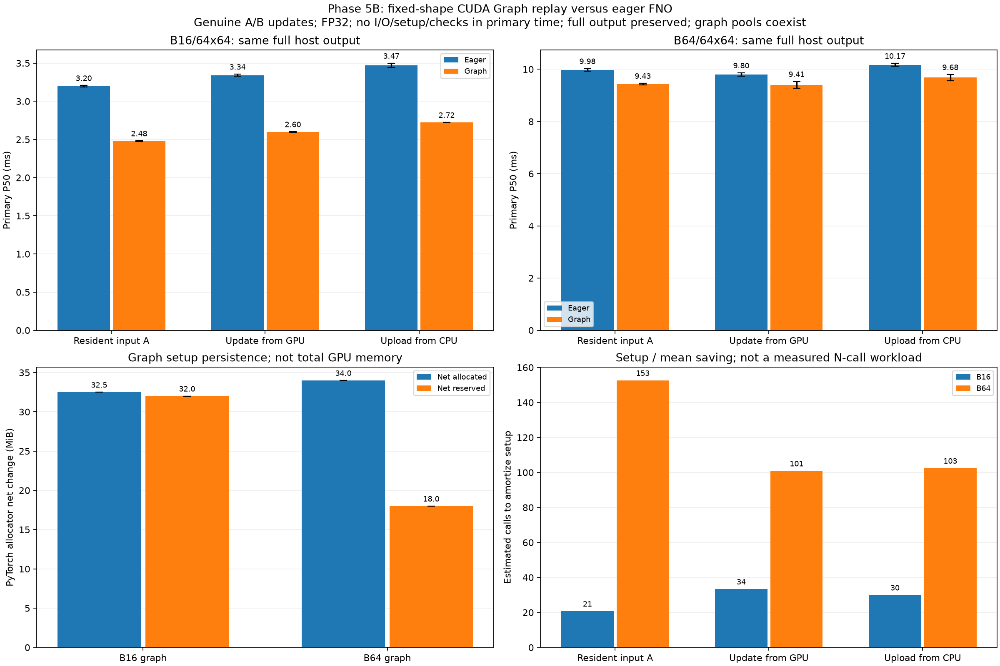

# Phase 5B: CUDA Graph replay with genuine input updates

The existing untrained FP32 FNO is retained with identical weights and two disjoint genuine ECMWF input windows per B16/B64 shape. No training, forecast assessment, AMP, compiler, JAX, Earth2Studio, driver or power-setting change is involved. One graph per shape is captured; eager remains available.

## Primary latency and paired savings

| Session | Batch | Boundary | Eager P50 ms | Graph P50 ms | Eager P95 ms | Graph P95 ms | Eager max ms | Graph max ms | Median paired eager/graph | Median paired saving ms |
|---|---:|---|---:|---:|---:|---:|---:|---:|---:|---:|
| rtx3050_physics_graph_run01 | 16 | resident | 3.190 | 2.471 | 6.076 | 3.005 | 19.782 | 3.126 | 1.288x | 0.705 |
| rtx3050_physics_graph_run01 | 16 | device_update | 3.328 | 2.592 | 4.102 | 3.457 | 4.161 | 7.801 | 1.231x | 0.607 |
| rtx3050_physics_graph_run01 | 16 | host_update | 3.498 | 2.723 | 4.560 | 3.745 | 5.238 | 7.676 | 1.266x | 0.705 |
| rtx3050_physics_graph_run01 | 64 | resident | 10.030 | 9.464 | 10.560 | 10.316 | 11.553 | 19.513 | 1.047x | 0.445 |
| rtx3050_physics_graph_run01 | 64 | device_update | 9.862 | 9.532 | 10.997 | 10.324 | 17.041 | 12.664 | 1.036x | 0.331 |
| rtx3050_physics_graph_run01 | 64 | host_update | 10.231 | 9.561 | 10.988 | 10.425 | 11.015 | 10.497 | 1.058x | 0.564 |
| rtx3050_physics_graph_run02 | 16 | resident | 3.208 | 2.482 | 4.058 | 2.890 | 4.219 | 3.068 | 1.282x | 0.695 |
| rtx3050_physics_graph_run02 | 16 | device_update | 3.356 | 2.601 | 4.348 | 3.301 | 4.722 | 3.467 | 1.315x | 0.799 |
| rtx3050_physics_graph_run02 | 16 | host_update | 3.442 | 2.724 | 4.066 | 3.252 | 4.457 | 3.424 | 1.271x | 0.752 |
| rtx3050_physics_graph_run02 | 64 | resident | 9.927 | 9.395 | 10.274 | 9.766 | 10.341 | 10.470 | 1.054x | 0.510 |
| rtx3050_physics_graph_run02 | 64 | device_update | 9.735 | 9.281 | 10.435 | 10.221 | 10.753 | 10.520 | 1.044x | 0.397 |
| rtx3050_physics_graph_run02 | 64 | host_update | 10.111 | 9.798 | 10.923 | 10.248 | 11.091 | 10.388 | 1.033x | 0.322 |

Observed maximum-latency regressions are retained: rtx3050_physics_graph_run01/B16/device_update: 4.161 -> 7.801 ms; rtx3050_physics_graph_run01/B16/host_update: 5.238 -> 7.676 ms; rtx3050_physics_graph_run01/B64/resident: 11.553 -> 19.513 ms; rtx3050_physics_graph_run02/B64/resident: 10.341 -> 10.470 ms. Median improvements do not guarantee every invocation or tail statistic improves.

Both cases/all six methods are shuffled per repetition; paired methods use the same A/B variant in that repetition. Resident always uses A and a shared untimed D2D reset/synchronization precondition for both paths, then measures only forward/full return. Device-update includes the same D2D input copy into the static buffer in both paths. Host-update includes the same pageable CPU-to-CUDA input copy in both paths. CPU packing/read and file writes are excluded. Primary timers contain no profiler, annotations or CUDA events; output checks/hashes occur outside timing. Bar heights are medians of session medians and whiskers span session medians, not confidence intervals. All samples/maxima are retained; short-session P95 values and mean-based amortization estimates are sensitive to outliers.

A = first B native frames, B = next B frames. No tiling, synthetic perturbation or output caching. A/B/A tests copy actual new input, read back the actual static input, check stable input/output pointers, require changed graph output hashes and compare graph/eager tightly as well as against CPU FP64. Incorrect shape, dtype, noncontiguous layout or wrong CUDA device is rejected. Model weights and runner lifetime must remain fixed; borrowed GPU output storage is overwritten on replay.

## Setup, persistence and estimated amortization

| Session | Batch | Total setup ms | Capture/instantiate ms | First replay ms | Net allocated MiB | Net reserved MiB | Setup allocated peak MiB |
|---|---:|---:|---:|---:|---:|---:|---:|
| rtx3050_physics_graph_run01 | 16 | 20.102 | 4.160 | 2.387 | 32.500 | 32.000 | 94.509 |
| rtx3050_physics_graph_run01 | 64 | 49.170 | 6.628 | 9.466 | 34.000 | 18.000 | 217.509 |
| rtx3050_physics_graph_run02 | 16 | 21.140 | 5.773 | 2.796 | 32.500 | 32.000 | 94.509 |
| rtx3050_physics_graph_run02 | 64 | 52.045 | 7.986 | 9.220 | 34.000 | 18.000 | 217.509 |

| Session | Batch | Boundary | Mean saving ms | Estimated calls to recover graph setup |
|---|---:|---|---:|---:|
| rtx3050_physics_graph_run01 | 16 | resident | 1.411 | 15 |
| rtx3050_physics_graph_run01 | 16 | device_update | 0.487 | 42 |
| rtx3050_physics_graph_run01 | 16 | host_update | 0.635 | 32 |
| rtx3050_physics_graph_run01 | 64 | resident | 0.237 | 208 |
| rtx3050_physics_graph_run01 | 64 | device_update | 0.624 | 79 |
| rtx3050_physics_graph_run01 | 64 | host_update | 0.589 | 84 |
| rtx3050_physics_graph_run02 | 16 | resident | 0.777 | 28 |
| rtx3050_physics_graph_run02 | 16 | device_update | 0.828 | 26 |
| rtx3050_physics_graph_run02 | 16 | host_update | 0.748 | 29 |
| rtx3050_physics_graph_run02 | 64 | resident | 0.534 | 98 |
| rtx3050_physics_graph_run02 | 64 | device_update | 0.423 | 123 |
| rtx3050_physics_graph_run02 | 64 | host_update | 0.429 | 122 |

Setup includes input-buffer clone, side-stream eager warmup, capture/instantiation and the first synchronized replay after an earlier eager warmup. It excludes common model/source/reference setup and validation. Costs are single observations per case/session in an initialized process. Estimated break-even uses setup divided by mean request saving; the plot averages finite per-session estimates then rounds up. This is not a measured multi-request application or cold-start guarantee.

Graph inputs/outputs/weights remain alive and each graph owns its default private pool. Allocator snapshots are taken before/after creation; all source buffers and earlier-shape graphs coexist. Net allocated/reserved increases and setup peaks are not total VRAM, graph executable/driver memory or standalone per-case requirements. Runtime memory probes are separate from latency and eager is measured while graph pools remain resident. See memory_samples.csv for baseline/peak/extra/reserved.

## Separate CPU/CUDA trace evidence

| Batch/boundary/backend | Profiled wall ms | CPU update ms | CPU dispatch ms | CPU return ms | Kernel events | CPU kernel-launch APIs | CPU graph-launch APIs | DtoH bytes | HtoD bytes | DtoD event bytes |
|---|---:|---:|---:|---:|---:|---:|---:|---:|---:|---:|
| B16/eager_resident | 4.0008 | 0.0000 | 3.0770 | 0.8635 | 99.0000 | 91.0000 | 0.0000 | 262144.0000 | 0.0000 | 12845056.0000 |
| B16/graph_resident | 2.7986 | 0.0000 | 0.2016 | 2.5464 | 102.0000 | 0.0000 | 1.0000 | 262144.0000 | 0.0000 | 0.0000 |
| B16/eager_device_update | 3.9820 | 0.0924 | 2.9431 | 0.8860 | 99.0000 | 91.0000 | 0.0000 | 262144.0000 | 0.0000 | 13107200.0000 |
| B16/graph_device_update | 2.9777 | 0.1132 | 0.2243 | 2.5877 | 102.0000 | 0.0000 | 1.0000 | 262144.0000 | 0.0000 | 262144.0000 |
| B16/eager_host_update | 4.2324 | 0.2635 | 3.0442 | 0.8493 | 99.0000 | 91.0000 | 0.0000 | 262144.0000 | 262144.0000 | 12845056.0000 |
| B16/graph_host_update | 2.9488 | 0.2630 | 0.2031 | 2.4159 | 102.0000 | 0.0000 | 1.0000 | 262144.0000 | 262144.0000 | 0.0000 |
| B64/eager_resident | 11.3728 | 0.0000 | 3.0034 | 8.3127 | 99.0000 | 91.0000 | 0.0000 | 1048576.0000 | 0.0000 | 51380224.0000 |
| B64/graph_resident | 10.1590 | 0.0000 | 0.2066 | 9.8559 | 102.0000 | 0.0000 | 1.0000 | 1048576.0000 | 0.0000 | 0.0000 |
| B64/eager_device_update | 10.4268 | 0.0778 | 2.8334 | 7.4603 | 99.0000 | 91.0000 | 0.0000 | 1048576.0000 | 0.0000 | 52428800.0000 |
| B64/graph_device_update | 9.6525 | 0.0975 | 0.1596 | 9.3499 | 102.0000 | 0.0000 | 1.0000 | 1048576.0000 | 0.0000 | 1048576.0000 |
| B64/eager_host_update | 11.3806 | 0.4181 | 3.2295 | 7.6493 | 99.0000 | 91.0000 | 0.0000 | 1048576.0000 | 1048576.0000 | 51380224.0000 |
| B64/graph_host_update | 9.7486 | 0.3428 | 0.1675 | 9.1831 | 102.0000 | 0.0000 | 1.0000 | 1048576.0000 | 1048576.0000 | 0.0000 |

Each profiled graph request must contain a real cudaGraphLaunch and kernels; eager has no graph-launch API. Every call returns exactly one full-output DtoH. Host-update must upload all input bytes; device-update includes at least those bytes in DtoD copy events. Resident resets occur outside the root range. Dispatch/return ranges overlap GPU work and cannot be added to kernel/copy intervals to explain wall time.

Capture can change internal implementation as well as host launch overhead. In the inspected trace, graph execution contains memcpy128 device kernels where eager reports internal DtoD copy events. Thus fewer DtoD event bytes do not mean device copies vanished, and 102 versus 99 kernel events do not establish more/less mathematical work. Kernel/copy category sums must not be used as a device bandwidth or occupancy claim. The CPU-only analyzer reconstructs all actual trace summaries from the hashed compressed Chrome trace.

Trace timing is a separate later experiment with profiler overhead and altered scheduling; primary results determine speed. Neither dispatch-range differences nor graph-launch counts isolate all causes of latency improvement. Full read/prepare/write application gains can be much smaller than these forward/transfer gains.

## Reproduce and validate

```bash
source .venv/physicsnemo/bin/activate
python physicsnemo_graph.py --output results/my_physics_graph01
python physicsnemo_graph.py --seed 20261110 --output results/my_physics_graph02
python scripts/analyze_physicsnemo_graph.py results/my_physics_graph01 results/my_physics_graph02 --recompute-reference --output results/my_physics_graph_report
```

Use new output paths. Without --recompute-reference, existing CPU data/plot dependencies suffice to validate the saved inputs/references/outputs, state/provenance hashes, A/B/A pointer/update evidence, seeded pairing, quantiles, allocator arithmetic and real trace launches/copy bytes. The optional flag independently rebuilds both CPU FP64 references from the archived exact FP32 state; numerical tolerance remains rtol=1e-4, atol=1e-5.

[Official PyTorch CUDA Graph usage and constraints](https://docs.pytorch.org/docs/2.14/notes/cuda.html#cuda-graphs).


