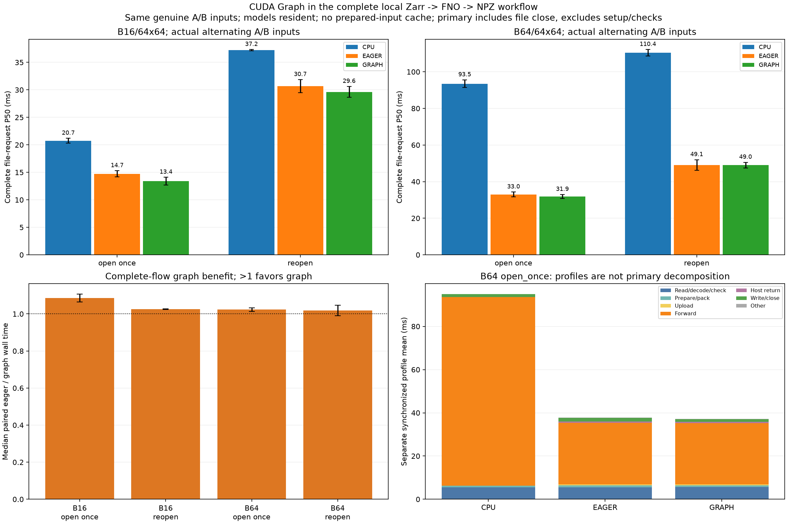

# Complete Zarr-to-file CPU/eager/CUDA Graph workflow

The selectable FnoFilePipeline engine runs the same untrained FP32 FNO, exact archived weights and two disjoint genuine ECMWF windows per shape. Every request rereads and packs its requested A/B input, copies it to the fixed GPU buffer for GPU engines, computes, returns the full output and writes/closes the same uncompressed NPZ schema. No input/output result cache, training or forecast-quality evaluation is involved.

## Primary complete-request results

| Session | Batch | Method | P50 ms | P95 ms | Maximum ms |
|---|---:|---|---:|---:|---:|
| rtx3050_physics_graph_pipeline_run01 | 16 | cpu_open_once | 20.304 | 24.917 | 32.334 |
| rtx3050_physics_graph_pipeline_run01 | 16 | eager_open_once | 14.187 | 16.723 | 16.952 |
| rtx3050_physics_graph_pipeline_run01 | 16 | graph_open_once | 12.691 | 16.011 | 18.122 |
| rtx3050_physics_graph_pipeline_run01 | 16 | cpu_reopen | 37.135 | 40.085 | 42.843 |
| rtx3050_physics_graph_pipeline_run01 | 16 | eager_reopen | 29.496 | 35.592 | 42.101 |
| rtx3050_physics_graph_pipeline_run01 | 16 | graph_reopen | 28.644 | 32.890 | 36.966 |
| rtx3050_physics_graph_pipeline_run01 | 64 | cpu_open_once | 91.371 | 101.391 | 142.541 |
| rtx3050_physics_graph_pipeline_run01 | 64 | eager_open_once | 31.662 | 41.307 | 42.800 |
| rtx3050_physics_graph_pipeline_run01 | 64 | graph_open_once | 30.878 | 40.132 | 40.787 |
| rtx3050_physics_graph_pipeline_run01 | 64 | cpu_reopen | 108.682 | 116.847 | 134.248 |
| rtx3050_physics_graph_pipeline_run01 | 64 | eager_reopen | 46.228 | 55.988 | 57.641 |
| rtx3050_physics_graph_pipeline_run01 | 64 | graph_reopen | 47.514 | 55.965 | 61.729 |
| rtx3050_physics_graph_pipeline_run02 | 16 | cpu_open_once | 21.187 | 50.734 | 95.634 |
| rtx3050_physics_graph_pipeline_run02 | 16 | eager_open_once | 15.288 | 18.070 | 23.371 |
| rtx3050_physics_graph_pipeline_run02 | 16 | graph_open_once | 14.102 | 16.843 | 16.952 |
| rtx3050_physics_graph_pipeline_run02 | 16 | cpu_reopen | 37.337 | 48.812 | 101.067 |
| rtx3050_physics_graph_pipeline_run02 | 16 | eager_reopen | 31.861 | 41.462 | 55.100 |
| rtx3050_physics_graph_pipeline_run02 | 16 | graph_reopen | 30.620 | 38.436 | 54.152 |
| rtx3050_physics_graph_pipeline_run02 | 64 | cpu_open_once | 95.586 | 286.079 | 361.538 |
| rtx3050_physics_graph_pipeline_run02 | 64 | eager_open_once | 34.313 | 42.737 | 43.531 |
| rtx3050_physics_graph_pipeline_run02 | 64 | graph_open_once | 32.987 | 42.147 | 43.060 |
| rtx3050_physics_graph_pipeline_run02 | 64 | cpu_reopen | 112.186 | 139.500 | 145.194 |
| rtx3050_physics_graph_pipeline_run02 | 64 | eager_reopen | 51.965 | 62.596 | 64.476 |
| rtx3050_physics_graph_pipeline_run02 | 64 | graph_reopen | 50.550 | 58.025 | 67.993 |

## Matched eager/graph contrasts and estimated setup amortization

| Session | Batch | Reader | Median paired eager/graph | Median saving ms | Graph-faster pairs | Mean saving ms | Setup ms | Estimated uses to recover setup |
|---|---:|---|---:|---:|---:|---:|---:|---:|
| rtx3050_physics_graph_pipeline_run01 | 16 | open_once | 1.108x | 1.218 | 24/30 | 1.282 | 23.269 | 19 |
| rtx3050_physics_graph_pipeline_run01 | 16 | reopen | 1.024x | 0.647 | 19/30 | 1.035 | 23.269 | 23 |
| rtx3050_physics_graph_pipeline_run01 | 64 | open_once | 1.014x | 0.271 | 19/30 | 0.919 | 52.386 | 58 |
| rtx3050_physics_graph_pipeline_run01 | 64 | reopen | 0.991x | -0.403 | 13/30 | 0.085 | 52.386 | 616 |
| rtx3050_physics_graph_pipeline_run02 | 16 | open_once | 1.064x | 0.988 | 23/30 | 0.970 | 22.862 | 24 |
| rtx3050_physics_graph_pipeline_run02 | 16 | reopen | 1.027x | 0.857 | 19/30 | 1.372 | 22.862 | 17 |
| rtx3050_physics_graph_pipeline_run02 | 64 | open_once | 1.033x | 0.979 | 20/30 | 1.241 | 51.971 | 42 |
| rtx3050_physics_graph_pipeline_run02 | 64 | reopen | 1.048x | 2.394 | 19/30 | 1.447 | 51.971 | 36 |

Pairing matches repetition/case/reader and the same A/B variant; order of all cases/methods is shuffled. The ratios/counts are descriptive, not significance tests or latency guarantees. All regressions, P95/maxima and samples remain. Top bars show the median of session medians, whiskers their range, not confidence intervals. Graph savings can be diluted or reversed by CPU/I/O/system variation; do not infer whole-workflow speedup from earlier forward-only measurements.

## Setup and scope

Models stay resident. Open-once reuses one dataset handle shared across all methods/cases, while selecting/loading/checking/packing anew per request. Reopen creates a handle each request. Neither path reuses a prepared tensor as its input. Eager and graph use the same fixed GPU input buffer and both include the host copy inside timing. CPU uses the same archived state/inputs with the recorded thread controls.

Common import/source-hash/model setup and shared reader opening are recorded separately. Per-shape graph setup covers buffer clone, side-stream warmup, capture/instantiate and first replay after eager warmup. Its allocator snapshots are net observations with earlier graphs present, not total VRAM, standalone engine memory or graph-executable memory. Eager/CPU timing runs while graph resources coexist. Setup divided by a positive mean end-to-end saving is an estimate sensitive to outliers, not a separately measured N-request application or cold startup.

Primary timing goes directly from source read through file close, including metadata/coordinate checks and output metadata construction. Source preparation, FP64 reference work, startup checks, output readback, hashes, cleanup and benchmark CSV/JSON writing are outside timers. File close does not request fsync or guarantee durable media persistence. Source/reference setup and validation may warm OS/library caches; no cold-disk claim or remote-download cost is made. first_observed.csv contains initialized-process observations.

## Separate stage profiles and real full-file traces

| Session | Batch | Method | Read ms | Prepare ms | Upload ms | Forward ms | Return ms | Write ms | Other ms | Profile mean ms |
|---|---:|---|---:|---:|---:|---:|---:|---:|---:|---:|---:|
| rtx3050_physics_graph_pipeline_run01 | 16 | cpu_open_once | 5.297 | 0.376 | 0.000 | 14.102 | 0.022 | 0.984 | 0.094 | 20.874 |
| rtx3050_physics_graph_pipeline_run01 | 16 | eager_open_once | 5.427 | 0.393 | 0.354 | 9.533 | 0.340 | 0.863 | 0.107 | 17.018 |
| rtx3050_physics_graph_pipeline_run01 | 16 | graph_open_once | 5.414 | 0.254 | 0.389 | 9.714 | 0.364 | 0.801 | 0.103 | 17.039 |
| rtx3050_physics_graph_pipeline_run01 | 16 | cpu_reopen | 21.880 | 0.241 | 0.000 | 14.433 | 0.018 | 0.848 | 0.088 | 37.508 |
| rtx3050_physics_graph_pipeline_run01 | 16 | eager_reopen | 21.853 | 0.233 | 0.333 | 8.512 | 0.302 | 1.304 | 0.107 | 32.643 |
| rtx3050_physics_graph_pipeline_run01 | 16 | graph_reopen | 21.988 | 0.237 | 0.334 | 8.694 | 0.352 | 0.814 | 0.090 | 32.509 |
| rtx3050_physics_graph_pipeline_run01 | 64 | cpu_open_once | 5.632 | 0.665 | 0.000 | 88.452 | 0.022 | 1.401 | 0.091 | 96.264 |
| rtx3050_physics_graph_pipeline_run01 | 64 | eager_open_once | 5.694 | 0.703 | 0.520 | 33.368 | 0.581 | 2.062 | 0.115 | 43.045 |
| rtx3050_physics_graph_pipeline_run01 | 64 | graph_open_once | 5.706 | 0.748 | 0.507 | 33.466 | 0.568 | 1.259 | 0.112 | 42.365 |
| rtx3050_physics_graph_pipeline_run01 | 64 | cpu_reopen | 22.678 | 0.672 | 0.000 | 83.756 | 0.022 | 1.414 | 0.093 | 108.635 |
| rtx3050_physics_graph_pipeline_run01 | 64 | eager_reopen | 22.300 | 0.945 | 0.464 | 31.954 | 0.569 | 1.813 | 0.121 | 58.167 |
| rtx3050_physics_graph_pipeline_run01 | 64 | graph_reopen | 22.242 | 1.079 | 0.483 | 32.363 | 0.579 | 1.223 | 0.116 | 58.086 |
| rtx3050_physics_graph_pipeline_run02 | 16 | cpu_open_once | 5.238 | 0.619 | 0.000 | 14.359 | 0.021 | 0.947 | 0.097 | 21.282 |
| rtx3050_physics_graph_pipeline_run02 | 16 | eager_open_once | 4.784 | 0.704 | 0.394 | 6.957 | 0.325 | 1.050 | 0.107 | 14.322 |
| rtx3050_physics_graph_pipeline_run02 | 16 | graph_open_once | 5.025 | 0.729 | 0.352 | 6.446 | 0.348 | 0.797 | 0.093 | 13.790 |
| rtx3050_physics_graph_pipeline_run02 | 16 | cpu_reopen | 22.155 | 0.456 | 0.000 | 13.564 | 0.020 | 0.967 | 0.093 | 37.255 |
| rtx3050_physics_graph_pipeline_run02 | 16 | eager_reopen | 22.008 | 0.229 | 0.343 | 6.768 | 0.315 | 1.113 | 0.097 | 30.874 |
| rtx3050_physics_graph_pipeline_run02 | 16 | graph_reopen | 21.353 | 0.430 | 0.311 | 6.133 | 0.311 | 0.800 | 0.085 | 29.422 |
| rtx3050_physics_graph_pipeline_run02 | 64 | cpu_open_once | 5.546 | 0.785 | 0.000 | 85.936 | 0.024 | 1.378 | 0.098 | 93.767 |
| rtx3050_physics_graph_pipeline_run02 | 64 | eager_open_once | 5.427 | 1.059 | 0.478 | 23.638 | 0.581 | 1.248 | 0.109 | 32.541 |
| rtx3050_physics_graph_pipeline_run02 | 64 | graph_open_once | 5.714 | 0.739 | 0.497 | 23.078 | 0.558 | 1.264 | 0.106 | 31.957 |
| rtx3050_physics_graph_pipeline_run02 | 64 | cpu_reopen | 22.650 | 1.269 | 0.000 | 85.174 | 0.022 | 1.371 | 0.093 | 110.581 |
| rtx3050_physics_graph_pipeline_run02 | 64 | eager_reopen | 22.236 | 0.927 | 0.475 | 22.983 | 0.547 | 1.435 | 0.108 | 48.712 |
| rtx3050_physics_graph_pipeline_run02 | 64 | graph_reopen | 22.093 | 0.893 | 0.487 | 22.990 | 0.585 | 1.265 | 0.111 | 48.425 |

Stage profiles are separate later executions with stage GPU synchronization. Their mean segments plus residual sum to their own profile mean, not primary P50; profiles can materially perturb latency. The separate CPU/CUDA trace covers source read, preprocessing, upload, actual engine call, full return and file close, with validation/hash/cleanup outside the root. CPU calls must have no CUDA activity; GPU calls must contain kernels, full input HtoD and full output DtoH, with real cudaGraphLaunch only for graph. Device activity overlaps CPU ranges and is not occupancy or an additive decomposition.

Every first/warmup/primary/profile/memory/trace file is read back and checked for exact values/dtypes/coordinates/init/lead/member/valid-time metadata plus elementwise CPU FP64 agreement at rtol=1e-4, atol=1e-5. Both A/B references are independently recomputed in the runner; the optional analyzer flag independently rebuilds the common pinned reference model. Actual last primary files for both variants/all methods are retained; all trial file/payload hashes match the corresponding deterministic retained output. CPU/eager/graph write equal byte counts per case/variant.

The CPU analyzer validates the pinned CUDA Graph reference evidence, reconstructs source selections and file contracts, verifies all hashes/errors/pairing/quantiles/stage sums/setup/runtime allocator arithmetic, and reconstructs actual full-file traces from gzip JSON. No silent eager/CPU fallback is allowed for graph. Plain eager and the previous pipeline remain available.

## Reproduce

```bash
source .venv/physicsnemo/bin/activate
python physicsnemo_graph_pipeline.py --output results/my_graph_pipeline01
python physicsnemo_graph_pipeline.py --seed 20261112 --output results/my_graph_pipeline02
python scripts/analyze_physicsnemo_graph_pipeline.py results/my_graph_pipeline01 results/my_graph_pipeline02 --recompute-reference --output results/my_graph_pipeline_report
# Only graph + open-once reader:
python physicsnemo_graph_pipeline.py --engines graph --readers open_once --output results/my_graph_only
# CPU engine alone:
python physicsnemo_graph_pipeline.py --engines cpu --readers reopen --output results/my_cpu_only
```

Use new output paths. The existing isolated PhysicsNeMo environment is needed to execute models. Without --recompute-reference, existing CPU data/plot dependencies suffice to revalidate saved GPU evidence and regenerate the report. This fixed-case benchmark does not implement arbitrary dynamic-shape serving, global multi-variable forecast models, remote retrieval, compression tuning or async overlap.


