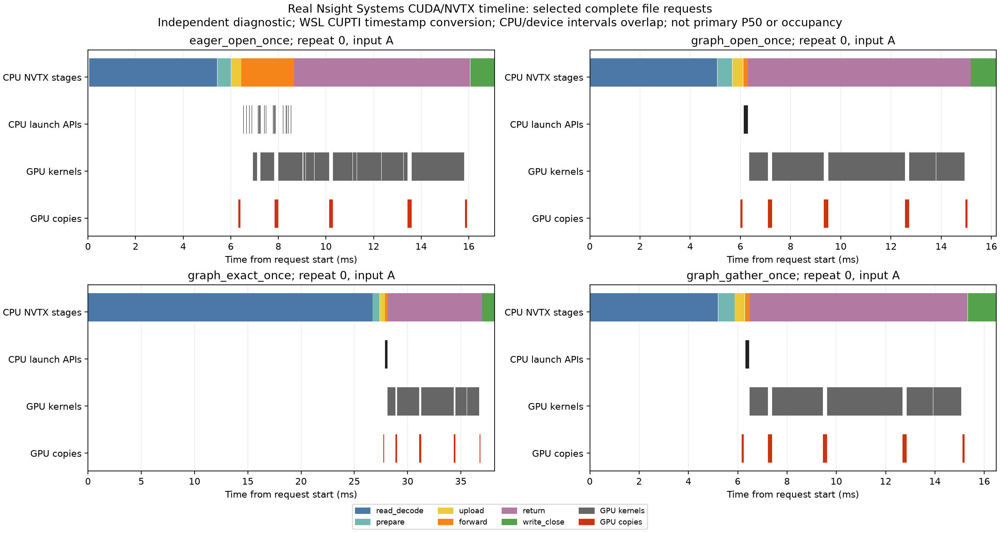

# Nsight Systems: real full-file CUDA/NVTX diagnostic

The target runs a fixed B64 untrained FNO with the canonical state and genuine A/B frames, shared-handle bounding/exact/gather readers and CPU/eager/graph engines. Every output is written/closed, read back and checked for values, shape/dtype, coordinate/time/member metadata and CPU FP64 agreement. All 18 last A/B files per capture remain. Validation/hashes/cleanup and pre-call synchronization are outside NVTX request roots.

## Capture status

| Capture | Nsight version | WSL workaround mode | NVTX calls | GPU kernels | Status |
|---|---|---|---:|---:|---|
| rtx3050_physics_nsight_run01 | NVIDIA Nsight Systems version 2024.5.1.113-245134619542v0 | none/environment directive | 36 | 0 | PARTIAL: CUDA API/NVTX only |
| rtx3050_physics_nsight_run02 | NVIDIA Nsight Systems version 2024.7.1.84-247135125610v0 | none/environment directive | 36 | 0 | PARTIAL: CUDA API/NVTX only |
| rtx3050_physics_nsight_run03 | NVIDIA Nsight Systems version 2024.7.1.84-247135125610v0 | Temporary official config file; original restored before export | 36 | 2376 | Complete GPU evidence |

The initial 2024.5 capture and 2024.7 environment-directive attempt lack device kernel/copy tables and cannot establish a GPU timeline. The final 2024.7 capture uses CuptiUseRawGpuTimestamps=false in the configuration path returned by nsys -z, restoring the exact original file (or removing the newly created file) after collection. Node-level graph tracing is requested. CUDAProfilerStart/Stop bounds the capture; CPU sampling/context-switch tracing is disabled.

NVIDIA documents this WSL timestamp workaround as less precise than the normal conversion. The recovered device activity is suitable for qualitative correlation here; do not treat small CPU/GPU timing offsets as exact scheduling measurements. [NVIDIA WSL troubleshooting](https://forums.developer.nvidia.com/t/nsys-doesnt-show-cuda-kernel-and-memory-data/315536/9), [Nsight Systems user guide](https://docs.nvidia.com/nsight-systems/UserGuide/).

## Complete-capture diagnostic medians

| Method | Calls | NVTX root ms | Read ms | Forward CPU range ms | Return CPU range ms | Kernel union ms | GPU active union ms | Kernel events/call | Kernel-launch APIs/call | Graph launch/call |
|---|---:|---:|---:|---:|---:|---:|---:|---:|---:|---:|
| cpu_open_once | 4 | 82.784 | 5.257 | 75.622 | 0.022 | 0.000 | 0.000 | 0.000 | 0.000 | 0.000 |
| eager_open_once | 4 | 17.443 | 5.546 | 2.237 | 7.402 | 8.090 | 8.757 | 99.000 | 99.000 | 0.000 |
| graph_open_once | 4 | 16.964 | 5.509 | 0.190 | 8.870 | 8.063 | 8.729 | 99.000 | 0.000 | 1.000 |
| cpu_exact_once | 4 | 106.675 | 27.306 | 76.810 | 0.027 | 0.000 | 0.000 | 0.000 | 0.000 | 0.000 |
| eager_exact_once | 4 | 39.614 | 27.403 | 2.220 | 7.443 | 8.091 | 8.758 | 99.000 | 99.000 | 0.000 |
| graph_exact_once | 4 | 38.561 | 27.058 | 0.191 | 8.847 | 8.064 | 8.729 | 99.000 | 0.000 | 1.000 |
| cpu_gather_once | 4 | 83.906 | 5.392 | 75.985 | 0.023 | 0.000 | 0.000 | 0.000 | 0.000 | 0.000 |
| eager_gather_once | 4 | 17.864 | 5.569 | 2.344 | 7.408 | 8.092 | 8.759 | 99.000 | 99.000 | 0.000 |
| graph_gather_once | 4 | 16.496 | 5.235 | 0.202 | 8.828 | 8.064 | 8.729 | 99.000 | 0.000 | 1.000 |

GPU events are matched to NVTX requests via CUDA runtime correlation IDs, not inferred only from nearby timestamps. CPU roots must contain no CUDA work. Each complete GPU root must contain real kernels, one full 1 MiB input HtoD and one full 1 MiB output DtoH. Graph roots require exactly one cudaGraphLaunch, eager roots actual kernel-launch APIs and no graph launch. Kernel counts are reconciled across the entire selected export. Internal device copies are also retained; event-category differences do not prove reduced mathematical work.

The CPU forward range measures dispatch plus any blocking host work, while return can wait for preceding GPU work and then transfer. GPU kernels overlap these CPU intervals. A larger return range is not evidence that PCIe transfer alone is slow; launch duration, return duration and GPU activity cannot be added as independent costs. Activity interval union is not GPU occupancy.

These calls include NVTX/tool instrumentation, a single B64 graph and a different cadence/resource history from the mixed-shape primary sessions. Their medians do not replace primary P50/P95 or provide an exact primary-stage decomposition. The selected four illustrated requests are examples, with all 36 calls retained in CSV.

## Reproduction and event artifacts

```bash
source .venv/physicsnemo/bin/activate
python scripts/setup_nsight_cli.py --release 2024.7.1
python scripts/run_physicsnemo_nsight.py --wsl-timestamps --output results/my_nsight
python scripts/analyze_physicsnemo_nsight.py results/my_nsight --output results/my_nsight_report
```

Use new output paths; the installer preserves existing tool directories and validates package SHA256 against NVIDIA repository metadata. Only a local CLI package is extracted; drivers and Python environments are not upgraded. The workaround changes only the specific Nsight config for the collection, then restores it. Other profiling sessions should not run concurrently.

Raw capture.nsys-rep and trace.sqlite remain local because Nsight can include process/environment metadata. events.sqlite contains only whitelisted NVTX/CUDA event tables, memcpy enums and referenced API/kernel names; metadata tables and unreferenced strings are omitted. Its manifest links its hash/table counts to the raw-export hash. The archived capture command, tool/package hashes, target source, collector logs and checked outputs are retained. CPU CI independently reconciles the selected events and output contract; it does not rerun Nsight or GPU execution.


