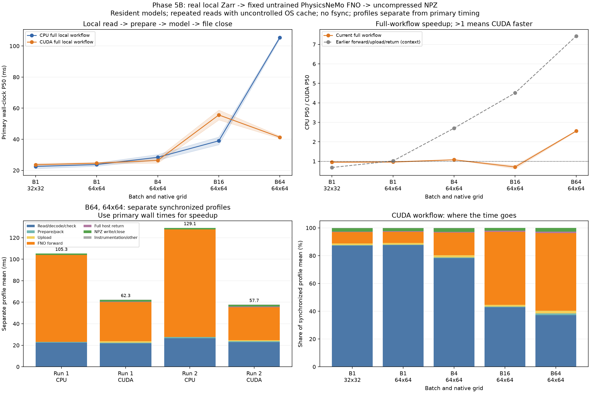

# Phase 5B: local Zarr-to-FNO-to-file performance

The same fixed, untrained 132,353-parameter FNO and FP32 input transformation are retained from phase 5A. No forecast-quality evaluation, training or Earth2Studio pipeline is involved.

## Primary complete-workflow timings

| Session | Batch/grid | CPU P50 ms | CUDA P50 ms | CPU/CUDA | CPU P95 ms | CUDA P95 ms | CUDA frames/s |
|---|---|---:|---:|---:|---:|---:|---:|
| rtx3050_physics_pipeline_run01 | 1/32x32 | 23.932 | 24.593 | 0.97x | 30.670 | 28.014 | 40.7 |
| rtx3050_physics_pipeline_run01 | 1/64x64 | 24.791 | 25.081 | 0.99x | 28.105 | 27.156 | 39.9 |
| rtx3050_physics_pipeline_run01 | 4/64x64 | 30.207 | 28.123 | 1.07x | 35.942 | 31.837 | 142.2 |
| rtx3050_physics_pipeline_run01 | 16/64x64 | 36.502 | 58.812 | 0.62x | 42.557 | 73.077 | 272.1 |
| rtx3050_physics_pipeline_run01 | 64/64x64 | 106.389 | 42.122 | 2.53x | 113.036 | 50.679 | 1519.4 |
| rtx3050_physics_pipeline_run02 | 1/32x32 | 21.100 | 22.616 | 0.93x | 23.276 | 25.839 | 44.2 |
| rtx3050_physics_pipeline_run02 | 1/64x64 | 22.672 | 24.202 | 0.94x | 26.759 | 28.906 | 41.3 |
| rtx3050_physics_pipeline_run02 | 4/64x64 | 26.605 | 24.650 | 1.08x | 30.918 | 28.095 | 162.3 |
| rtx3050_physics_pipeline_run02 | 16/64x64 | 41.482 | 52.451 | 0.79x | 55.503 | 85.935 | 305.0 |
| rtx3050_physics_pipeline_run02 | 64/64x64 | 104.542 | 40.549 | 2.58x | 126.436 | 91.825 | 1578.4 |

For the final listed case B64/64x64, observed complete-workflow CPU/CUDA ratios range from 2.53x to 2.58x. Ratios below 1 elsewhere are retained, including any nonmonotonic batch behavior. These results do not justify assuming every batch benefits from CUDA.

Primary wall time is measured directly through file close. It includes Zarr open/read/decode and source coordinate validation, fixed scaling and contiguous FP32 packing, frame/coordinate output metadata construction, host tensor creation, CUDA upload, model forward, full CPU return and uncompressed NPZ creation/write/close. CPU and CUDA models/weights stay resident; each invocation reopens and rereads the source. File readback, reference checks, hashing, cleanup and benchmark CSV/JSON writing are excluded.

Primary repetitions are separate from stage-profile repetitions. CUDA completion is guaranteed by the blocking full host copy before writing. Profiles additionally synchronize GPU stages and expose instrumentation cost; their mean segments plus residual sum to the profile mean, not the primary P50. Stage medians are never added to estimate total latency.

Profile means can differ materially from primary timings because synchronization boundaries and execution time/system state differ. In particular, GPU forward wall times in this workflow may be longer than the earlier forward-only benchmark. The current samples do not isolate driver scheduling, power state, shape history or other causes. Stage shares describe the synchronized profile experiment, not an exact decomposition of primary latency or proof of a sole bottleneck.

## Independent stage profiles

| Session | Batch/grid | Backend | Read/decode/check ms | Prepare ms | Upload ms | Forward ms | Return ms | Write/close ms | Other ms | Profile mean ms |
|---|---|---|---:|---:|---:|---:|---:|---:|---:|---:|
| rtx3050_physics_pipeline_run01 | 1/32x32 | cpu | 20.559 | 0.094 | 0.000 | 1.677 | 0.011 | 0.602 | 0.038 | 22.980 |
| rtx3050_physics_pipeline_run01 | 1/32x32 | cuda | 21.557 | 0.086 | 0.352 | 1.909 | 0.108 | 0.631 | 0.040 | 24.684 |
| rtx3050_physics_pipeline_run01 | 1/64x64 | cpu | 21.598 | 0.103 | 0.000 | 2.372 | 0.011 | 0.657 | 0.036 | 24.778 |
| rtx3050_physics_pipeline_run01 | 1/64x64 | cuda | 22.279 | 0.111 | 0.349 | 2.184 | 0.107 | 0.585 | 0.044 | 25.657 |
| rtx3050_physics_pipeline_run01 | 4/64x64 | cpu | 20.110 | 0.130 | 0.000 | 6.315 | 0.014 | 0.830 | 0.040 | 27.437 |
| rtx3050_physics_pipeline_run01 | 4/64x64 | cuda | 22.298 | 0.131 | 0.557 | 5.537 | 0.163 | 0.808 | 0.044 | 29.539 |
| rtx3050_physics_pipeline_run01 | 16/64x64 | cpu | 25.436 | 0.243 | 0.000 | 16.498 | 0.020 | 1.135 | 0.050 | 43.381 |
| rtx3050_physics_pipeline_run01 | 16/64x64 | cuda | 25.584 | 0.250 | 0.747 | 33.213 | 0.521 | 1.087 | 0.069 | 61.471 |
| rtx3050_physics_pipeline_run01 | 64/64x64 | cpu | 22.474 | 0.665 | 0.000 | 80.861 | 0.022 | 1.239 | 0.048 | 105.308 |
| rtx3050_physics_pipeline_run01 | 64/64x64 | cuda | 21.718 | 0.663 | 1.410 | 36.289 | 0.566 | 1.588 | 0.068 | 62.302 |
| rtx3050_physics_pipeline_run02 | 1/32x32 | cpu | 18.228 | 0.073 | 0.000 | 1.433 | 0.008 | 0.551 | 0.028 | 20.323 |
| rtx3050_physics_pipeline_run02 | 1/32x32 | cuda | 18.643 | 0.079 | 0.253 | 1.770 | 0.087 | 0.537 | 0.035 | 21.405 |
| rtx3050_physics_pipeline_run02 | 1/64x64 | cpu | 19.670 | 0.086 | 0.000 | 2.610 | 0.013 | 0.821 | 0.042 | 23.241 |
| rtx3050_physics_pipeline_run02 | 1/64x64 | cuda | 22.106 | 0.088 | 0.256 | 1.875 | 0.098 | 0.564 | 0.038 | 25.025 |
| rtx3050_physics_pipeline_run02 | 4/64x64 | cpu | 20.077 | 0.151 | 0.000 | 6.534 | 0.014 | 0.810 | 0.037 | 27.623 |
| rtx3050_physics_pipeline_run02 | 4/64x64 | cuda | 20.849 | 0.158 | 0.351 | 3.434 | 0.125 | 0.687 | 0.036 | 25.640 |
| rtx3050_physics_pipeline_run02 | 16/64x64 | cpu | 26.480 | 0.242 | 0.000 | 16.250 | 0.018 | 0.943 | 0.049 | 43.982 |
| rtx3050_physics_pipeline_run02 | 16/64x64 | cuda | 23.114 | 0.256 | 0.775 | 26.434 | 0.558 | 1.007 | 0.068 | 52.212 |
| rtx3050_physics_pipeline_run02 | 64/64x64 | cpu | 26.651 | 1.124 | 0.000 | 99.917 | 0.019 | 1.374 | 0.058 | 129.143 |
| rtx3050_physics_pipeline_run02 | 64/64x64 | cuda | 22.849 | 0.958 | 0.936 | 30.670 | 0.640 | 1.608 | 0.075 | 57.736 |

## Output/source correctness and interpretation

Every first, warmup, primary, profile and memory-probe invocation writes a real NPZ file, reads it back, verifies exact array values/dtypes/coordinates/initialization/lead/member/valid-time metadata and compares the full model output elementwise with the archived CPU FP64 reference (rtol=1e-4, atol=1e-5). Each session independently recomputes that FP64 reference using the archived FP32 weights cast to double. Numerical differences describe arithmetic consistency, not weather error. Output variable is dimensionless model_output, not a temperature forecast.

Only the last primary output per case/backend is retained. Deterministic payload/file hashes, output byte counts and numerical checks are recorded for all primary/profile/first observations; discarded trial files are removed after validation outside timing. The CPU-only analyzer checks retained files against original frames, archived weights/reference and every recorded trial hash, then independently reconciles raw quantiles, method ordering and stage sums. CPU/CUDA write identical byte counts with uncompressed np.savez.

The source is the pinned local Zarr, not a fresh remote download. Cases follow listed order; primary CPU/CUDA order is seeded and shuffled per repetition, profiles use a separate seed. Reads occur after source hash/reference setup and may use OS/library cache; first_observed.csv is an initialized-process observation, not cold storage/process timing. No cache is dropped. Validation readback and trial deletion also affect cache/system state outside timing. The range shading covers session medians and is not a confidence interval. Short-session P95 values are estimates.

Write completion means file close at the application/OS level; fsync and durable media persistence are not requested. Compression, metadata-heavy Zarr output, asynchronous overlap, remote acquisition, model/process startup and training are separate workloads. Setup duration is recorded outside primary timing; GPU allocator memory.csv is a separate warmed full-invocation observation and is not total process VRAM.

The earlier forward/upload/return curve is context from an earlier measurement session, not a contemporaneous decomposition of current end-to-end times. Compare current CPU/CUDA within each session for the complete-workflow speedup.

## Read coverage

| Batch/grid | Packed input bytes | Materialized frames | Selection bytes before truncation | Touched local chunks | Nominal uncompressed chunk bytes |
|---|---:|---:|---:|---:|---:|
| 1/32x32 | 4096 | 1 | 4096 | 1 | 835584 |
| 1/64x64 | 16384 | 1 | 16384 | 4 | 3342336 |
| 4/64x64 | 65536 | 4 | 65536 | 4 | 3342336 |
| 16/64x64 | 262144 | 16 | 262144 | 4 | 3342336 |
| 64/64x64 | 1048576 | 102 | 1671168 | 4 | 3342336 |

Selection matches phase 5A: native rectangular init/lead/member selection, then first B flattened frames. B64 materializes 102 frames before truncation to 64. Chunk estimates use the local v2 chunk layout; they are neither measured physical disk bytes nor remote-archive transfer sizes. This baseline deliberately preserves that selection behavior so later reader changes can be assessed separately.

## Reproduce

```bash
source .venv/physicsnemo/bin/activate
python physicsnemo_pipeline.py --output results/my_physics_pipeline01
python physicsnemo_pipeline.py --order-seed 20261103 --output results/my_physics_pipeline02
python scripts/analyze_physicsnemo_pipeline.py results/my_physics_pipeline01 results/my_physics_pipeline02 --output results/my_physics_pipeline_comparison
```

Use new output paths. The existing phase-5 isolated environment and exact lock apply; CPU-only dependencies suffice to revalidate saved artifacts and regenerate this report. No JAX installation is required.


