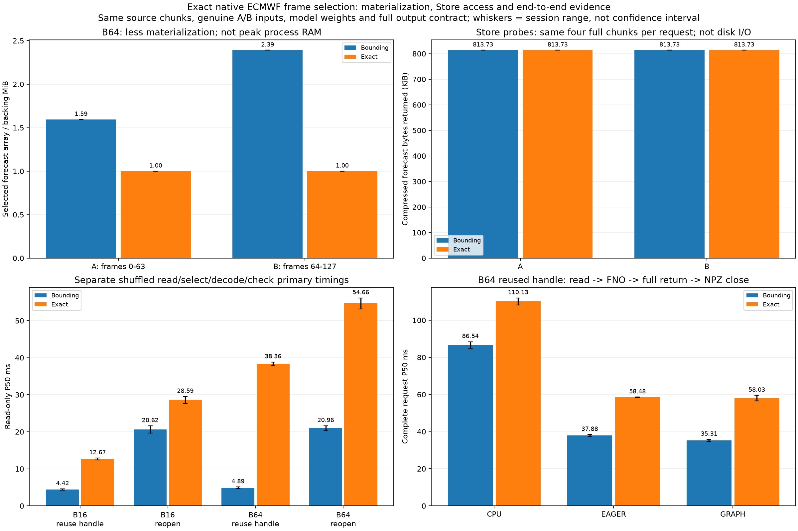

# Exact-frame reader and complete-workflow comparison

The optional exact_once/exact_reopen readers use shared-dimension xarray vectorized isel for the same native flattened init/lead/member A/B windows. Existing open_once/reopen bounding readers and CLI defaults remain. Models, input scaling/FP32 packing, fixed GPU buffers, output schema, output byte counts, tolerance and graph replay behavior are unchanged within this comparison. No prepared-input/output cache, regridding, rechunking, remote retrieval, training or forecast-quality evaluation is involved.

## Selection and actual Store coverage

| Batch | Variant | Selection | Materialized frames | Forecast array/backing MiB | Forecast Store gets | Compressed bytes returned | Nominal decoded chunk bytes |
|---|---|---|---:|---:|---:|---:|---:|
| 16 | A | bounding | 16 | 0.250 | 4 | 833260 | 3342336 |
| 16 | A | exact | 16 | 0.250 | 4 | 833260 | 3342336 |
| 16 | B | bounding | 32 | 0.500 | 4 | 833260 | 3342336 |
| 16 | B | exact | 16 | 0.250 | 4 | 833260 | 3342336 |
| 64 | A | bounding | 102 | 1.594 | 4 | 833260 | 3342336 |
| 64 | A | exact | 64 | 1.000 | 4 | 833260 | 3342336 |
| 64 | B | bounding | 153 | 2.391 | 4 | 833260 | 3342336 |
| 64 | B | exact | 64 | 1.000 | 4 | 833260 | 3342336 |

Separate instrumented LocalStore probes retain all key/byte observations including coordinates and metadata. Forecast chunk gets must match unique expected keys and stored compressed file sizes exactly. Probe returned-view and ultimate backing-array bytes must match selection budgets. These are Store API bytes, not physical disk/network traffic, HTTP requests, decoder invocation counts or peak process RAM. The unchanged fixture chunks are [1,4,51,32,32], so both paths read the same four forecast chunks (833,260 compressed bytes, 3,342,336 nominal uncompressed bytes) for both A/B and B16/B64. Exact selection reduces the forecast result/backing array, not chunk coverage in this fixture.

## Independent read-only primary timings

| Session | Batch | Reader | P50 ms | P95 ms | Maximum ms |
|---|---:|---|---:|---:|---:|
| rtx3050_physics_reader_run01 | 16 | open_once | 4.618 | 5.617 | 7.052 |
| rtx3050_physics_reader_run01 | 16 | reopen | 21.613 | 25.719 | 35.540 |
| rtx3050_physics_reader_run01 | 16 | exact_once | 12.948 | 15.327 | 16.972 |
| rtx3050_physics_reader_run01 | 16 | exact_reopen | 29.542 | 36.679 | 58.367 |
| rtx3050_physics_reader_run01 | 64 | open_once | 5.109 | 6.562 | 9.374 |
| rtx3050_physics_reader_run01 | 64 | reopen | 21.639 | 26.430 | 43.666 |
| rtx3050_physics_reader_run01 | 64 | exact_once | 38.859 | 47.836 | 50.299 |
| rtx3050_physics_reader_run01 | 64 | exact_reopen | 56.149 | 72.970 | 95.101 |
| rtx3050_physics_reader_run02 | 16 | open_once | 4.217 | 4.716 | 5.846 |
| rtx3050_physics_reader_run02 | 16 | reopen | 19.635 | 20.718 | 23.247 |
| rtx3050_physics_reader_run02 | 16 | exact_once | 12.400 | 13.348 | 13.884 |
| rtx3050_physics_reader_run02 | 16 | exact_reopen | 27.644 | 30.794 | 50.084 |
| rtx3050_physics_reader_run02 | 64 | open_once | 4.662 | 5.626 | 6.728 |
| rtx3050_physics_reader_run02 | 64 | reopen | 20.273 | 21.020 | 21.919 |
| rtx3050_physics_reader_run02 | 64 | exact_once | 37.865 | 38.908 | 39.211 |
| rtx3050_physics_reader_run02 | 64 | exact_reopen | 53.175 | 55.495 | 56.496 |

Read-only timings include select/read/decode/source validation and, for reopen, dataset open/close. Packing, identity/value/coordinate checks, hashes, probes and report writing are outside primary timing. All cases/readers are shuffled within each repeat and use the same alternating A/B input. No model executes in these measurements. Shared-handle setup/probes/reference checks warm caches; there is no cold-disk claim.

### Paired read-only contrasts, split by genuine input variant

| Session | Batch | Handle | Variant | Median bounding/exact | Median saving ms | Exact-faster pairs |
|---|---:|---|---|---:|---:|---:|
| rtx3050_physics_reader_run01 | 16 | open_once | A | 0.350x | -8.503 | 0/20 |
| rtx3050_physics_reader_run01 | 16 | open_once | B | 0.356x | -8.105 | 0/20 |
| rtx3050_physics_reader_run01 | 16 | reopen | A | 0.729x | -7.998 | 1/20 |
| rtx3050_physics_reader_run01 | 16 | reopen | B | 0.717x | -8.159 | 0/20 |
| rtx3050_physics_reader_run01 | 64 | open_once | A | 0.123x | -34.138 | 0/20 |
| rtx3050_physics_reader_run01 | 64 | open_once | B | 0.132x | -33.903 | 0/20 |
| rtx3050_physics_reader_run01 | 64 | reopen | A | 0.370x | -35.888 | 0/20 |
| rtx3050_physics_reader_run01 | 64 | reopen | B | 0.382x | -35.222 | 0/20 |
| rtx3050_physics_reader_run02 | 16 | open_once | A | 0.351x | -7.577 | 0/20 |
| rtx3050_physics_reader_run02 | 16 | open_once | B | 0.350x | -8.172 | 0/20 |
| rtx3050_physics_reader_run02 | 16 | reopen | A | 0.729x | -7.579 | 0/20 |
| rtx3050_physics_reader_run02 | 16 | reopen | B | 0.703x | -8.238 | 0/20 |
| rtx3050_physics_reader_run02 | 64 | open_once | A | 0.118x | -33.383 | 0/20 |
| rtx3050_physics_reader_run02 | 64 | open_once | B | 0.132x | -32.706 | 0/20 |
| rtx3050_physics_reader_run02 | 64 | reopen | A | 0.379x | -33.140 | 0/20 |
| rtx3050_physics_reader_run02 | 64 | reopen | B | 0.381x | -32.980 | 0/20 |

## Complete Zarr-to-file primary timings

| Session | Batch | Engine/reader | P50 ms | P95 ms | Maximum ms |
|---|---:|---|---:|---:|---:|
| rtx3050_physics_reader_pipeline_run01 | 16 | cpu_open_once | 19.556 | 24.000 | 27.573 |
| rtx3050_physics_reader_pipeline_run01 | 16 | eager_open_once | 14.960 | 18.983 | 20.316 |
| rtx3050_physics_reader_pipeline_run01 | 16 | graph_open_once | 14.627 | 17.129 | 18.887 |
| rtx3050_physics_reader_pipeline_run01 | 16 | cpu_exact_once | 24.852 | 32.207 | 37.184 |
| rtx3050_physics_reader_pipeline_run01 | 16 | eager_exact_once | 21.559 | 25.212 | 26.320 |
| rtx3050_physics_reader_pipeline_run01 | 16 | graph_exact_once | 20.576 | 23.251 | 24.456 |
| rtx3050_physics_reader_pipeline_run01 | 16 | cpu_reopen | 37.596 | 46.070 | 55.685 |
| rtx3050_physics_reader_pipeline_run01 | 16 | eager_reopen | 32.067 | 37.847 | 39.681 |
| rtx3050_physics_reader_pipeline_run01 | 16 | graph_reopen | 31.557 | 38.416 | 41.477 |
| rtx3050_physics_reader_pipeline_run01 | 16 | cpu_exact_reopen | 42.809 | 52.821 | 53.395 |
| rtx3050_physics_reader_pipeline_run01 | 16 | eager_exact_reopen | 39.008 | 43.595 | 49.959 |
| rtx3050_physics_reader_pipeline_run01 | 16 | graph_exact_reopen | 37.369 | 41.585 | 43.422 |
| rtx3050_physics_reader_pipeline_run01 | 64 | cpu_open_once | 88.439 | 113.147 | 126.335 |
| rtx3050_physics_reader_pipeline_run01 | 64 | eager_open_once | 38.449 | 49.943 | 50.602 |
| rtx3050_physics_reader_pipeline_run01 | 64 | graph_open_once | 35.841 | 41.445 | 42.175 |
| rtx3050_physics_reader_pipeline_run01 | 64 | cpu_exact_once | 112.037 | 135.715 | 147.692 |
| rtx3050_physics_reader_pipeline_run01 | 64 | eager_exact_once | 58.328 | 71.063 | 77.771 |
| rtx3050_physics_reader_pipeline_run01 | 64 | graph_exact_once | 59.555 | 65.847 | 69.694 |
| rtx3050_physics_reader_pipeline_run01 | 64 | cpu_reopen | 105.446 | 130.941 | 154.987 |
| rtx3050_physics_reader_pipeline_run01 | 64 | eager_reopen | 54.634 | 62.116 | 69.119 |
| rtx3050_physics_reader_pipeline_run01 | 64 | graph_reopen | 51.565 | 61.209 | 63.216 |
| rtx3050_physics_reader_pipeline_run01 | 64 | cpu_exact_reopen | 127.424 | 148.813 | 165.049 |
| rtx3050_physics_reader_pipeline_run01 | 64 | eager_exact_reopen | 76.910 | 101.003 | 113.858 |
| rtx3050_physics_reader_pipeline_run01 | 64 | graph_exact_reopen | 76.664 | 88.165 | 99.395 |
| rtx3050_physics_reader_pipeline_run02 | 16 | cpu_open_once | 19.031 | 25.623 | 74.877 |
| rtx3050_physics_reader_pipeline_run02 | 16 | eager_open_once | 14.536 | 18.786 | 23.607 |
| rtx3050_physics_reader_pipeline_run02 | 16 | graph_open_once | 14.033 | 18.369 | 42.298 |
| rtx3050_physics_reader_pipeline_run02 | 16 | cpu_exact_once | 25.076 | 27.653 | 39.038 |
| rtx3050_physics_reader_pipeline_run02 | 16 | eager_exact_once | 20.388 | 26.175 | 28.820 |
| rtx3050_physics_reader_pipeline_run02 | 16 | graph_exact_once | 20.501 | 29.059 | 35.019 |
| rtx3050_physics_reader_pipeline_run02 | 16 | cpu_reopen | 35.998 | 40.225 | 89.970 |
| rtx3050_physics_reader_pipeline_run02 | 16 | eager_reopen | 30.345 | 36.804 | 67.993 |
| rtx3050_physics_reader_pipeline_run02 | 16 | graph_reopen | 30.277 | 34.310 | 52.287 |
| rtx3050_physics_reader_pipeline_run02 | 16 | cpu_exact_reopen | 41.418 | 59.243 | 76.330 |
| rtx3050_physics_reader_pipeline_run02 | 16 | eager_exact_reopen | 37.233 | 43.379 | 47.387 |
| rtx3050_physics_reader_pipeline_run02 | 16 | graph_exact_reopen | 36.267 | 42.473 | 74.839 |
| rtx3050_physics_reader_pipeline_run02 | 64 | cpu_open_once | 84.633 | 95.511 | 237.410 |
| rtx3050_physics_reader_pipeline_run02 | 64 | eager_open_once | 37.305 | 45.110 | 114.521 |
| rtx3050_physics_reader_pipeline_run02 | 64 | graph_open_once | 34.778 | 45.123 | 71.040 |
| rtx3050_physics_reader_pipeline_run02 | 64 | cpu_exact_once | 108.223 | 120.139 | 273.051 |
| rtx3050_physics_reader_pipeline_run02 | 64 | eager_exact_once | 58.634 | 85.929 | 133.714 |
| rtx3050_physics_reader_pipeline_run02 | 64 | graph_exact_once | 56.507 | 74.772 | 132.351 |
| rtx3050_physics_reader_pipeline_run02 | 64 | cpu_reopen | 100.715 | 109.640 | 403.056 |
| rtx3050_physics_reader_pipeline_run02 | 64 | eager_reopen | 53.537 | 76.805 | 119.407 |
| rtx3050_physics_reader_pipeline_run02 | 64 | graph_reopen | 51.205 | 72.303 | 171.799 |
| rtx3050_physics_reader_pipeline_run02 | 64 | cpu_exact_reopen | 124.367 | 157.004 | 588.467 |
| rtx3050_physics_reader_pipeline_run02 | 64 | eager_exact_reopen | 73.842 | 85.396 | 90.877 |
| rtx3050_physics_reader_pipeline_run02 | 64 | graph_exact_reopen | 74.032 | 83.900 | 91.898 |

### Matched complete-request reader contrasts

| Session | Batch | Engine | Handle | Median bounding/exact | Median saving ms | Exact-faster pairs |
|---|---:|---|---|---:|---:|---:|
| rtx3050_physics_reader_pipeline_run01 | 16 | cpu | open_once | 0.756x | -6.476 | 0/30 |
| rtx3050_physics_reader_pipeline_run01 | 16 | cpu | reopen | 0.878x | -5.535 | 3/30 |
| rtx3050_physics_reader_pipeline_run01 | 16 | eager | open_once | 0.720x | -5.691 | 1/30 |
| rtx3050_physics_reader_pipeline_run01 | 16 | eager | reopen | 0.856x | -5.383 | 1/30 |
| rtx3050_physics_reader_pipeline_run01 | 16 | graph | open_once | 0.719x | -5.776 | 0/30 |
| rtx3050_physics_reader_pipeline_run01 | 16 | graph | reopen | 0.858x | -5.264 | 2/30 |
| rtx3050_physics_reader_pipeline_run01 | 64 | cpu | open_once | 0.789x | -23.499 | 1/30 |
| rtx3050_physics_reader_pipeline_run01 | 64 | cpu | reopen | 0.824x | -22.849 | 2/30 |
| rtx3050_physics_reader_pipeline_run01 | 64 | eager | open_once | 0.635x | -21.519 | 0/30 |
| rtx3050_physics_reader_pipeline_run01 | 64 | eager | reopen | 0.703x | -23.631 | 0/30 |
| rtx3050_physics_reader_pipeline_run01 | 64 | graph | open_once | 0.593x | -22.921 | 0/30 |
| rtx3050_physics_reader_pipeline_run01 | 64 | graph | reopen | 0.671x | -24.477 | 0/30 |
| rtx3050_physics_reader_pipeline_run02 | 16 | cpu | open_once | 0.802x | -5.002 | 1/30 |
| rtx3050_physics_reader_pipeline_run02 | 16 | cpu | reopen | 0.855x | -5.854 | 3/30 |
| rtx3050_physics_reader_pipeline_run02 | 16 | eager | open_once | 0.699x | -6.295 | 0/30 |
| rtx3050_physics_reader_pipeline_run02 | 16 | eager | reopen | 0.821x | -6.806 | 1/30 |
| rtx3050_physics_reader_pipeline_run02 | 16 | graph | open_once | 0.682x | -6.045 | 1/30 |
| rtx3050_physics_reader_pipeline_run02 | 16 | graph | reopen | 0.813x | -6.978 | 0/30 |
| rtx3050_physics_reader_pipeline_run02 | 64 | cpu | open_once | 0.779x | -24.242 | 1/30 |
| rtx3050_physics_reader_pipeline_run02 | 64 | cpu | reopen | 0.796x | -25.519 | 0/30 |
| rtx3050_physics_reader_pipeline_run02 | 64 | eager | open_once | 0.599x | -22.471 | 0/30 |
| rtx3050_physics_reader_pipeline_run02 | 64 | eager | reopen | 0.700x | -22.507 | 1/30 |
| rtx3050_physics_reader_pipeline_run02 | 64 | graph | open_once | 0.604x | -22.558 | 0/30 |
| rtx3050_physics_reader_pipeline_run02 | 64 | graph | reopen | 0.680x | -23.079 | 1/30 |

Both methods include actual A/B reads/packing, new-input HtoD for GPU, the same untrained FP32 FNO, full host output and identical uncompressed NPZ creation/close. Models stay resident; eager/graph share fixed GPU input storage and graph resources coexist with other engines. Setup, FP64 reference work, output readback/checks/hashes and cleanup are outside primary timing. Every output file is read back and validated; last A/B outputs for every case/method remain archived. Real full-file traces independently prove the requested engine, full HtoD/DtoH and genuine cudaGraphLaunch only for graph.

Independent synchronized stage profiles and allocator observations remain in each pipeline run. They are not an exact decomposition of primary P50 or standalone/total VRAM. File close is not fsync/durable-media persistence. CPU dispatch, GPU execution, OS/library state and profiling can vary; no single driver/power-state cause is isolated. All P95/maxima, regressions and samples remain. Paired ratios/counts describe these sessions, not significance tests or latency guarantees. Do not compare older sessions with different protocols as a causal decomposition.

## Validation and reproduction

The analyzer validates common pinned GPU evidence, both full-file workflows, source frame identities/coordinates, archived FP64 agreement, equal output byte counts, seeded pairing/quantiles, profile sums, setup/runtime allocator arithmetic and actual trace kernels/launches/copy bytes. It additionally validates reader budgets, observed backing-array sizes, every Store key/byte record against the unchanged source, and read-only input hashes versus pinned native A/B arrays. --recompute-reference independently rebuilds the common FP64 references using the isolated model environment.

```bash
source .venv/physicsnemo/bin/activate
python physicsnemo_graph_pipeline.py --readers open_once exact_once reopen exact_reopen --seed 20261113 --output results/my_reader_pipeline01
python physicsnemo_graph_pipeline.py --readers open_once exact_once reopen exact_reopen --seed 20261114 --output results/my_reader_pipeline02
python physicsnemo_reader_benchmark.py --seed 20261113 --output results/my_reader01
python physicsnemo_reader_benchmark.py --seed 20261114 --output results/my_reader02
python scripts/analyze_physicsnemo_reader.py results/my_reader_pipeline01 results/my_reader_pipeline02 --reader-runs results/my_reader01 results/my_reader02 --recompute-reference --output results/my_reader_report
# Exact reader, graph alone:
python physicsnemo_graph_pipeline.py --engines graph --readers exact_once --output results/my_exact_graph
```

Run benchmarks separately, use new output paths. Reader-only execution needs the CPU data dependencies; Store probes support Zarr 3 LocalStore and the original environment's Zarr 2 DirectoryStore. Recorded formal measurements use the saved isolated-environment versions. Model execution/reference rebuild needs the isolated PhysicsNeMo environment. Without --recompute-reference, CPU dependencies suffice to validate saved GPU evidence and redraw this figure. Existing pipeline defaults retain bounding readers; exact is explicitly selected.


