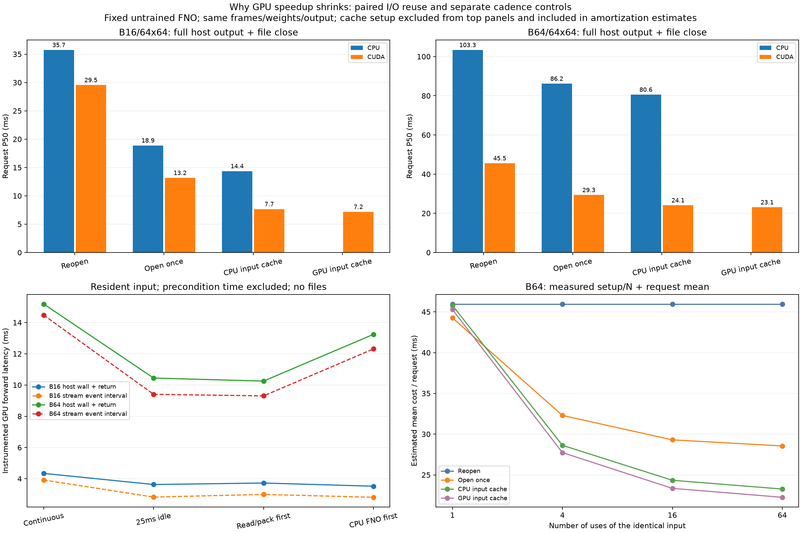

# Phase 5B: paired reuse and GPU cadence controls

Fixed untrained FNO, identical ECMWF input frames/weights, FP32, full host outputs and identical uncompressed NPZ files. Models remain resident. No forecast assessment, model training, driver/power-setting changes, JAX or Earth2Studio installation.

## Paired workflow requests

| Session | Batch/grid | Workflow | P50 ms | P95 ms | Setup ms, outside requests |
|---|---|---|---:|---:|---:|
| rtx3050_physics_reuse_run01 | 16/64x64 | cpu_reopen | 34.900 | 38.085 | 0.000 |
| rtx3050_physics_reuse_run01 | 16/64x64 | cuda_reopen | 29.043 | 31.653 | 0.000 |
| rtx3050_physics_reuse_run01 | 16/64x64 | cpu_open_once | 18.888 | 21.031 | 337.633 |
| rtx3050_physics_reuse_run01 | 16/64x64 | cuda_open_once | 13.266 | 17.912 | 337.633 |
| rtx3050_physics_reuse_run01 | 16/64x64 | cpu_host_cache | 14.211 | 15.611 | 25.110 |
| rtx3050_physics_reuse_run01 | 16/64x64 | cuda_host_cache | 7.441 | 11.097 | 25.110 |
| rtx3050_physics_reuse_run01 | 16/64x64 | cuda_device_cache | 7.145 | 11.718 | 25.521 |
| rtx3050_physics_reuse_run01 | 64/64x64 | cpu_reopen | 103.127 | 108.812 | 0.000 |
| rtx3050_physics_reuse_run01 | 64/64x64 | cuda_reopen | 44.065 | 62.193 | 0.000 |
| rtx3050_physics_reuse_run01 | 64/64x64 | cpu_open_once | 86.592 | 90.702 | 14.615 |
| rtx3050_physics_reuse_run01 | 64/64x64 | cuda_open_once | 28.888 | 37.824 | 14.615 |
| rtx3050_physics_reuse_run01 | 64/64x64 | cpu_host_cache | 80.326 | 87.803 | 22.479 |
| rtx3050_physics_reuse_run01 | 64/64x64 | cuda_host_cache | 23.144 | 33.459 | 22.479 |
| rtx3050_physics_reuse_run01 | 64/64x64 | cuda_device_cache | 23.041 | 31.899 | 22.998 |
| rtx3050_physics_reuse_run02 | 16/64x64 | cpu_reopen | 36.552 | 39.640 | 0.000 |
| rtx3050_physics_reuse_run02 | 16/64x64 | cuda_reopen | 30.056 | 33.980 | 0.000 |
| rtx3050_physics_reuse_run02 | 16/64x64 | cpu_open_once | 18.889 | 20.765 | 285.460 |
| rtx3050_physics_reuse_run02 | 16/64x64 | cuda_open_once | 13.069 | 18.229 | 285.460 |
| rtx3050_physics_reuse_run02 | 16/64x64 | cpu_host_cache | 14.504 | 17.879 | 22.172 |
| rtx3050_physics_reuse_run02 | 16/64x64 | cuda_host_cache | 7.891 | 16.605 | 22.172 |
| rtx3050_physics_reuse_run02 | 16/64x64 | cuda_device_cache | 7.203 | 10.882 | 22.549 |
| rtx3050_physics_reuse_run02 | 64/64x64 | cpu_reopen | 103.528 | 107.683 | 0.000 |
| rtx3050_physics_reuse_run02 | 64/64x64 | cuda_reopen | 47.023 | 61.985 | 0.000 |
| rtx3050_physics_reuse_run02 | 64/64x64 | cpu_open_once | 85.729 | 89.263 | 17.322 |
| rtx3050_physics_reuse_run02 | 64/64x64 | cuda_open_once | 29.777 | 40.435 | 17.322 |
| rtx3050_physics_reuse_run02 | 64/64x64 | cpu_host_cache | 80.776 | 85.063 | 23.292 |
| rtx3050_physics_reuse_run02 | 64/64x64 | cuda_host_cache | 25.006 | 37.986 | 23.292 |
| rtx3050_physics_reuse_run02 | 64/64x64 | cuda_device_cache | 23.094 | 36.913 | 23.806 |

## Within-repetition reuse contrasts

| Session | Batch | Backend | Reuse mode | Median paired reopen-minus-mode ms | Median paired reopen/mode |
|---|---:|---|---|---:|---:|
| rtx3050_physics_reuse_run01 | 16 | cpu | open_once | 17.149 | 1.88x |
| rtx3050_physics_reuse_run01 | 16 | cuda | open_once | 16.026 | 2.30x |
| rtx3050_physics_reuse_run01 | 16 | cpu | host_cache | 21.572 | 2.53x |
| rtx3050_physics_reuse_run01 | 16 | cuda | host_cache | 21.077 | 3.95x |
| rtx3050_physics_reuse_run01 | 16 | cuda | device_cache | 21.762 | 4.35x |
| rtx3050_physics_reuse_run01 | 64 | cpu | open_once | 17.105 | 1.20x |
| rtx3050_physics_reuse_run01 | 64 | cuda | open_once | 15.764 | 1.61x |
| rtx3050_physics_reuse_run01 | 64 | cpu | host_cache | 23.642 | 1.29x |
| rtx3050_physics_reuse_run01 | 64 | cuda | host_cache | 21.805 | 1.95x |
| rtx3050_physics_reuse_run01 | 64 | cuda | device_cache | 22.099 | 2.14x |
| rtx3050_physics_reuse_run02 | 16 | cpu | open_once | 17.870 | 1.94x |
| rtx3050_physics_reuse_run02 | 16 | cuda | open_once | 16.300 | 2.28x |
| rtx3050_physics_reuse_run02 | 16 | cpu | host_cache | 21.791 | 2.49x |
| rtx3050_physics_reuse_run02 | 16 | cuda | host_cache | 21.625 | 4.06x |
| rtx3050_physics_reuse_run02 | 16 | cuda | device_cache | 21.583 | 4.06x |
| rtx3050_physics_reuse_run02 | 64 | cpu | open_once | 17.832 | 1.21x |
| rtx3050_physics_reuse_run02 | 64 | cuda | open_once | 17.792 | 1.66x |
| rtx3050_physics_reuse_run02 | 64 | cpu | host_cache | 22.195 | 1.27x |
| rtx3050_physics_reuse_run02 | 64 | cuda | host_cache | 23.212 | 2.02x |
| rtx3050_physics_reuse_run02 | 64 | cuda | device_cache | 23.449 | 2.23x |

Both cases and all workflows are shuffled within each repetition. The paired contrasts match observations by repetition, not by identical clock/power state; they are descriptive, not significance tests. Compare modes/backends within these sessions; earlier experiments used different case/call schedules. Reopen includes every open/read/decode/check/pack/upload/forward/return/write-close. Open-once removes repeated dataset opening but still selects, loads, validates and packs each call; underlying backend/OS caches are uncontrolled. Host-cache removes read/pack and reuses prepared CPU tensor and metadata. Device-cache also removes H2D input copy. All modes keep the same full output and file-close boundary; no fsync.

Host/device input caches apply only when the exact same source frames, transform and input are reused; changed data require rebuilding them. They are not read-to-file speedups for arbitrary new inputs. Open handles can serve other valid selections; regression tests cover changing selections. All cases/mode caches coexist here and add memory outside timed requests. Cache setup is observed once per session/case and reported explicitly. Model startup is common and excluded.

## Cadence: same GPU-resident input, no writes

| Session | Batch | Condition | Precondition P50 ms | Forward+return wall P50 ms | Stream-event P50 ms |
|---|---:|---|---:|---:|---:|
| rtx3050_physics_reuse_run01 | 16 | continuous | 0.000 | 4.047 | 3.607 |
| rtx3050_physics_reuse_run01 | 16 | idle_gap | 25.091 | 4.515 | 3.723 |
| rtx3050_physics_reuse_run01 | 16 | read_gap | 21.921 | 3.585 | 2.839 |
| rtx3050_physics_reuse_run01 | 16 | cpu_gap | 13.665 | 3.427 | 2.719 |
| rtx3050_physics_reuse_run01 | 64 | continuous | 0.000 | 10.655 | 10.068 |
| rtx3050_physics_reuse_run01 | 64 | idle_gap | 25.103 | 10.192 | 9.203 |
| rtx3050_physics_reuse_run01 | 64 | read_gap | 23.585 | 10.123 | 9.222 |
| rtx3050_physics_reuse_run01 | 64 | cpu_gap | 77.565 | 10.652 | 9.691 |
| rtx3050_physics_reuse_run02 | 16 | continuous | 0.000 | 4.442 | 4.020 |
| rtx3050_physics_reuse_run02 | 16 | idle_gap | 25.090 | 3.612 | 2.777 |
| rtx3050_physics_reuse_run02 | 16 | read_gap | 22.096 | 4.519 | 3.790 |
| rtx3050_physics_reuse_run02 | 16 | cpu_gap | 13.921 | 4.790 | 4.109 |
| rtx3050_physics_reuse_run02 | 64 | continuous | 0.000 | 16.087 | 15.291 |
| rtx3050_physics_reuse_run02 | 64 | idle_gap | 25.102 | 13.140 | 11.978 |
| rtx3050_physics_reuse_run02 | 64 | read_gap | 23.042 | 13.198 | 12.268 |
| rtx3050_physics_reuse_run02 | 64 | cpu_gap | 78.257 | 16.079 | 15.152 |

Cadence runs occur after workflow requests. Case/condition blocks are shuffled; inner calls are consecutive following condition-specific warmups. Continuous has no intentional host work between calls; idle-gap sleeps 25 ms; read-gap opens/reads/packs and checks source input; CPU-gap executes the same CPU FNO. These preconditions are outside the reported GPU forward wall time but included in the precondition column. Their durations and host workloads are not exactly matched, so contrasts do not identify one hardware cause.

Wall time includes event records, host dispatch, GPU forward and blocking full host return. CUDA event interval brackets the forward on the stream; it can include host dispatch gaps and GPU scheduling delays and is not the sum of kernel-active times. No utilization, occupancy, Tensor Core use, driver scheduling or GPU clock cause is established by these intervals alone. Telemetry is a coarse before/after snapshot. Output checking is deferred until the end of each measured block to reduce inter-call verification gaps.

## Amortization and validation limits

Bottom-right plot is an estimate `(one-time cache setup + N * measured request mean)/N`, not a separately timed N-request application. It excludes common model startup, assumes an unchanged input, uses warm repeated-request measurements, and does not establish a cold single-request speedup. Top workflow bars are medians across session medians. Cadence curves take the median of per-block medians; the cadence table reports pooled per-session sample medians. Inner observations in a block are related and are not independent experimental replications. All per-session values and raw pairing/block order are retained above/in CSV.

Every workflow invocation writes/readbacks/checks full arrays, dtypes, coordinates, frame identities, payload hashes and elementwise CPU FP64 error outside timing. Each session independently recomputes the archived reference from exact FP32 state/inputs cast to FP64. Cadence outputs and CPU-gap computations are checked against the same reference. Last workflow files plus one actual cadence array per case are retained; all trial file/output hashes are reconciled by the CPU analyzer. Numerical tolerance is rtol=1e-4, atol=1e-5, describing arithmetic consistency only.

No OS cache clearing, async prefetch/overlap, compressed output or remote retrieval is measured. Source hash/reference setup and repeated file validation warm caches. Results describe this small architecture/workload/machine, not all GPU models.

## Reproduce

```bash
source .venv/physicsnemo/bin/activate
python physicsnemo_reuse.py --output results/my_physics_reuse01
python physicsnemo_reuse.py --seed 20261106 --output results/my_physics_reuse02
python scripts/analyze_physicsnemo_reuse.py results/my_physics_reuse01 results/my_physics_reuse02 --output results/my_physics_reuse_report
```

Use new output paths. CPU-only dependencies can regenerate the report and validate archived outputs; running experiments requires the existing isolated CUDA environment.


