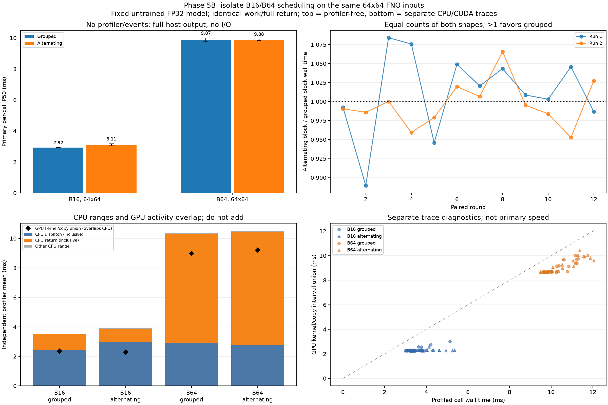

# Phase 5B: grouped versus alternating FNO batch shapes

The same fixed untrained FNO, weights and ECMWF input frames are retained. Only request order changes: B16 and B64 both have the same 64x64 spatial grid. GPU inputs/model stay resident; every call recomputes and returns the full output. No reads, packing, input upload, file writes, training or forecast assessment are in these timings.

## Profiler-free primary results

| Session | Schedule | Case | Samples | P50 ms | P95 ms | Maximum ms |
|---|---|---|---:|---:|---:|---:|
| rtx3050_physics_schedule_run01 | grouped | B16/64x64 | 96 | 2.929 | 3.929 | 5.546 |
| rtx3050_physics_schedule_run01 | grouped | B64/64x64 | 96 | 9.752 | 11.587 | 12.663 |
| rtx3050_physics_schedule_run01 | alternating | B16/64x64 | 96 | 3.171 | 4.097 | 5.091 |
| rtx3050_physics_schedule_run01 | alternating | B64/64x64 | 96 | 9.926 | 10.951 | 11.889 |
| rtx3050_physics_schedule_run02 | grouped | B16/64x64 | 96 | 2.913 | 4.071 | 4.777 |
| rtx3050_physics_schedule_run02 | grouped | B64/64x64 | 96 | 9.990 | 11.601 | 12.200 |
| rtx3050_physics_schedule_run02 | alternating | B16/64x64 | 96 | 3.043 | 3.941 | 4.924 |
| rtx3050_physics_schedule_run02 | alternating | B64/64x64 | 96 | 9.842 | 11.606 | 11.950 |

## Paired equal-work block comparison

| Session | Grouped block P50 ms | Alternating block P50 ms | Median paired alternating/grouped | Paired rounds where grouped is faster |
|---|---:|---:|---:|---:|
| rtx3050_physics_schedule_run01 | 103.490 | 106.196 | 1.015x | 8/12 |
| rtx3050_physics_schedule_run02 | 105.551 | 104.508 | 0.993x | 5/12 |

**Observed result:** session median paired block ratios lie on both sides of 1. These sessions do not show a consistent total-work speedup from grouping the two batch shapes. This does not rule out effects in other workloads or identify the cause of earlier pipeline outliers.

A paired round uses the same first shape and equal numbers of B16/B64 calls in both schedules. All four first-shape/first-schedule combinations balance across each full set of four rounds. Every block starts with the same alternating warmup ending in B64. Block wall time is measured directly; per-call sum plus recorded loop residual reconciles to it. Per-call/inner observations are related, not independent statistical replications. Median ratios and the direction count are descriptive, not confidence/significance tests. All slower calls and maxima remain visible. Top-left bars are medians of session medians; whiskers span session medians, not confidence intervals.

Output checks/hashes occur after a whole measured block, so validation does not insert unequal per-call gaps. Primary calls contain no profiler, record_function ranges or CUDA events. The block retains at most one block of host outputs plus representatives, and CPU allocation/dispatch/return behavior remains part of the measured request. Changing order changes those behaviors too; this is not a pure kernel-only experiment.

## Real CPU/CUDA trace observations

| Case/schedule | Mean profiled wall ms | CPU dispatch ms | CPU return ms | Kernel union ms | Copy union ms | Launch runtime ms | Explicit sync API ms | Kernels/call | DtoH bytes/call | HtoD bytes/call |
|---|---:|---:|---:|---:|---:|---:|---:|---:|---:|---:|
| B16/grouped | 3.5273 | 2.4345 | 1.0529 | 2.1997 | 0.1530 | 0.4024 | 0.0045 | 99.0000 | 262144.0000 | 0.0000 |
| B16/alternating | 3.9150 | 2.9829 | 0.8799 | 2.1434 | 0.1524 | 0.4797 | 0.0056 | 99.0000 | 262144.0000 | 0.0000 |
| B64/grouped | 10.3439 | 2.9153 | 7.3728 | 8.3604 | 0.6261 | 0.4775 | 0.0097 | 99.0000 | 1048576.0000 | 0.0000 |
| B64/alternating | 10.5090 | 2.7674 | 7.6904 | 8.6001 | 0.6143 | 0.4411 | 0.0107 | 99.0000 | 1048576.0000 | 0.0000 |

Each trace call must contain real CUDA kernels and exactly one DtoH copy of the full output (262,144 bytes for B16; 1,048,576 for B64). Trace calls are annotated by schedule/round/position/case; the CPU analyzer decompresses the hashed Chrome trace and independently reconstructs every summary, byte count and ordering label.

Dispatch/return ranges are inclusive CPU durations and may contain waiting. GPU kernel/copy intervals overlap them; union accounting avoids counting concurrent device activity twice. Return time is not physical copy time alone. CUDA runtime launch and synchronization durations are CPU-side observations, not device execution time. The recorded runtime_wait_ms field counts only API names containing Synchronize; other runtime calls, including copies to pageable host memory, can also wait, so it is not total waiting time. GPU active intervals and wall-minus-active are not occupancy or attribution to one driver/power cause.

Traces run in a separate later profiling session with condition warmups, fewer calls and a different plan seed. Instrumentation, CPU allocation and system state can affect trace timing; use primary results for speed. No GPU clock/power/driver, precision, model or compiler setting changed. An observed association with batch-order switching does not prove a specific cuFFT/allocator/driver mechanism. A lack of repeatable improvement does not rule out all other workloads.

## Evidence and reproduction

Every warmup, primary and profiled output is checked elementwise against the archived CPU FP64 reference at rtol=1e-4, atol=1e-5. Each session independently recomputes that reference from the same FP32 weights/inputs cast to double. Actual retained FP32 outputs, weights, source identities/hashes, raw calls/blocks, trace summaries and gzip Chrome traces are saved. These numerical checks assess arithmetic consistency only.

The CPU-only analyzer reloads source frames and retained arrays, checks all output/state/reference hashes, recomputes seeded plans, transitions, quantiles, block sums and trace intervals/copy counts. It validates saved GPU evidence without claiming to rerun GPU work. Chrome trace JSON can be decompressed and opened in a compatible trace viewer.

```bash
source .venv/physicsnemo/bin/activate
python physicsnemo_schedule.py --output results/my_physics_schedule01
python physicsnemo_schedule.py --seed 20261108 --output results/my_physics_schedule02
python scripts/analyze_physicsnemo_schedule.py results/my_physics_schedule01 results/my_physics_schedule02 --output results/my_physics_schedule_report
```

Use new output paths and the existing isolated PhysicsNeMo/CUDA environment. JAX and Earth2Studio remain deferred. Cached-input numbers describe repeated identical inputs and exclude the earlier read-to-file boundary.


