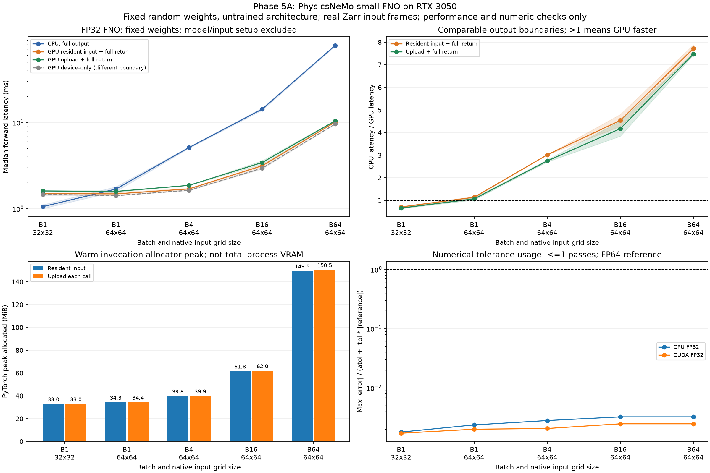

# Phase 5A: small PhysicsNeMo FNO forward performance

**Completed:** isolated Python/CUDA environment, official FNO forward, CPU/RTX 3050 timing/memory and full-output numerical checks. This is a fixed-seed, untrained architecture benchmark, not a pretrained forecast model. No training, model-checkpoint download or forecast-quality assessment is involved. Earth2Studio model pipelines (5C) remain future work.

Environment: Python 3.12.16, PhysicsNeMo 2.2.2, PyTorch 2.14.1+cu126, CUDA 12.6; CPU threads 6, interop threads 1. Model has 132,353 parameters. [Exact model configuration and recorded controls](../rtx3050_physicsnemo_run01/environment.json). TF32 is disabled, inference mode/eval are used, and deterministic algorithms are requested.

## Comparable steady-state timings

| Session | Batch/grid | CPU P50 ms | GPU resident + return P50 ms | CPU/GPU ratio | GPU upload + return P50 ms | GPU resident P95 ms | Resident batch frames/s |
|---|---|---:|---:|---:|---:|---:|---:|
| rtx3050_physicsnemo_run01 | 1 / 32x32 | 1.1130 | 1.5254 | 0.73x | 1.6361 | 2.0809 | 655.6 |
| rtx3050_physicsnemo_run01 | 1 / 64x64 | 1.5839 | 1.4328 | 1.11x | 1.5578 | 1.8105 | 697.9 |
| rtx3050_physicsnemo_run01 | 4 / 64x64 | 5.0308 | 1.6691 | 3.01x | 1.8640 | 2.4036 | 2396.6 |
| rtx3050_physicsnemo_run01 | 16 / 64x64 | 14.6957 | 3.0612 | 4.80x | 3.2603 | 4.0681 | 5226.8 |
| rtx3050_physicsnemo_run01 | 64 / 64x64 | 76.6146 | 10.1342 | 7.56x | 10.3127 | 12.3297 | 6315.2 |
| rtx3050_physicsnemo_run02 | 1 / 32x32 | 1.0051 | 1.4681 | 0.68x | 1.5794 | 2.4383 | 681.2 |
| rtx3050_physicsnemo_run02 | 1 / 64x64 | 1.8017 | 1.5423 | 1.17x | 1.6176 | 2.2243 | 648.4 |
| rtx3050_physicsnemo_run02 | 4 / 64x64 | 5.2157 | 1.7297 | 3.02x | 1.8705 | 2.5754 | 2312.5 |
| rtx3050_physicsnemo_run02 | 16 / 64x64 | 13.8305 | 3.2363 | 4.27x | 3.6037 | 4.1474 | 4943.8 |
| rtx3050_physicsnemo_run02 | 64 / 64x64 | 79.4845 | 10.0834 | 7.88x | 10.5753 | 10.9422 | 6347.1 |

CPU and the two main GPU paths produce full host outputs. All reuse model weights; GPU resident input is preuploaded. The upload method copies existing packed host input each call. Device-only CUDA is a separately labeled diagnostic with output left on device and completion synchronized; its untimed verification copy is not part of that latency. Batch frames/s is batch size divided by synchronous batch latency, not an asynchronously streamed service-throughput measurement.

Zarr reads, input transform, model import/construction/upload, CUDA initialization, FP64 reference work, output validation and NPZ/CSV writing are excluded from steady-state timings. Thus this is not yet the complete read-to-model-to-file application benchmark. Cases run in listed order; methods are shuffled within each repetition with recorded order seeds. Shading is the range of session medians, not a confidence interval. P95 values from these short sessions are sample estimates, not latency guarantees.

## Model/input identity and numerical correctness

The source is the checked-in pinned ECMWF ensemble Zarr. Batch frames are distinct initialization/lead/member selections in native coordinate order, not repeated/upsampled tiles. Grid 32 uses the southern 32 latitude rows and first 32 longitudes; grid 64 uses the full local native grid. Source Celsius values undergo the fixed benchmark transform `(C - 20)/20` in FP64 then FP32. This is input scaling for an untrained workload, not training-derived weather normalization. Exact frame identities, coordinate bounds, input hashes and source manifest are saved.

CPU and GPU use identical serialized FP32 model state. The reference runs the same architecture on CPU after casting those exact weights/inputs to FP64; every parameter and output is checked to be double precision. All timed, warmup, first-forward and memory-probe results are checked elementwise at rtol=1e-4, atol=1e-5. The plotted normalized tolerance fraction must be <=1. These are numerical arithmetic differences, not forecast errors or skill scores.

Every case NPZ stores actual packed FP32 input, complete CPU FP64 reference output, CPU FP32 output and CUDA FP32 output. The CPU-only analyzer reloads source frames, checks hashes, compares saved outputs and reconciles quantiles, ordering, first observations and memory arithmetic. In the isolated environment, `--recompute-reference` independently reloads weights and recomputes every FP64 output.

## Memory and first-forward boundaries

memory.csv records live allocated baseline, peak allocated, extra allocated and peak reserved per warmed GPU invocation. The graph uses the maximum observed allocated peak across sessions for each case/method. Allocator-reserved space may include previous workloads, and driver/cuFFT allocations are not necessarily fully represented; none of these is total process VRAM or a fresh-process per-case peak. Input/weights remain resident, and allocator cache is not cleared between methods.

first_forward.csv separately records the first observed FP32 CPU/CUDA forward per shape. Package imports, CPU model construction, observed CUDA setup and model upload are recorded in environment.json. These observations occur in an initialized process, following other setup/reference work; they are not a full cold-process startup measurement. They are kept separate from warmed timing samples.

## Reproduce

```bash
bash scripts/setup_physicsnemo.sh
source .venv/physicsnemo/bin/activate
python physicsnemo_benchmark.py --output results/my_physicsnemo01
python physicsnemo_benchmark.py --order-seed 20261103 --output results/my_physicsnemo02
python scripts/analyze_physicsnemo.py results/my_physicsnemo01 results/my_physicsnemo02 --recompute-reference --output results/my_physicsnemo_comparison
```

The existing Python 3.10 weather-gpu environment remains a separate baseline. New environment versions and CPU thread controls must be considered before comparing with older metric-kernel experiments, which perform different work. CUDA 12.6 torchvision and the official NVIDIA Warp CUDA12 wheel are pinned to avoid mismatched default binaries; the complete environment lock is checked in. No driver, global Python, JAX or Earth2Studio installation is required by this case.

[Official PhysicsNeMo FNO API](https://docs.nvidia.com/physicsnemo/latest/physicsnemo/api/models/fnos.html), [phase-5 plan](../../docs/phase5_plan_zh.md).


