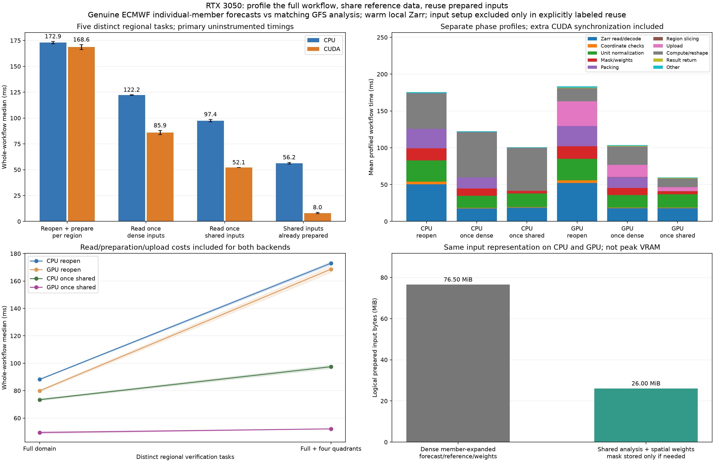

# Regional verification: stage costs and shared input reuse

The same checked-in genuine ECMWF ensemble batch is verified against exact-valid-time GFS analysis. Workloads contain one full-domain task or five distinct tasks: full domain plus northwest/northeast/southwest/southeast quadrants. Each task returns separate spatial Bias/MAE/RMSE for every initialization/lead/member. Cache stores input data, not metric results; every task is recomputed.

## Whole-workflow results

Primary timings are measured without phase instrumentation. Each once_* invocation includes warm local Zarr opening/reading/decoding, coordinate validation, unit normalization, masks/weights, packing and GPU upload where applicable. Reuse-only excludes previously prepared input setup for both CPU and GPU; it must not be presented as first-use latency.

| Session | Tasks | CPU reopen ms | CPU read once/dense ms | CPU read once/shared ms | GPU reopen ms | GPU read once/dense ms | GPU read once/shared ms | CPU reuse-only ms | GPU reuse-only ms |
|---|---:|---:|---:|---:|---:|---:|---:|---:|---:|
| rtx3050_pipeline_run01 | 1 | 88.609 | 89.768 | 74.078 | 80.583 | 80.423 | 50.184 | 31.681 | 3.514 |
| rtx3050_pipeline_run01 | 5 | 171.855 | 122.050 | 96.249 | 166.244 | 83.866 | 52.139 | 55.420 | 8.641 |
| rtx3050_pipeline_run02 | 1 | 87.786 | 86.929 | 72.767 | 79.194 | 77.021 | 48.720 | 30.950 | 3.207 |
| rtx3050_pipeline_run02 | 5 | 174.037 | 122.395 | 98.633 | 170.941 | 87.866 | 52.091 | 57.036 | 7.385 |

## Observations

- rtx3050_pipeline_run01, five tasks: CPU whole-workflow improvement 1.79x; GPU whole-workflow improvement 3.19x. With the same shared/read-once policy, GPU is 1.85x faster than CPU. Reuse-only GPU/CPU speedup is 6.41x, with setup excluded for both.
- rtx3050_pipeline_run02, five tasks: CPU whole-workflow improvement 1.76x; GPU whole-workflow improvement 3.28x. With the same shared/read-once policy, GPU is 1.89x faster than CPU. Reuse-only GPU/CPU speedup is 7.72x, with setup excluded for both.

Dense-read-once isolates the benefit of reusing input reads/preparation while retaining the old member-expanded representation. Shared-read-once additionally keeps one GFS reference per initialization/lead and one latitude-weight vector instead of duplicating both across 51 members. All-finite data avoid retaining a full member-specific mask; missing data use the tested joint-finite-mask fallback. Both retain FP32 Kelvin forecast/reference values and per-member outputs.

Logical prepared input storage falls from 76.50 MiB to 26.00 MiB (66.0% less). These are live buffer payload sizes, not allocator-reserved memory, peak memory or total VRAM. CPU and GPU share the same representation. Region slicing and any reshape/materialization needed by the dense method remain inside measured work.

## Phase breakdown (separate profiling runs)

Stages are Zarr read/decode (including metadata open and selection), coordinate checks, Celsius-to-FP32-Kelvin normalization, mask/weight construction, array packing, region selection, upload, compute (including dense regional reshape/materialization), result return and residual other overhead. Dense reopen selects each requested region before reading, so it does not deliberately reread unrelated chunks. Read-once reads the full domain and serves all regional tasks from that input.

Stage profiles are separate from the primary uninstrumented timings. CUDA is synchronized at stage boundaries; additional synchronization and timer overhead can change the profile total. The stacked chart uses mean durations from the same profiled workflows, so components add to mean profile total. It does not add independently measured medians or substitute their sum for whole-workflow measurements.

| Backend/workflow, five tasks | Zarr read/decode ms | Unit normalization ms | Mask/weights ms | Packing ms | Upload ms | Compute ms | Mean profile total ms |
|---|---:|---:|---:|---:|---:|---:|---:|
| cpu_reopen_dense | 50.522 | 28.817 | 16.690 | 26.069 | 0.000 | 48.513 | 175.581 |
| cpu_once_dense | 17.487 | 16.642 | 9.845 | 14.890 | 0.000 | 61.662 | 122.420 |
| cpu_once_shared | 18.608 | 18.680 | 3.563 | 0.049 | 0.000 | 58.317 | 100.819 |
| cuda_reopen_dense | 52.220 | 29.109 | 17.193 | 27.366 | 33.620 | 17.671 | 183.271 |
| cuda_once_dense | 17.904 | 17.233 | 9.624 | 14.553 | 16.733 | 24.842 | 103.589 |
| cuda_once_shared | 18.021 | 18.243 | 3.851 | 0.054 | 5.550 | 11.760 | 59.587 |

## Validation and limits

All warmups, uninstrumented repetitions and profiled workflows validate every returned regional/group metric against FP64 arithmetic using the unchanged original dense packing path, rtol=atol=1e-5. Correctness checks and result writes occur outside timed intervals. The report independently reloads hashed source data, recomputes reference values and valid-weight/count coverage, checks timing quantiles and seeded method order, and reconciles each phase profile to its own total.

The four unit tests cover regional parity, member-specific missing values, compact input ownership/storage, explicit reuse behavior and optional CPU/CUDA shared arithmetic. All 39 tests pass in the WSL CUDA environment. These tests do not treat unrelated ensemble members or overlapping valid dates as independent observations.

Both backends have equal cache reuse. CUDA context initialization, remote acquisition, source hashing and correctness/output handling are excluded. Reads are warm local Zarr; first-use means a new workflow input preparation in an already initialized process, not a cold-cache/process-start measurement. An explicit shared cache remains allocated during the session, including when other methods execute. Method order is shuffled within repetitions; task-count order is fixed. Bands/error bars show ranges of session medians, not confidence intervals. The single-variable, two-session result cannot establish general Zarr/NetCDF throughput or future workloads.

GFS analysis is model-dependent, not independent station truth. The domain includes land/ocean, and source values have provider unit conversion/bit rounding. This work measures pipeline efficiency; it does not rank ECMWF/GFS forecast skill. No change to the archived earlier benchmark results is implied.

## Reproduce

```bash
source ~/venvs/weather-gpu/bin/activate
python -m pip install -r requirements-zarr.txt
python weather_pipeline.py --output results/my_pipeline01
python weather_pipeline.py --output results/my_pipeline02 --seed 20261104
python scripts/analyze_pipeline.py results/my_pipeline01 results/my_pipeline02 --output results/my_pipeline_comparison
```

Use `--backend numpy` for CPU-only runs. A small offline CI case uses `--case control_small --repeats 3 --warmup 1 --profile-repeats 2`. Source data, attribution and pinned read-only snapshots: [batch manifest](../../data/ecmwf_batch_case/manifest.json) and [data README](../../data/ecmwf_batch_case/README.md).


