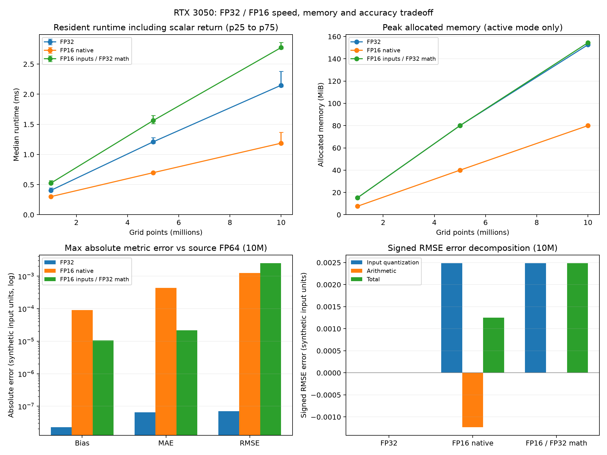

# Precision tradeoff: rtx3050_precision_run02

Sources: unchanged environment.json, summary.csv and samples.csv in this directory.

Validated 180 timing samples and their saved per-repeat Bias/MAE/RMSE values. Timing groups, repeat IDs, medians, quartiles, metric summaries, error fields and agreement flags reconcile. FP64 source and quantized-input references were regenerated from the recorded seed. Metric-reference reconciliation allows 1e-14 absolute difference for cross-platform FP64 rounding. No samples were removed.

Protocol: GPU-resident synthetic inputs, seed 42, 5 warmups, 20 measured repeats per size/mode. Synchronized wall time includes returning three host scalars. Input generation, input conversion to FP16, upload and validation are outside timing. The mixed mode casts to FP32 before subtraction inside each timed call.

Hardware: 12th Gen Intel(R) Core(TM) i5-12400F; NVIDIA GeForce RTX 3050; PyTorch 2.14.1+cu126, CUDA runtime 12.6. Pre/post GPU state snapshots and the seeded per-size mode order are saved in environment.json. These snapshots do not establish clocks/load during each sample.

## Runtime and allocated memory

| Points | Mode | Median ms | IQR/median | FP32 / mode runtime | Input MiB | Peak allocated MiB | Finite |
|---:|---|---:|---:|---:|---:|---:|---|
| 1,000,000 | FP32 | 0.403 | 12.37% | 1.00x | 7.629 | 15.262 | True |
| 1,000,000 | FP16 native | 0.300 | 5.33% | 1.34x | 3.815 | 7.633 | True |
| 1,000,000 | FP16 inputs / FP32 math | 0.523 | 10.75% | 0.77x | 3.815 | 15.260 | True |
| 5,000,000 | FP32 | 1.209 | 7.70% | 1.00x | 38.147 | 80.002 | True |
| 5,000,000 | FP16 native | 0.698 | 2.39% | 1.73x | 19.073 | 40.002 | True |
| 5,000,000 | FP16 inputs / FP32 math | 1.563 | 8.68% | 0.77x | 19.073 | 80.000 | True |
| 10,000,000 | FP32 | 2.149 | 11.98% | 1.00x | 76.294 | 152.590 | True |
| 10,000,000 | FP16 native | 1.188 | 16.80% | 1.81x | 38.147 | 80.002 | True |
| 10,000,000 | FP16 inputs / FP32 math | 2.774 | 3.86% | 0.77x | 38.147 | 154.441 | True |

Memory is CUDA peak allocated minus the pre-input allocation baseline. It includes active input tensors and intermediate tensors; only one precision mode is resident at a time. It is not reserved memory or whole-device VRAM. FP16 input storage is exactly half of FP32; working-memory peaks need not halve.

## Metric accuracy

Errors below are the maximum absolute error across measured repetitions against FP64 arithmetic on the original FP32 source inputs. They use synthetic input units. The diagnostic threshold rtol=atol=1e-5 is not a meteorological acceptance criterion.

| Points | Mode | Bias abs error | MAE abs error | RMSE abs error | Source agreement | Input-reference agreement |
|---:|---|---:|---:|---:|---|---|
| 1,000,000 | FP32 | 3.19786e-08 | 6.71844e-08 | 1.1016e-07 | True | True |
| 1,000,000 | FP16 native | 9.36069e-05 | 0.000245981 | 0.0019163 | False | False |
| 1,000,000 | FP16 inputs / FP32 math | 2.233e-06 | 2.72469e-05 | 0.00255741 | False | True |
| 5,000,000 | FP32 | 6.08307e-08 | 1.09863e-08 | 1.17035e-07 | True | True |
| 5,000,000 | FP16 native | 6.30033e-05 | 2.07314e-05 | 0.00178635 | False | False |
| 5,000,000 | FP16 inputs / FP32 math | 1.50238e-07 | 0.000105034 | 0.00259316 | False | True |
| 10,000,000 | FP32 | 2.29446e-08 | 6.55823e-08 | 7.10578e-08 | True | True |
| 10,000,000 | FP16 native | 8.99801e-05 | 0.000434095 | 0.00125368 | False | False |
| 10,000,000 | FP16 inputs / FP32 math | 1.05432e-05 | 2.15113e-05 | 0.00248368 | False | True |

## Error decomposition at 10,000,000 points

Source reference: FP64 arithmetic on the original FP32 input values. Input reference: FP64 arithmetic on the values actually stored for a mode. For FP16 modes, the difference between these references isolates input quantization.

| Mode | RMSE | Source RMSE | Signed input quantization delta | Signed arithmetic delta |
|---|---:|---:|---:|---:|
| FP32 | 2.061246395 | 2.061246324 | +0 | +7.10578e-08 |
| FP16 native | 2.062500000 | 2.061246324 | +0.00248374 | -0.00123007 |
| FP16 inputs / FP32 math | 2.063730001 | 2.061246324 | +0.00248374 | -6.62161e-08 |

Signed quantization delta + signed arithmetic delta = signed total metric error. Absolute errors do not necessarily add: native FP16 arithmetic can partially cancel quantization error. A smaller total error in one synthetic case does not establish a more reliable algorithm.

## Interpretation and limits

- Compare speed, allocated memory and all three errors together. A runtime ratio above one is not evidence of acceptable accuracy.
- FP32 arithmetic on FP16 inputs can reduce arithmetic error but cannot recover information lost during input conversion. Materializing FP32 working tensors also costs time and memory. This eager implementation is not a fused mixed-precision kernel.
- Native FP16 can overflow in intermediate subtraction or squaring even when input values are representable. The unit tests explicitly exercise this failure. Nonfinite outputs are flagged and receive no valid speedup claim.
- Backend-internal reduction accumulation is not assumed to be FP16; native intermediate and output tensor dtypes are FP16.
- Each size uses a seeded mode order and each mode is timed as one block. Runs with the same seed repeat the same order. This does not fully control order, cache, clock or background-load effects. Do not infer significance from these short sessions.
- No application error budget or real weather verification has been established. Keep FP32 as the baseline pending real-data validation.

Regenerate: `python scripts/analyze_precision.py results/rtx3050_precision_run02`

