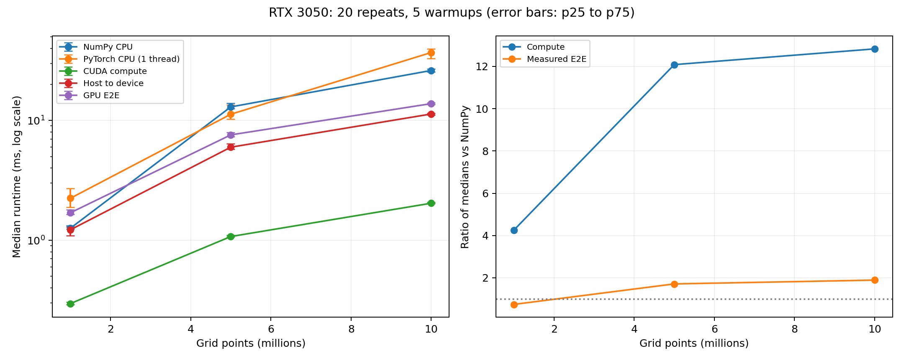

# RTX 3050 run01 analysis

Source: the three user-uploaded files in this directory. Raw inputs are preserved unchanged.

Environment reported by the run: NVIDIA GeForce RTX 3050, Python 3.10.12, NumPy 2.2.6, PyTorch 2.14.1+cu126, CUDA runtime 12.6, WSL2. PyTorch CPU threads: 1.

Protocol: FP32 synthetic data, 5 warmups and 20 measured repetitions per method and size. Timings use synchronized host wall time.

| Points | NumPy ms | CUDA compute ms | H2D ms | GPU E2E ms | Compute speedup | E2E speedup |
|---:|---:|---:|---:|---:|---:|---:|
| 1,000,000 | 1.261 | 0.296 | 1.224 | 1.697 | 4.26x | 0.74x |
| 5,000,000 | 12.982 | 1.074 | 5.984 | 7.583 | 12.09x | 1.71x |
| 10,000,000 | 26.152 | 2.038 | 11.330 | 13.823 | 12.83x | 1.89x |

Validation passed: 300 positive finite timing samples; all group counts, repeat IDs, medians, quartiles and speedups reconcile.

## Interpretation

- At 1M points GPU E2E is slower than NumPy. GPU E2E is faster at the tested 5M and 10M sizes. No exact crossover threshold was measured.
- At 10M, H2D takes 11.330 ms while GPU compute takes 2.038 ms. Input transfer is the largest measured component. These are separately sampled medians, not an additive decomposition of E2E latency.
- CUDA compute IQR/median is 2.61%–4.14%; PyTorch CPU is 18.42%–36.83%. CPU scheduling, clocks and background load are possible factors, not diagnosed causes.
- The PyTorch CPU median rises from 11.274 ms at 5M to 36.927 ms at 10M. The present data cannot establish the cause. Do not generalize this CPU comparison to all thread settings.
- No timing samples were removed. At 5M CUDA compute has a 2.042 ms maximum versus a 1.074 ms median; the chart shows the middle 50%, not all samples.
- E2E includes two input copies, metric computation and scalar return, with preallocated GPU input buffers. It excludes disk I/O and preprocessing.
- These files do not contain per-backend metric values or correctness logs. The runner checks agreement before saving files; independent numerical correctness cannot be rechecked from timing samples alone.
- This is one user-supplied run, not an independently reproduced GPU experiment. Driver version, exact CPU model, power mode and background load are missing. Software versions are reported as supplied.

## Next experiment

Repeat the same protocol in a separate output folder to assess run-to-run variation. Then use profiling to test whether keeping model output on GPU avoids the observed transfer cost. Change one condition at a time.

Regenerate: `python scripts/analyze_run.py results/rtx3050_run01`

## Timing variation

IQR/median = (p75 - p25) / median. It describes within-run variation, not a confidence interval.

| Points | Method | IQR / median | Minimum ms | Maximum ms |
|---:|---|---:|---:|---:|
| 1,000,000 | numpy_cpu | 6.27% | 1.188 | 1.596 |
| 1,000,000 | torch_cpu | 36.83% | 1.239 | 4.246 |
| 1,000,000 | torch_cuda | 4.14% | 0.289 | 0.414 |
| 1,000,000 | h2d | 16.10% | 1.045 | 1.547 |
| 1,000,000 | gpu_e2e | 9.41% | 1.587 | 2.354 |
| 5,000,000 | numpy_cpu | 10.63% | 12.101 | 16.449 |
| 5,000,000 | torch_cpu | 28.27% | 9.486 | 29.987 |
| 5,000,000 | torch_cuda | 2.85% | 1.064 | 2.042 |
| 5,000,000 | h2d | 10.90% | 5.662 | 7.287 |
| 5,000,000 | gpu_e2e | 8.42% | 6.989 | 8.582 |
| 10,000,000 | numpy_cpu | 5.15% | 24.860 | 40.437 |
| 10,000,000 | torch_cpu | 18.42% | 32.656 | 52.926 |
| 10,000,000 | torch_cuda | 2.61% | 2.021 | 2.180 |
| 10,000,000 | h2d | 3.30% | 10.995 | 15.127 |
| 10,000,000 | gpu_e2e | 3.21% | 13.289 | 14.765 |
