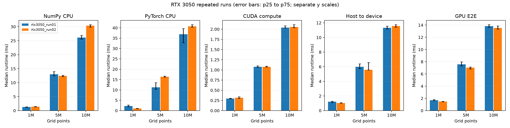

# rtx3050_run01 vs rtx3050_run02

Sources: unchanged environment.json, samples.csv and summary.csv in each run directory.

Validation passed: 300 baseline and 300 repeat timing samples. All timing groups, repeat IDs, positive finite values, medians, quartiles and speedups reconcile. No samples were removed.

Recorded environment and protocol are identical across runs: NVIDIA GeForce RTX 3050, Python 3.10.12, NumPy 2.2.6, PyTorch 2.14.1+cu126, CUDA runtime 12.6, 1 PyTorch CPU thread(s), float32, seed 42, 5 warmups and 20 measured repeats per group.

## Runtime and within-run variation

Change = (repeat median / baseline median - 1). Negative means faster. IQR/median = (p75 - p25) / median; this measures within-run spread, not a confidence interval.

| Points | Method | Baseline ms | Repeat ms | Change | Baseline IQR/median | Repeat IQR/median |
|---:|---|---:|---:|---:|---:|---:|
| 1,000,000 | NumPy CPU | 1.261 | 1.378 | +9.27% | 6.27% | 8.09% |
| 1,000,000 | PyTorch CPU | 2.243 | 0.978 | -56.40% | 36.83% | 16.23% |
| 1,000,000 | CUDA compute | 0.296 | 0.315 | +6.50% | 4.14% | 13.81% |
| 1,000,000 | Host to device | 1.224 | 1.042 | -14.89% | 16.10% | 3.74% |
| 1,000,000 | GPU E2E | 1.697 | 1.468 | -13.49% | 9.41% | 4.51% |
| 5,000,000 | NumPy CPU | 12.982 | 12.388 | -4.58% | 10.63% | 3.72% |
| 5,000,000 | PyTorch CPU | 11.274 | 16.358 | +45.10% | 28.27% | 2.94% |
| 5,000,000 | CUDA compute | 1.074 | 1.075 | +0.04% | 2.85% | 1.83% |
| 5,000,000 | Host to device | 5.984 | 5.587 | -6.64% | 10.90% | 18.39% |
| 5,000,000 | GPU E2E | 7.583 | 7.024 | -7.37% | 8.42% | 4.81% |
| 10,000,000 | NumPy CPU | 26.152 | 30.368 | +16.12% | 5.15% | 2.87% |
| 10,000,000 | PyTorch CPU | 36.927 | 40.748 | +10.35% | 18.42% | 2.98% |
| 10,000,000 | CUDA compute | 2.038 | 2.055 | +0.81% | 2.61% | 3.65% |
| 10,000,000 | Host to device | 11.330 | 11.577 | +2.18% | 3.30% | 2.89% |
| 10,000,000 | GPU E2E | 13.823 | 13.533 | -2.10% | 3.21% | 3.85% |

## Speedup relative to each run's NumPy baseline

| Points | Baseline compute | Repeat compute | Baseline E2E | Repeat E2E |
|---:|---:|---:|---:|---:|
| 1,000,000 | 4.26x | 4.37x | 0.74x | 0.94x |
| 5,000,000 | 12.09x | 11.53x | 1.71x | 1.76x |
| 10,000,000 | 12.83x | 14.78x | 1.89x | 2.24x |

## Interpretation and limits

- NumPy reference Bias/MAE/RMSE values are identical across runs: True. Per-backend metric values are not saved, so timing files cannot independently validate CUDA numerical agreement.
- Inspect absolute CPU and GPU times alongside speedup: a slower NumPy baseline raises speedup even when GPU time does not improve.
- Two user-supplied runs provide an initial repeatability check, not enough independent sessions to establish long-term stability or statistical significance.
- Identical recorded metadata does not establish identical system load, clocks or thermals. Exact CPU model, driver, power mode and background load were not recorded.
- H2D and compute are separately sampled medians. Their sum is not a measured decomposition of GPU E2E.

## Next experiment

Profile a GPU-resident workflow against the current E2E boundary. CUDA compute already uses resident inputs; a new experiment should explicitly measure a repeated resident-input workflow including the required scalar return, and account for the initial upload separately. Keep sizes, seed, threads, warmups and repeats fixed. Record driver, CPU and system-load context before the run.

Regenerate: `python scripts/compare_runs.py results/rtx3050_run01 results/rtx3050_run02`

