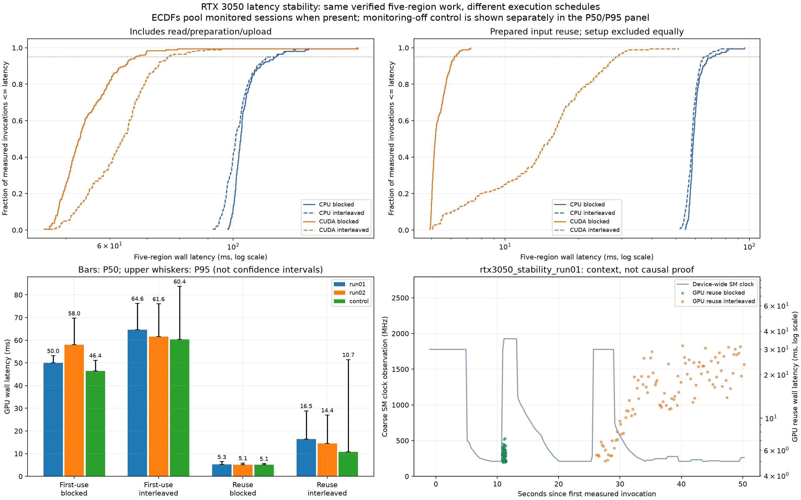

# Regional verification latency distributions and scheduling

Every invocation computes the same full domain plus four quadrants, retaining individual initialization/lead/member Bias/MAE/RMSE. The source is the checked-in genuine ECMWF ensemble batch matched to GFS f000 analysis. No numerical kernel or precision was changed from the shared-input pipeline.

Blocked execution measures one method consecutively, with warmups directly before its block. Interleaved execution shuffles CPU/GPU first-use and reuse methods within every repetition. Consecutive methods still return results and validate them between calls; this is application wall latency, not continuously enqueued device-only throughput. First-use means fresh read/preparation/upload with warm local data and initialized CUDA.

## Distribution summaries

| Session | Monitor | Schedule | Method | N | P50 ms | P95 ms | P99 ms | Max ms |
|---|---|---|---|---:|---:|---:|---:|---:|
| rtx3050_stability_run01 | on | blocked | cpu_once_shared | 100 | 102.064 | 116.494 | 124.521 | 166.754 |
| rtx3050_stability_run01 | on | blocked | cpu_reuse_shared | 100 | 58.748 | 63.816 | 72.566 | 75.549 |
| rtx3050_stability_run01 | on | blocked | cuda_once_shared | 100 | 50.031 | 53.175 | 61.760 | 62.217 |
| rtx3050_stability_run01 | on | blocked | cuda_reuse_shared | 100 | 5.268 | 6.437 | 7.101 | 7.230 |
| rtx3050_stability_run01 | on | interleaved | cpu_once_shared | 100 | 100.814 | 113.103 | 123.280 | 128.132 |
| rtx3050_stability_run01 | on | interleaved | cpu_reuse_shared | 100 | 58.175 | 62.783 | 70.275 | 75.588 |
| rtx3050_stability_run01 | on | interleaved | cuda_once_shared | 100 | 64.608 | 76.220 | 88.886 | 95.569 |
| rtx3050_stability_run01 | on | interleaved | cuda_reuse_shared | 100 | 16.473 | 28.885 | 31.204 | 31.589 |
| rtx3050_stability_run02 | on | interleaved | cpu_once_shared | 100 | 101.867 | 115.179 | 129.604 | 136.428 |
| rtx3050_stability_run02 | on | interleaved | cpu_reuse_shared | 100 | 57.988 | 68.130 | 74.751 | 84.856 |
| rtx3050_stability_run02 | on | interleaved | cuda_once_shared | 100 | 61.646 | 76.030 | 86.063 | 97.130 |
| rtx3050_stability_run02 | on | interleaved | cuda_reuse_shared | 100 | 14.425 | 26.997 | 39.252 | 51.165 |
| rtx3050_stability_run02 | on | blocked | cpu_once_shared | 100 | 103.683 | 119.760 | 134.877 | 136.608 |
| rtx3050_stability_run02 | on | blocked | cpu_reuse_shared | 100 | 59.431 | 76.877 | 81.987 | 95.366 |
| rtx3050_stability_run02 | on | blocked | cuda_once_shared | 100 | 58.031 | 69.720 | 80.289 | 167.706 |
| rtx3050_stability_run02 | on | blocked | cuda_reuse_shared | 100 | 5.126 | 5.866 | 6.033 | 6.167 |
| rtx3050_stability_control | off | blocked | cpu_once_shared | 100 | 100.468 | 110.150 | 119.510 | 141.070 |
| rtx3050_stability_control | off | blocked | cpu_reuse_shared | 100 | 57.787 | 64.242 | 72.562 | 74.983 |
| rtx3050_stability_control | off | blocked | cuda_once_shared | 100 | 46.441 | 51.158 | 58.057 | 64.159 |
| rtx3050_stability_control | off | blocked | cuda_reuse_shared | 100 | 5.115 | 5.636 | 5.753 | 5.783 |
| rtx3050_stability_control | off | interleaved | cpu_once_shared | 100 | 104.314 | 121.598 | 142.704 | 148.060 |
| rtx3050_stability_control | off | interleaved | cpu_reuse_shared | 100 | 61.389 | 70.576 | 97.231 | 103.774 |
| rtx3050_stability_control | off | interleaved | cuda_once_shared | 100 | 60.393 | 83.771 | 124.208 | 149.431 |
| rtx3050_stability_control | off | interleaved | cuda_reuse_shared | 100 | 10.714 | 51.482 | 177.073 | 178.323 |

## Measured schedule differences

- rtx3050_stability_run01, once_shared: blocked P50/P95 50.031/53.175 ms; interleaved 64.608/76.220 ms. Interleaved/blocked median ratio 1.29x.
- rtx3050_stability_run01, reuse_shared: blocked P50/P95 5.268/6.437 ms; interleaved 16.473/28.885 ms. Interleaved/blocked median ratio 3.13x.
- rtx3050_stability_run02, once_shared: blocked P50/P95 58.031/69.720 ms; interleaved 61.646/76.030 ms. Interleaved/blocked median ratio 1.06x.
- rtx3050_stability_run02, reuse_shared: blocked P50/P95 5.126/5.866 ms; interleaved 14.425/26.997 ms. Interleaved/blocked median ratio 2.81x.
- rtx3050_stability_control, once_shared: blocked P50/P95 46.441/51.158 ms; interleaved 60.393/83.771 ms. Interleaved/blocked median ratio 1.30x.
- rtx3050_stability_control, reuse_shared: blocked P50/P95 5.115/5.636 ms; interleaved 10.714/51.482 ms. Interleaved/blocked median ratio 2.09x.

Schedule is an observed performance condition, not an identified hardware cause. Device clocks, Windows/WSL scheduling, driver overhead, other device work, allocation and host dispatch are candidate mechanisms; this experiment does not isolate them. CPU and GPU cache policies are identical. A monitoring-off session is an observer-overhead control, not a randomized estimate of monitoring cost: order, seed and external state also differ.

rtx3050_stability_run01: blocked/interleaved matched median SM clock 1927/247 MHz; rtx3050_stability_run02: blocked/interleaved matched median SM clock 1927/285 MHz. Coarse telemetry can miss short active bursts and sample idle gaps. It does not show the clock of every timed kernel or prove clock behavior caused the latency difference. Kernel/host trace profiling is needed to separate dispatch gaps, device execution and result return.

## Reading the figure

- Upper left: empirical cumulative distribution of complete local workflows. Upper right: same plot with prepared-input setup excluded equally for CPU/GPU. At a given time on the x-axis, y is the observed fraction completed by that time. Logarithmic x-axes expose the tails; the dotted line marks 95%.
- Lower left: each session is kept separate. Bars show P50, whiskers extend to P95; neither is a confidence interval. The monitoring-off control is included here, not silently pooled into monitored ECDF curves.
- Lower right: one monitored session, with coarse device-wide SM clock samples and wall times of GPU reuse invocations. The two y-axes measure different quantities. Clock sampling cannot resolve individual kernels or attribute activity to this process.

## Context and limitations

[context_summary.csv](context_summary.csv) matches the nearest GPU observation to each invocation midpoint only if within 0.6 s. Clock observations can be reused for multiple short invocations, so matched counts are not independent telemetry samples. Unsupported counters remain missing. Device utilization reflects a sampling window and all device activity. Process context-switch/page-fault/CPU-time and GC deltas are collected outside timers and are descriptive; snapshots can include a small amount of surrounding instrumentation. None is causal proof.

Every warmup and measured returned metric is validated against unchanged dense-path FP64 arithmetic (rtol=atol=1e-5). The analyzer independently checks input hashes, regional coverage, deterministic execution order, previous-method labels, all timing quantiles and recorded maximum numerical error bounds. No outliers are removed. CUDA initialization, source hashing, correctness validation, resource snapshots, CSV writing and explicit reuse input-cache setup are excluded from invocation timers.

The number of repetitions and schedule order are recorded per session. P95/P99 are sample estimates, especially uncertain at the far tail; they are not guarantees. All reported measurements use one machine/day/case. GPU monitoring itself may affect timing. These experiments do not rank forecast models or establish general production latency.

## Reproduce

```bash
python weather_stability.py --output results/my_stability01 --telemetry
python weather_stability.py --output results/my_stability02 --telemetry --schedules interleaved blocked --seed 20261106
python weather_stability.py --output results/my_stability_control --seed 20261107
python scripts/analyze_stability.py results/my_stability01 results/my_stability02 results/my_stability_control --output results/my_stability_comparison
```

Use the existing WSL CUDA environment. `--backend numpy --case control_small --repeats 4 --warmup 1` is the offline CPU smoke case. [Earlier phase-cost report](../rtx3050_pipeline_comparison/analysis.md), [JAX adoption survey](../../docs/jax_survey_zh.md).


