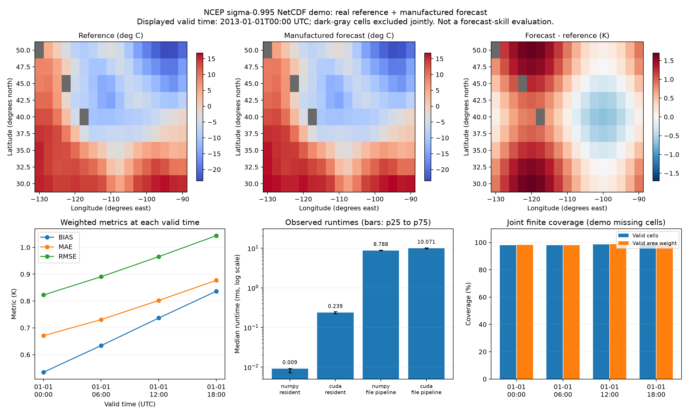

# NetCDF weather pipeline: rtx3050_weather_run02

Forecast role: **manufactured perturbation of reanalysis; not an operational forecast**.

Reference role: real NCEP reanalysis subset, FP32, with explicitly injected demo missing cells.

For the committed demo, NCEP reanalysis air temperature at sigma 0.995 is a real reference field. The forecast perturbation and missing cells are deliberately manufactured. This is a software-validation case, not a forecast-skill assessment, not ERA5 and not 2-m station observations.

Coverage: 602/612 joint finite values (98.37%); 4 valid times, 9 x 17 grid. 2013-01-01T00:00:00.000000000 to 2013-01-01T18:00:00.000000000 UTC. Latitude 30..50, longitude -130..-90 degrees.

Normalization: supported temperature units -> K -> FP32; coordinates sorted and longitude wrapped to [-180,180). Valid time and spatial coordinates must match exactly. No regridding, inner join or init-time/lead-time inference. Weighting: coslat. The denominator includes only joint finite cells. All-times metrics pool valid weighted cells over the sampled times; RMSE is not an average of the per-time RMSE values. It is not a continuous-day average.

Reference arithmetic uses FP64 on the same packed FP32 data and weights. All saved backend values and all timed metric values agree at rtol=atol=1e-5; 80 positive finite timing samples and all summaries reconcile. NetCDF input hashes match. No timing samples were removed.

## Pooled verification metrics

| Backend | Bias K | MAE K | RMSE K | Valid fraction | Area-weighted valid fraction |
|---|---:|---:|---:|---:|---:|
| reference_fp64 | 0.685742374 | 0.770504044 | 0.934485432 | 98.37% | 98.41% |
| numpy_fp32 | 0.685742438 | 0.770504117 | 0.934485435 | 98.37% | 98.41% |
| cuda_fp32 | 0.685742438 | 0.770504057 | 0.934485435 | 98.37% | 98.41% |

## Timing boundaries

5 warmups and 20 measured repetitions per method. Resident compute reuses packed joint-valid inputs and weights; CUDA includes scalar return. The file pipeline reopens both NetCDF files, decodes units/coordinates, checks alignment, builds the mask and weights, packs valid cells, allocates/uploads inputs for CUDA and returns metrics. OS/file caches are warm, not a cold-storage experiment. Context initialization, downloading and result-file output are excluded. The file-pipeline method is actually timed, not estimated by adding separately sampled components.

| Method | Median ms | p25 ms | p75 ms |
|---|---:|---:|---:|
| numpy_resident | 0.0091 | 0.0072 | 0.0093 |
| numpy_warm_file_pipeline | 8.7880 | 8.7067 | 9.0140 |
| cuda_resident | 0.2393 | 0.2249 | 0.2547 |
| cuda_warm_file_pipeline | 10.0710 | 9.6996 | 10.3009 |

## Interpretation and limits

- This deliberately small input is a correctness case, not a GPU scaling benchmark. Inspect the observed runtimes; do not extrapolate them to large domains or claim GPU acceleration if CUDA is slower.
- The example has four six-hourly samples on one date. The reported errors reflect the manufactured perturbation and mask pattern, not operational forecast performance. Real-forecast evaluation requires a genuine forecast/reference pair, matching valid times, levels and variable meaning.
- Cosine-latitude weights approximate relative cell areas on regular latitude/longitude grids. Curvilinear/projected grids and dateline-crossing subsets require additional grid/area handling.
- Methods execute in blocks in a fixed order. Only these short sessions and this small region are represented; pre/post GPU snapshots do not describe load throughout the measurement.

Source and preparation: [manifest](../../data/weather_demo/manifest.json), [xarray example](https://docs.xarray.dev/en/stable/examples/area_weighted_temperature.html), [NOAA PSL NCEP reanalysis](https://psl.noaa.gov/data/gridded/data.ncep.reanalysis.html). Reanalysis data provided by NOAA PSL, Boulder, Colorado, USA.

